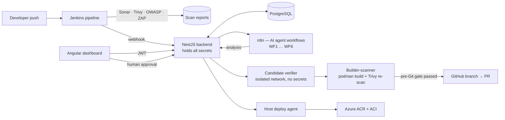

<div align="center">

# 🛡️ AI-Driven DevSecOps Platform

**Multi-agent AI platform that analyses CI/CD security findings and proposes fixes — with a human always in control.**

*Final-year engineering project (PFE) — ESPRIT × Vermeg, Feb → Aug 2026*


</div>

---

## 🎯 The problem

A CI/CD pipeline with SonarQube, Trivy, OWASP Dependency-Check and OWASP ZAP produces **hundreds of findings**.
Developers don't know which ones matter, why a build broke, or how to fix it safely — so reports get ignored.

## 💡 What this platform does

On every Jenkins build, the platform:

1. **Collects and normalises** the results of 4 security scanners into a single view.
2. **Explains** each problem with AI agents (root cause, security impact, developer guidance).
3. **Proposes fixes** as GitHub Pull Requests — **only after a human approves them**.
4. **Rebuilds and re-scans** each fix in an isolated sandbox before anything reaches Git.
5. **Optimises** broken `Jenkinsfile` and `Dockerfile` with per-issue selection.
6. **Deploys** to Azure (ACR + ACI) through a locked-down host agent.

---

## 🏗️ Architecture



| Component | Role |
|---|---|
| **Backend** (NestJS, TypeORM) | Decisions, authorisation (JWT + RBAC), state, audit. The only component holding secrets. |
| **n8n workflows** | AI agents: incident analysis, patch/PR generation, post-PR validation, Jenkinsfile & Dockerfile optimisers, security remediation evaluation. |
| **Candidate verifier** | Clones the exact commit, builds the proposed fix. No published port, no DB access, no GitHub token. |
| **Builder-scanner** | Builds the container image (podman) and re-runs Trivy on the candidate fix. |
| **Frontend** (Angular 17) | 3-layer dashboard: status → remediation cards → precise human instructions per CVE. |
| **Infra** | Docker Compose locally; Terraform for Azure (resource group + Container Registry); deployment to Azure Container Instances. |

---

## 🧠 Key design decisions (and why)

| Decision | Why |
|---|---|
| **Human-in-the-loop for every code fix** | An AI agent never opens a PR on its own. Fixes require an explicit, JWT-protected approval (`POST /incidents/:id/approve`). AI suggests, humans decide. |
| **Deterministic security score instead of an LLM score** | An LLM can give two different scores for the same report. Security gating must be reproducible and auditable, so the score is computed in code from CVE severities and scanner results (`backend/src/common/security-score.ts`). A scanner that did not run is excluded, never silently counted as "clean". |
| **Guardrail: no automatic fix for vulnerabilities in pipeline files** | Jenkinsfile / Dockerfile optimisers may fix configuration errors, but security vulnerabilities always require human review. |
| **Only CRITICAL CVEs block deployment** | A clear, predictable rule that developers can trust, instead of blocking on noise. |
| **Verify before Git** | Every candidate fix is rebuilt and re-scanned in an isolated sandbox. A fix that leaves the vulnerability in place is reported as such, not merged. |
| **Idempotency everywhere** | A finding fingerprint is unique per project in the database, and an anti-loop guard (SHA-256 of repo + branch + type + error, 24h TTL) prevents the same build from triggering the same workflow twice. |
| **Least privilege for deployment** | The backend never holds Azure credentials. A host agent accepts only fixed, parameterised commands (no command injection). |

---

## ✅ Results

- **4 scanners** unified in one dashboard (SonarQube, Trivy, OWASP Dependency-Check, OWASP ZAP).
- **End-to-end flow validated on real Jenkins builds**, including test projects requested by Vermeg.
- **28 / 31 end-to-end scenarios passed (90.3%)**.
- On the test repository, successive PRs brought SonarQube **BLOCKER issues from 4 to 0**.
- Azure chain proven: image pushed to ACR, container running on ACI with 0 restarts.

---

## 🛠️ Tech stack

**Backend** NestJS 10 · TypeORM · PostgreSQL 16 · JWT/RBAC · Swagger
**Frontend** Angular 17
**AI orchestration** n8n · LLM agents (analysis, remediation, judge, developer guidance)
**CI/CD & security** Jenkins (multibranch + shared library) · SonarQube · Trivy · OWASP Dependency-Check · OWASP ZAP
**Containers** Docker / Docker Compose · podman · Nginx
**Cloud & IaC** Azure (ACR, ACI) · Terraform

---

## 🚀 Run it locally

**Prerequisites:** Docker, plus the tooling stack running separately (Jenkins, SonarQube, n8n).

```bash
# 1. Secrets — never committed (.env is git-ignored)
#    ./.env          → POSTGRES_PASSWORD, JWT_SECRET, BUILDER_INTERNAL_SECRET
#    ./backend/.env  → database, GitHub, Jenkins, SonarQube and n8n settings
# 2. Start the platform
docker compose up -d
```

| Service | URL |
|---|---|
| Frontend | http://localhost:4200 |
| Backend API | http://localhost:3001/api |
| Swagger | http://localhost:3001/api/docs |
| Health check | http://localhost:3001/healthz |

> 🔐 No default credentials: the password policy rejects known default passwords (`admin123`, `Admin@123`, …). Set your own secrets.

---

## 📚 Documentation

Detailed technical documentation (in French) is available in [`docs/technical-understanding/`](docs/technical-understanding/):
architecture, n8n workflows, remediation lifecycle, retry & idempotency, Azure deployment, end-to-end scenarios and failure matrix.

---

## 👤 Author

**Souhaiel Amri** — Cloud & DevOps Engineer (ESPRIT), former military helicopter pilot
[LinkedIn](https://www.linkedin.com/in/souhaiel-amri-8990b4164/) · amrisouhail96@gmail.com
