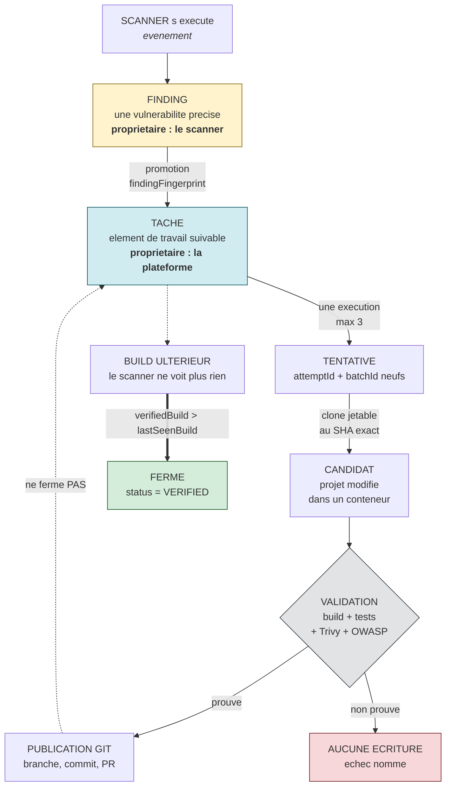
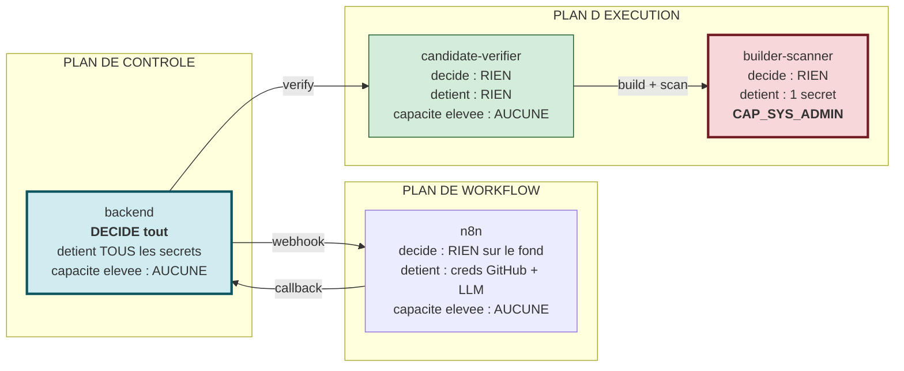
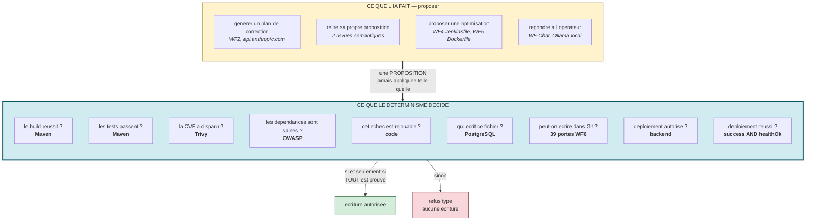

# 00 — GUIDE MAÎTRE

> À lire en premier. Ce document donne l'idée, le vocabulaire et la philosophie.
> Tout le reste n'en est que le détail.

---

## 1. Quel problème cette plateforme résout-elle ?

### Le constat de départ

Une chaîne CI/CD moderne **détecte** beaucoup de vulnérabilités : Trivy trouve des CVE
dans l'image, OWASP Dependency-Check en trouve dans les dépendances, SonarQube signale
des failles de code, ZAP teste l'application en marche. Résultat concret observé sur ce
projet : le build #151 de `pfe-app-test` porte **14 CVE critiques Trivy** et
**23 CVE critiques OWASP**, avec **38 problèmes bloquants non résolus**.

Détecter n'est pas corriger. Le développeur se retrouve devant une liste de centaines de
findings, sans savoir lesquels sont corrigeables, par quelle version, ni si la correction
casserait le build.

### L'idée de la plateforme

Automatiser le chemin **détection → correction proposée → correction *prouvée* →
publication**, en utilisant l'IA pour **proposer** et du code déterministe pour
**valider**.

Le mot important est *prouvée*. La plateforme ne déclare jamais une vulnérabilité
corrigée parce qu'un modèle de langage l'a affirmé, ni parce qu'une Pull Request existe.
Elle le déclare quand :

1. le projet modifié **compile** réellement ;
2. ses **tests** passent réellement ;
3. une image est **réellement construite** ;
4. **Trivy** confirme sur cette image que la CVE visée a disparu **et** que le paquet
   concerné est présent à la version corrigée ;
5. **OWASP Dependency-Check** confirme de son côté ;
6. et seulement alors, Git est touché.

### La philosophie en une phrase

> **L'IA propose, le déterminisme décide.**

C'est la phrase à retenir pour la soutenance, et elle est vérifiable dans le code :
voir `36` ci-dessous, et `provesSecurityClosure()` dans
`backend/src/security-remediation/security-artifact-scan.ts`.

---

## 2. Le vocabulaire : sept concepts volontairement distincts

C'est **la** source de confusion du projet, et aussi sa principale qualité de conception.
Ces sept notions sont séparées *exprès*.

### 2.1 Détection (*detection*)

Un scanner s'exécute et produit un rapport. C'est un **événement**, pas un objet durable.
Stocké dans `reports.rawData`.

### 2.2 Finding

Une vulnérabilité **individuelle** extraite d'un rapport : « CVE-2022-45868 sur
`com.h2database:h2` version 2.1.212 ». C'est de la **donnée observée**, propriété du
scanner. On ne la « corrige » pas : on peut seulement constater qu'un scan ultérieur ne
la voit plus.

### 2.3 Tâche de remédiation (*remediation task*)

Un finding **promu en élément de travail suivable**, ligne de la table
`manual_remediation_tasks`.

**Pourquoi séparer finding et tâche ?** Parce qu'ils n'ont pas le même propriétaire ni le
même cycle de vie. Le scanner possède le finding ; la plateforme possède la tâche. La
preuve est dans le schéma : la table a **deux colonnes de statut distinctes**.

| Colonne | Propriétaire | Signification |
|---|---|---|
| `status` | la plateforme | où en est le **travail** (`TODO`, `VERIFIED`, `REOPENED`) |
| `scannerStatus` | le scanner | ce que le **scanner** voit (`DETECTED`, `NOT_DETECTED`, `UNAVAILABLE`) |

Si ces deux notions étaient fusionnées, il serait impossible de représenter l'état réel
le plus fréquent : *« j'ai traité cette tâche, mais le scanner n'a pas encore reconfirmé »*.

### 2.4 Tentative (*attempt*)

Une **exécution** d'une remédiation pour une tâche. Une tâche peut avoir plusieurs
tentatives (jusqu'à `MAX_AUTOMATIC_ATTEMPTS = 3`,
`backend/src/manual-remediation/security-remediation-lifecycle.ts`).

**Pourquoi séparer tâche et tentative ?** Parce qu'un échec technique (timeout du
vérificateur, réseau) ne doit pas condamner la tâche. On rejoue une **nouvelle
tentative**, avec une nouvelle identité, sans effacer l'historique de la précédente.

### 2.5 Candidat (*candidate*)

Le projet **modifié dans un espace de travail jetable** : un clone au commit exact, le
`pom.xml` patché, puis compilé, testé, empaqueté en image et scanné.

**Pourquoi séparer candidat et projet ?** Parce que le candidat vit et meurt dans un
conteneur isolé. Le dépôt GitHub réel n'est **jamais** modifié pendant l'évaluation.
C'est la barrière pré-Git.

### 2.6 Validation

L'ensemble des preuves déterministes que le candidat est bon. Pas un avis : un faisceau
de constats vérifiables, résumé par `provesSecurityClosure()`.

### 2.7 Publication Git, puis déploiement

- **Branche créée** ≠ **PR créée** ≠ **PR mergée** ≠ **projet corrigé**.
- **Déploiement autorisé** ≠ **déploiement réussi**.

Ces distinctions sont matérialisées dans le code : voir `13-GIT-GITHUB-INTEGRATION.md`
et `14-AZURE-DEPLOYMENT.md`.

### Schéma — les sept concepts et qui les possède



**Lecture.** Les deux couleurs du haut marquent le **changement de propriétaire** : le
scanner possède le finding, la plateforme possède la tâche. La flèche en pointillés de
`PUBLICATION GIT` vers `TÂCHE` dit l'essentiel : publier **ne ferme pas**. Seule la
flèche épaisse du bas ferme, et elle part d'un **build ultérieur** — un événement que la
plateforme ne contrôle pas.

### Le schéma mental à retenir

```
Scanner s'exécute          → DÉTECTION         (reports.rawData)
  └─ une vulnérabilité     → FINDING           (donnée du scanner)
      └─ promue en travail → TÂCHE             (manual_remediation_tasks)
          └─ une exécution → TENTATIVE         (securityFindingRemediation.attempts[])
              └─ un essai  → CANDIDAT          (espace jetable, candidate-verifier)
                  └─ preuves → VALIDATION      (build + tests + Trivy + OWASP)
                      └─ si prouvé → GIT       (branche, commit, PR)
                          └─ puis  → DÉPLOIEMENT (gouvernance Azure)
```

---

## 3. Les quatre plans de l'architecture

L'architecture réelle s'organise en quatre plans, avec un **gradient de privilège**
délibérément inversé :

| Plan | Composants | Détient des secrets ? | Capacité élevée ? | Décide ? |
|---|---|---|---|---|
| **Contrôle** | frontend, backend, PostgreSQL | **oui** (tous) | non | **oui** |
| **Workflow** | n8n (WF1→WF6) | credentials n8n | non | non |
| **Exécution** | candidate-verifier, builder-scanner | **presque aucun** | `CAP_SYS_ADMIN` pour un seul | non |
| **Outillage** | Jenkins, SonarQube, Nexus, Prometheus, Grafana | leurs propres creds | DinD privilégié | non |

### Schéma — le gradient de privilège inversé



**Lecture.** Lire le schéma de gauche à droite, c'est voir le privilège **monter** et
l'autorité **descendre**. À gauche, le backend décide tout et n'a aucune capacité
système. À droite, `builder-scanner` a la seule capacité élevée de la plateforme et ne
décide de rien. Le composant qui manipule du code venant d'un dépôt
(`candidate-verifier`, en vert) est le plus démuni des trois : rien à voler, rien à
écrire.

**L'idée forte** : le composant qui **décide** n'a aucune capacité élevée, et le
composant qui a une capacité élevée ne décide de rien.

- `candidate-verifier` exécute du code venant d'un dépôt (donc potentiellement hostile)
  et tourne à **capacité nulle**, sans base de données, sans jeton GitHub, sans port publié.
- `builder-scanner` est le **seul** à obtenir `CAP_SYS_ADMIN` (nécessaire à Podman
  rootless) — et il ne prend aucune décision métier.
- Aucun `docker.sock` n'est monté nulle part dans `platform/docker-compose.yml`.

---

## 4. Ce que fait l'IA — et surtout ce qu'elle ne fait pas  *(PART 36)*

### Où l'IA intervient réellement

**Au total : 14 appels à `api.anthropic.com`** répartis sur cinq workflows publiés —
WF1 (5), WF2 (4), WF4 (2), WF5 (2), WF-Chat (1).

> Le conteneur `ollama` tourne, mais **aucun workflow publié ni aucun code backend ne
> l'appelle** : vérifié, aucune URL ne pointe vers le service. WF1 porte des variables
> nommées `ollamaBodyString`, mais ce sont des noms **hérités** — les requêtes partent
> bien vers Anthropic. Ollama est donc une capacité installée et non utilisée.

| Emplacement | Workflow | Nœud réel | Rôle |
|---|---|---|---|
| Analyse de cause racine | **WF1** | `Route cause Analysis1` | expliquer pourquoi le build a échoué |
| Analyse de risque de sécurité | **WF1** | `Security Risk Analysis1` | qualifier le risque |
| Faisabilité de remédiation | **WF1** | `Remediation Feasibility 1` | estimer `autoFixable` |
| Guide développeur | **WF1** | `Developer Guidance Analysis` | rédiger des recommandations |
| « Judge » | **WF1** | `Judge - HTTP Request1` | **rédiger la justification — pas décider** (voir ci-dessous) |
| Génération du plan de correction | WF2 | `Generate Remediation Plan` | proposer une modification de code |
| Revue sémantique indépendante | WF2 | `Independent Semantic Review` | relire la proposition |
| Revue sémantique inter-fichiers | WF2 | `Independent Cross-File Semantic Review` | cohérence multi-fichiers |
| Assistant conversationnel | WF-Chat-V4 | `Get Incidents1` (nom trompeur : il POSTe vers Anthropic) | répondre à l'opérateur |
| Optimiseur Jenkinsfile | WF4 | `Jenkinsfile Optimizer Agent` | proposer une optimisation |
| Applicateur Jenkinsfile | WF4 | `Apply Agent` | produire le fichier à commiter |
| Optimiseur Dockerfile | WF5 | `Dockerfile Optimizer Agent` | proposer une optimisation |
| Applicateur Dockerfile | WF5 | `Dockerfile Apply Agent` | produire le fichier à commiter |

### Le cas du « Judge » de WF1 — l'exemple le plus parlant

Un nœud s'appelle `Judge` et appelle un modèle de langage. On pourrait croire que l'IA
tranche. **C'est l'inverse, et le code le dit explicitement.**

`Prepare - Judge Body` calcule la recommandation en **154 lignes de règles
déterministes** *avant* d'appeler le modèle (étapes requises indisponibles → `BLOCK`,
CVE critiques → `BLOCK`, blockers Sonar → `FIX_PROPOSED`, sinon `NOTIFY_ONLY`). Le
payload envoyé au modèle porte ce commentaire :

> *« Payload pour le Judge IA (validation + rédaction, **PAS décision**) »*

Puis `Judge - Parse Output` **écrase** la réponse du modèle :

```js
// Governance decision is deterministic. The LLM may explain it but cannot replace it.
parsed.aiSuggestedDecision = parsed.decision || null;   // on GARDE l'avis de l'IA
parsed.decision = String(governance.recommendation || 'BLOCK').toUpperCase();
parsed.reasonCode = governance.reasonCode || 'GOVERNANCE_DATA_MISSING';
```

Trois choses à retenir : l'avis du modèle est **conservé** (`aiSuggestedDecision`) pour
pouvoir comparer après coup ; la décision effective vient **uniquement** de la règle ; et
en l'absence de donnée de gouvernance le défaut est **`BLOCK`**.

C'est ce `decision` qui est persisté en `reports.judgeDecision`, et c'est lui qui produit
le motif *« Décision de gouvernance : BLOCK »* dans la gouvernance de déploiement Azure.
Détail complet : `03-N8N-COMPLETE-GUIDE.md` §5.2 bloc E.

### Ce que l'IA ne décide **jamais**

C'est la liste la plus importante du projet pour la soutenance :

| Décision | Qui décide réellement | Preuve dans le code |
|---|---|---|
| Le build réussit-il ? | Maven, dans le conteneur | `candidate-verifier` |
| Les tests passent-ils ? | Maven | `candidate-verifier` |
| La CVE a-t-elle disparu ? | **Trivy**, sur l'image réelle | `cveTargets()` / `provesSecurityClosure()` |
| Les dépendances sont-elles saines ? | **OWASP Dependency-Check** | rescan du candidat |
| Cet échec est-il rejouable ? | code déterministe | `security-remediation-lifecycle.ts` |
| Qui a le droit d'écrire ce fichier ? | **PostgreSQL** (index unique partiel) | `remediation_target_reservations` |
| Peut-on écrire dans Git ? | une porte déterministe **par workflow écrivain** (39 portes pour WF6, `Apply Gate — Docker Déterministe` pour WF5, `Authorize Backend Approval` pour WF4/WF5, `write-guard` + porte d'annulation pour WF2) | `13-GIT-GITHUB-INTEGRATION.md` |
| Le déploiement est-il autorisé ? | backend, recalculé | `deployment-authorization.service.ts` |
| Le déploiement a-t-il réussi ? | `classifyAgentDeploymentResult()` | `agent-deployment-result.ts` |
| **Faut-il bloquer ce build ?** | **154 lignes de règles**, pas le « Judge » | `Prepare - Judge Body` (WF1) |

### Schéma — la frontière entre proposition et décision



**Lecture.** La flèche épaisse au milieu est **la** frontière du projet. Tout ce qui est
au-dessus est révocable, non déterministe, et n'engage rien. Tout ce qui est en dessous
est mesuré par un outil externe ou garanti par la base de données. L'IA n'a aucune flèche
qui traverse vers `ecriture autorisee`.

**Formule pour le jury** : *« L'IA n'a aucun droit d'écriture. Elle produit une
proposition ; tout ce qui engage le dépôt ou la production est décidé par du code
déterministe et prouvé par des outils externes. »*

---

## 5. Les invariants architecturaux  *(PART 37)*

Règles qui doivent rester vraies. Chacune est dérivée du code réel.

| # | Invariant | Garanti par |
|---|---|---|
| I1 | Le backend est la seule source de vérité | le frontend n'importe aucune logique de classification |
| I2 | Absence de scan ≠ succès | `cveTargets()` lève `INCOMPLETE_SECURITY_SCAN` ; `provesSecurityClosure()` est en `try/catch → false` |
| I3 | Une preuve de correction exige une **présence positive** du paquet à la version corrigée | `provesSecurityClosure()` : `found.length > 0 && found.every(version === targetVersion)` |
| I4 | Un rapport filtré/altéré est refusé | rejet si `ModifiedFindings` est présent |
| I5 | Un seul écrivain par (projet, fichier cible) | index unique partiel PostgreSQL `WHERE state='ACTIVE'` |
| I6 | Une réservation incohérente est impossible | contrainte `CHECK` sur `(state, claims, releasedAt)` |
| I7 | Une tentative périmée ne peut pas muter la tentative courante | `attemptId` + `batchId` + `completionDigest` |
| I8 | Chaque retry a une **nouvelle** identité | nouveaux `attemptId` **et** `batchId` |
| I9 | Pas d'écriture Git sans validation | 39 portes avant la première mutation GitHub dans WF6 |
| I10 | Un effet de bord Git non résolu **met en quarantaine** au lieu de libérer | `settleTargetClaim()` |
| I11 | PR existante ≠ vulnérabilité corrigée | seul `CANDIDATE_READY` produit un badge positif |
| I12 | `VERIFIED` repose sur une preuve de build | `verifiedBuild > lastSeenBuild` |
| I13 | HTTP 200 ≠ déploiement réussi | `classifyAgentDeploymentResult()` exige `success && healthOk` |
| I14 | Une autorisation de déploiement est à usage unique et courte | `status`, `consumedAt`, TTL 15 min |
| I15 | Une dérive d'identité annule l'autorisation | recalcul comparé à l'instantané gelé |
| I16 | Le critique exige un administrateur **côté serveur** | `evaluateAuthorizationRequest()` |
| I17 | Le frontend ne décide pas la gouvernance | il affiche `preview.decision` |
| I18 | Les secrets ne descendent pas dans le plan d'exécution | vérifié par `candidate-verifier/isolation.spec.ts` |

---

## 6. Limitations connues  *(PART 38)*

À assumer devant le jury, pas à cacher. Une limitation expliquée est une preuve de
maîtrise ; une limitation découverte par le jury est une faiblesse.

### Limitations de conception (assumées)

| Limitation | Détail | Impact démo |
|---|---|---|
| **Maven uniquement** | Le pipeline d'admission ne gère que Maven. `backend/RELEASE-SOURCE.md` (présent sur `release/chain4a-r1-scoped` et `release/azure-governance-r1`, absent de l'arbre de travail) le dit : *« cross-ecosystem resolver tests demonstrate extensibility, not new ecosystem remediation support »*. | aucun |
| **Sur-sérialisation multi-module** | Sur la branche de travail, `productionTarget()` renvoie `'pom.xml'` pour toute tâche : deux modules d'un même projet se sérialisent. C'est **sûr** (trop prudent), jamais dangereux. | aucun |
| **IA non déterministe** | WF2 dépend d'un LLM. Atténué par deux revues sémantiques indépendantes **et** la validation déterministe. | aucun |
| **Agent Azure sur l'hôte** | La politique du tenant interdit la création d'App Registration ; les credentials restent sur l'hôte et seul l'agent Python les lit. Contrainte externe, documentée dans `infra/DEPLOY.md`. | aucun |

### Limitations d'implémentation

| Limitation | Détail |
|---|---|
| **Aucun registre de migrations** | Pas de table de ledger ; l'état appliqué est attesté par les rapports `docs/qa/`. |
| **13 nœuds non atteignables dans WF2** | `Build File Result`, `Classify GitHub Write Error`, `Transport Requires Read`… — nœuds orphelins (voir `03b`). |
| **Horloges différentes sur `deployment_authorizations`** | `createdAt` est écrit par PostgreSQL (UTC), `expiresAt` par Node (heure locale) : un audit SQL de `expiresAt - createdAt` lit un TTL gonflé de 2 h. L'application du TTL reste correcte (15 min effectifs, prouvés). |
| **Projet inexistant → 200** | `GET /azure-deploy/ready|governance/:id` répond 200 pour un id inconnu, classé « non configuré », au lieu de 404. *Fail-closed*, mais le contrat serait plus net en 404. |
| **8 workflows de sonde** dans n8n | `R52`→`R60-SONAR-*-PROBE-TEMP`, `DEBUG-*` — inactifs, nommés « safe to delete ». L'un d'eux, `DEBUG-create-pr-only`, **crée une PR sans aucune porte**. |
| **WF3 accède directement à PostgreSQL** | son nœud `Get Incident From DB` lit la base **sans passer par le backend** — seule exception trouvée au principe « le backend est la source de vérité unique ». C'est une **lecture** (son écriture passe bien par `POST /api/incidents/:id/validation`), mais cela donne un credential PostgreSQL à n8n. |
| **Trois webhooks non authentifiés** | WF2 (`wf2-r22e-test`), WF5 (`dockerfile-*`) et WF-Chat (`chat-agent`) n'ont pas d'authentification, alors que WF1 (`jenkins-event`) et WF6 en ont une (`headerAuth`). Pour WF-Chat, cela permet de consommer des appels LLM. |
| **Ollama installé et non utilisé** | le conteneur tourne ; aucun workflow publié ni code backend n'appelle `:11434`. Les variables `ollamaBodyString` de WF1 sont des vestiges. |
| **Noms de nœuds trompeurs** | `Get Incidents1` (WF-Chat) appelle en réalité Anthropic ; `Create Pull Request1` (WF2) est un doublon de nom. |

### Limitations opérationnelles

| Limitation | Détail |
|---|---|
| **Déploiement mono-nœud** | WSL2, pas de haute disponibilité ; `AZURE_DEPLOY_AGENT_URL` pointe une IP de passerelle Docker. |
| **ZAP non actif** | Les conteneurs `sec4*-zap` sont sortis ; les findings ZAP en base sont **historiques**. |
| **Observabilité par la base** | Pas de logger structuré ni d'identifiant de corrélation dans les logs : la reconstitution passe par la base (ce qui marche très bien, voir `30`). |

---

## 7. Résumé quantitatif de la documentation

```
TOTAL_COMPONENTS_DOCUMENTED            = 20
TOTAL_N8N_WORKFLOWS_DOCUMENTED         = 24 (inventaire) dont les 7 publiés documentés en
                                         profondeur, bloc par bloc
TOTAL_N8N_NODES_DOCUMENTED             = 539 (100 % des nœuds des workflows actifs)
TOTAL_BACKEND_FILES_CATALOGUED         = 347 (217 runtime + 130 spec)
TOTAL_FRONTEND_COMPONENTS_CATALOGUED   = 66 fichiers .ts sous src/app dont 26 composants
                                         (38 catalogués nominativement en 18-)
TOTAL_API_ENDPOINTS_DOCUMENTED         = 119
TOTAL_DB_TABLES_DOCUMENTED             = 16
TOTAL_DOCKER_SERVICES_DOCUMENTED       = 14 (5 plan plateforme + 9 plan outillage)
TOTAL_CONFIGURATION_FLAGS_DOCUMENTED   = 37

N8N_NODE_COVERAGE     = 539/539 des workflows actifs (100 %) ; 1038 nœuds de workflows
                        inactifs/obsolètes recensés en inventaire mais non détaillés
BACKEND_FILE_COVERAGE = 347/347 catalogués (100 %) ; ~60 fichiers critiques expliqués en prose
API_COVERAGE          = 119/119 (100 %)
DATABASE_COVERAGE     = 16/16 tables, colonnes, contraintes et index (100 %)

UNKNOWN_OR_UNRESOLVED_TECHNICAL_POINTS = 5
  (révisés après la passe de vérification des workflows publiés — voir §9)
  1. 4 URL n8n assemblées entièrement par expression : la route exacte dépend de
     l'exécution (WF1 `Lookup Project`, WF2 `Register WF2 Execution`,
     WF2 `Pre-Git Cancellation Gate`, WF-Chat `Get Incidents`). Les deux de WF2 ont
     été résolues par sonde live : `execution-started` et `pre-write-gate`.
  2. Les 13 nœuds non atteignables de WF2 : leur intention d'origine n'est pas
     déterminable à partir du code actuel.
  3. Le contenu exact des prompts LLM de WF4/WF5 n'a pas été retranscrit (volumineux,
     et sans incidence sur l'architecture).
  4. `subscriptionRef` de `AzureDeploymentConfig` : usage non déterminé à partir du
     code actuel (champ déclaré, aucune lecture trouvée).
  5. La provenance exacte des 2 lignes de `remediation_target_reservations` créées le
     2026-10-07 à 19:00/19:08 UTC n'est pas attribuable depuis le code.

DOCUMENTATION_SOURCE_VERIFIED = YES
FINAL_STATUS = B — COMPLETE_WITH_IDENTIFIED_GAPS
```

## 7 bis. Corrections issues de la vérification des workflows publiés

Une seconde passe, portant cette fois sur les **7 workflows réellement publiés** dans
l'instance n8n (et non sur leur description), a corrigé quatre erreurs matérielles de la
première version. Elles sont consignées ici parce qu'une documentation qui cache ses
corrections ne vaut rien.

| Erreur de la v1 | Réalité vérifiée | Impact |
|---|---|---|
| « 6 nœuds mutants GitHub, dans 2 workflows » | **14 nœuds mutants, dans 4 workflows** (WF6 : 4, WF2 : 4, WF4 : 3, WF5 : 3) | **majeur** — c'était la table la plus sensible du document |
| « 3 appels Anthropic (WF2) + Ollama pour le chat » | **14 appels Anthropic** (WF1 : 5, WF2 : 4, WF4 : 2, WF5 : 2, WF-Chat : 1) ; **Ollama n'est appelé par rien** | majeur — le bloc multi-agents de WF1 était entièrement omis |
| WF1 décrit en 6 lignes | WF1 contient un **moteur de gouvernance déterministe de 154 lignes** qui produit `judgeDecision`, lequel alimente la gouvernance de déploiement Azure | majeur — une boucle architecturale non tracée |
| « le backend est la seule source de vérité » sans nuance | **WF3 lit PostgreSQL directement** (`Get Incident From DB`) — seule exception, en lecture | nuance à connaître |

**Pourquoi l'erreur sur les écrivains Git s'est produite**, car c'est instructif : je
cherchais les écritures GitHub par l'URL `api.github.com`. Or n8n propose un **nœud natif
`github`** dont l'URL n'apparaît pas dans les paramètres. **8 des 14** écrivains
utilisent ce nœud avec les opérations `edit` ou `create`, et étaient donc invisibles à une
recherche par URL. La bonne méthode cherche les deux formes simultanément.

Ce que la correction **ne** remet **pas** en cause : aucun chemin backend n'écrit dans
Git, et chacun des quatre workflows écrivains possède sa propre porte déterministe **et**
exige une autorisation backend avant d'appliquer (`Authorize Backend Approval` pour
WF4/WF5, `Apply Gate — Docker Déterministe` pour WF5, `write-guard` + porte d'annulation
pour WF2, les 39 portes pour WF6).

---

## 8. Passe de vérification contre le code source  *(PART 44)*

Avant finalisation, une passe automatisée a confronté la documentation au code réel.
Aucun nom n'a été laissé à la supposition.

| Contrôle | Résultat |
|---|---|
| Chemins de fichiers cités entre backticks | **263 cités, 262 existants.** Le seul absent, `backend/RELEASE-SOURCE.md`, est explicitement qualifié dans le texte comme présent sur les branches de release et absent de l'arbre de travail |
| Noms de fonctions | **41 vérifiés, 41 trouvés** dans `backend/src`, `frontend/src`, `candidate-verifier/src` |
| Constantes et codes d'erreur | **27 vérifiés, 27 trouvés** |
| Tables de base de données | **16 citées, 16 existantes** en base réelle |
| Identifiants de workflow n8n | **18 cités, tous valides** dans l'inventaire de l'instance |
| Noms de conteneurs | tous les conteneurs cités tournent réellement |
| Drapeaux d'environnement | **19 cités, 19 trouvés** dans le code (backend, verifier, scanner, compose) |
| Ports | relevés depuis `docker ps`, pas depuis les fichiers Compose |
| Noms de statuts | relevés depuis les énumérations réelles et la distribution réelle en base |

Trois faux positifs du contrôleur ont été écartés après vérification manuelle : des noms
de jobs Jenkins (`pfe-app-test`) pris pour des conteneurs, un réseau Docker
(`pfe-network`) pris pour un conteneur, et des identifiants de 16 caractères
(`completionDigest`, `HealthController`) pris pour des identifiants de workflow.

Une correction de fond a été appliquée à l'issue de cette passe : `BUILDER_INTERNAL_SECRET`
est désormais tracé vers ses trois emplacements réels
(`builder-scanner/src/internal-auth.ts`,
`candidate-verifier/src/remote-builder-artifact-validator.ts`,
`platform/docker-compose.yml`) au lieu d'être mentionné sans référence.

---

### Note de fraîcheur

Des fichiers du frontend ont été modifiés **en parallèle** de la rédaction de cette
documentation (fenêtre 01:19 → 02:03 le 2026-10-08), hors de ce travail de rédaction.
Une revérification a été faite à la fin : les **sept** affirmations structurelles
documentées sur le shell projet tiennent toujours (onglet `deploiement` dans
`VALID_TABS`, `implements OnChanges`, `resetProjectScopedState()`,
`tabMap.deploiement`, bloc `activeTab === 'deploiement'` dans le template, tuile
d'aperçu pointant sur `deploiement`, 8 onglets).

Un module apparu pendant cette fenêtre a été lu puis documenté parce qu'il porte
l'invariant central du projet jusqu'à l'affichage :
`frontend/src/app/shared/data-truth.ts` (voir `06-FRONTEND-COMPLETE-GUIDE.md` §5 bis et
`10-SECURITY-SCANNERS.md`). La suite frontend compte désormais **30** fichiers de
spécification, tous passants.

---

Le statut **B** est délibéré et honnête : tout ce qui porte l'architecture est documenté
et vérifié à la source, et les 5 points non résolus sont nommés plutôt que comblés par
de l'invention.
