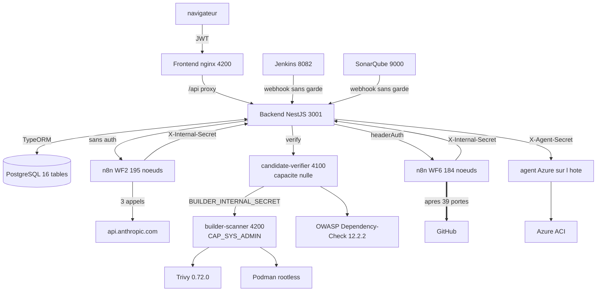
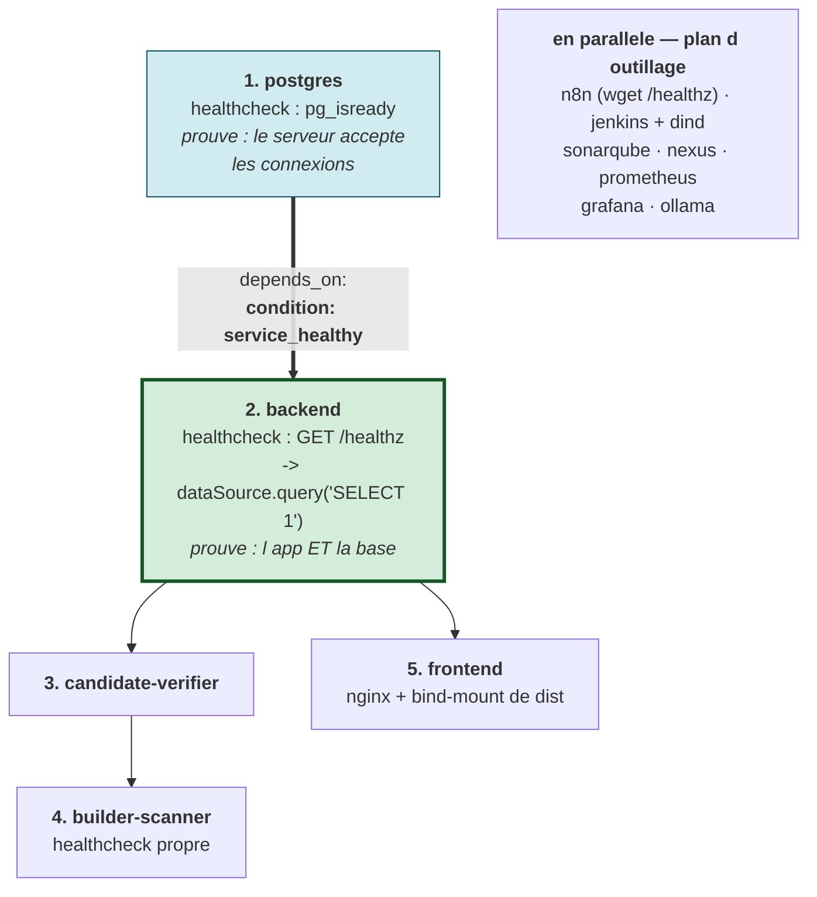
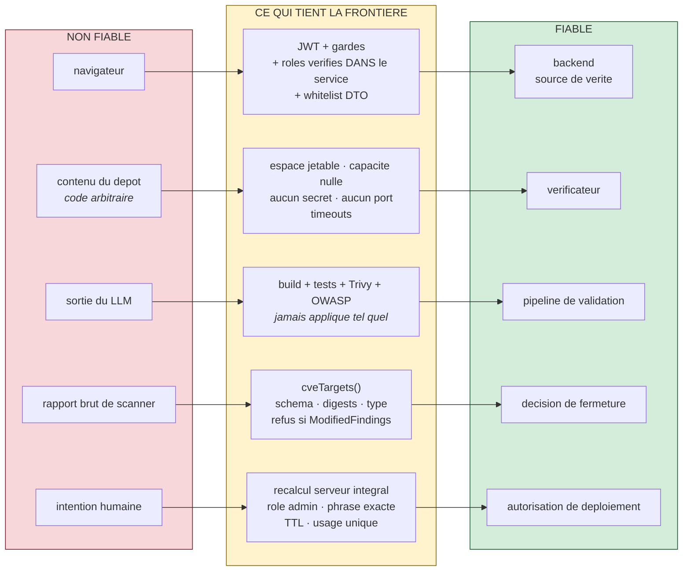

# 01 — ARCHITECTURE GLOBALE

Reconstruite depuis le code et le runtime réels (conteneurs inspectés le 2026-10-08).

---

## 1. Carte générale

```
                         ┌──────────────────────────────┐
   navigateur ──────────▶│  FRONTEND  (nginx :4200)     │  présentation seule
                         │  Angular, bind-mount de dist │
                         └───────────────┬──────────────┘
                                         │ /api  (proxy nginx, JWT Bearer)
                                         ▼
 Jenkins ─┐                ┌──────────────────────────────────────────┐
 Sonar   ─┼─ webhooks ────▶│         BACKEND  (NestJS :3001)          │
 Trivy   ─┘  (sans garde)  │  décisions · autorisations · état · audit │
                           │  détient TOUS les secrets                │
                           └──┬──────────┬───────────────┬────────────┘
                              │          │               │
              ┌───────────────┘          │               └──────────────┐
              ▼                          ▼                              ▼
   ┌────────────────────┐   ┌────────────────────────┐      ┌──────────────────────┐
   │ PostgreSQL :5433   │   │   n8n  :5678           │      │ agent Azure (hôte)   │
   │ 16 tables          │   │ WF1 WF2 WF3 WF4 WF5    │      │ 172.19.0.1:7799      │
   │ invariants en DB   │   │ WF6 WF-Chat            │      │ seul à lire ~/.azure │
   └────────────────────┘   └──┬──────────┬──────────┘      └──────────┬───────────┘
                               │          │                            │
                   api.anthropic.com   callbacks                       ▼
                     (WF2 : 3 appels)  X-Internal-Secret            Azure ACI
                               │          │
                               ▼          ▼
                        ┌──────────────────────────────┐
                        │  CANDIDATE-VERIFIER  :4100   │  AUCUN port publié
                        │  capacité élevée : AUCUNE    │  ni DB ni jeton GitHub
                        │  clone au SHA exact, mvn     │
                        └──────────────┬───────────────┘
                                       │ BUILDER_INTERNAL_SECRET
                                       ▼
                        ┌──────────────────────────────┐
                        │  BUILDER-SCANNER     :4200   │  AUCUN port publié
                        │  CAP_SYS_ADMIN (podman)      │  seul à exécuter
                        │  podman build + trivy        │  podman/trivy
                        └──────────────┬───────────────┘
                                       │
                           ╔═══════════▼════════════════╗
                           ║   BARRIÈRE PRÉ-GIT         ║
                           ║   39 portes dans WF6       ║
                           ╚═══════════┬════════════════╝
                                       ▼
                                   GitHub  (branche → commit → PR)
```

### Plan d'outillage (compose de l'hôte, séparé)

```
jenkins :8082  ──▶ docker-dind :2376 (privileged)      sonarqube :9000
nexus :8081        prometheus :9090      grafana :3000       ollama :11434
minikube (127.0.0.1 uniquement)
```

---

## 2. Chaque flèche, en détail

| # | De → Vers | Protocole / Endpoint | Authentification | Identifiants portés | Sync ? | Si échec |
|---|---|---|---|---|---|---|
| 1 | navigateur → frontend | HTTP(S) :4200, nginx `try_files` | — | — | sync | page indisponible |
| 2 | frontend → backend | HTTP `/api/*` via proxy nginx | `Authorization: Bearer <JWT>` | `projectId`, `incidentId`, `taskId` | sync | `userHttpError()` affiche un message, jamais un succès |
| 3 | Jenkins → backend | `POST /api/webhooks/jenkins/by-job/:jobName` | **aucune garde** | `jobName`, `build_number`, `build_url` | sync | aucun incident créé |
| 4 | Sonar → backend | `POST /api/webhooks/sonarqube/:projectId` | **aucune garde** | `projectId` | sync | aucun bug ingéré |
| 5 | Trivy → backend | `POST /api/webhooks/trivy/:projectId` | **aucune garde** | `projectId` | sync | aucune donnée ingérée |
| 6 | backend → PostgreSQL | TCP 5432 (interne), TypeORM, `synchronize=false` | user/mot de passe | toutes les clés | sync | `/healthz` échoue (il fait un vrai `SELECT 1`) |
| 7 | backend → n8n WF6 | `POST /webhook/wf6-security-remediation-evaluate` | **`headerAuth`** (credential `httpHeaderAuth`) | `projectId`, `taskId`, `attemptId`, `attemptNumber`, `batchId`, dépôt, SHA de base | **async** (callbacks) | `DISPATCH_FAILED`, rejouable |
| 8 | backend → n8n WF2 | `POST /webhook/wf2-r22e-test` | **aucune** | `incidentId`, `requestId` | async | statut WF2 persisté en échec |
| 9 | backend → WF4/WF5 | webhooks optimizer | secret de callback | `projectId`, `incidentId` | async, *fire-and-forget* | journalisé, n'échoue jamais la réponse webhook |
| 10 | n8n → backend | 25 appels HTTP (voir `04`) | `X-Internal-Secret` sur les routes internes | `attemptId`, `batchId`, `requestId` | sync | timeout explicite → échec typé |
| 11 | WF2 → Anthropic | `POST api.anthropic.com/v1/messages` ×3 | clé API (credential n8n) | — | sync | nœud en erreur → arrêt |
| 12 | backend → candidate-verifier | `POST http://candidate-verifier:4100/verify` | **aucun secret nécessaire** (réseau isolé, le worker ne détient rien) | manifeste de candidat, SHA de base | sync (long) | `VERIFIER_TIMEOUT` → rejouable |
| 13 | candidate-verifier → builder-scanner | `POST http://builder-scanner:4200` | `BUILDER_INTERNAL_SECRET` | digest d'artefact | sync | *fail-closed* si secret absent |
| 14 | builder-scanner → registres | pull d'images de base, DB Trivy | — | — | sync | `INCOMPLETE_SECURITY_SCAN` |
| 15 | WF2 / WF4 / WF5 / WF6 → GitHub | **14 nœuds mutants** : 4 (WF6) + 4 (WF2) + 3 (WF4) + 3 (WF5) | credential GitHub n8n | branche, SHA | sync | gate en erreur → arrêt, aucune écriture |
| 16 | backend → agent Azure | `POST http://172.19.0.1:7799/deploy` | `X-Agent-Secret` | `authorizationId`, `artifactDigest`, cible | sync (timeout 180 s) | `AGENT_TRANSPORT_FAILED` |
| 17 | agent → Azure | CLI `az` sur l'hôte | session `az login` de l'hôte | groupe de ressources, nom de cible | sync | remonté comme échec sémantique |

### Points pédagogiques sur ce tableau

**Pourquoi la flèche 12 n'a-t-elle pas de secret ?** Parce que c'est le cœur du modèle de
sécurité : `candidate-verifier` ne détient rien à voler. Il n'a ni mot de passe de base,
ni `JWT_SECRET`, ni jeton GitHub. Même compromis par un dépôt hostile, il ne peut rien
exfiltrer et rien écrire. Cette propriété est vérifiée par un test structurel,
`candidate-verifier/isolation.spec.ts`, pas seulement par un commentaire.

**Pourquoi les flèches 7 et 8 diffèrent-elles en authentification ?** WF6 a un webhook
authentifié (`headerAuth`), WF2 n'en a pas. C'est une asymétrie réelle du projet,
documentée en `38`.

**Pourquoi la flèche 16 passe-t-elle par un agent sur l'hôte ?** Parce que la politique
du tenant Azure interdit de créer un service principal. La session `az` personnelle a le
rôle *Owner* sur toute la souscription : le choix a donc été de ne **jamais** faire sortir
ce jeton de l'hôte. Le backend ne détient aucun credential Azure ; il appelle un agent
Python lié à `172.19.0.1` (passerelle du bridge Docker), donc joignable uniquement par
les conteneurs de ce réseau — jamais `0.0.0.0`.

---

## 3. Diagramme Mermaid — composants



**Lecture du diagramme.** Les seules flèches qui *écrivent* à l'extérieur sont
`WF2 / WF4 / WF5 / WF6 ⟹ GitHub` (**14 nœuds mutants** au total) et `agent ⟹ Azure`.
Toutes les autres lisent, calculent ou persistent. C'est volontaire : la surface
d'écriture externe se vérifie en examinant **cinq** arêtes, et chacune a sa propre
porte déterministe — voir `13-GIT-GITHUB-INTEGRATION.md` §2.

---

## 4. Ce qui tourne où  *(PART 33)*

| Composant | Où | Port publié | Réseau | Stockage |
|---|---|---|---|---|
| frontend | conteneur `pfe-frontend` (nginx:alpine) | `0.0.0.0:4200` | `pfe-network` | bind-mount de `frontend/dist/.../browser` |
| backend | conteneur `pfe-backend` | `0.0.0.0:3001` | `pfe-network` + `candidate-verification-net` | — |
| PostgreSQL | conteneur `pfe-postgres` | `0.0.0.0:5433` | `pfe-network` | volume `postgres_data` |
| candidate-verifier | conteneur `pfe-candidate-verifier` | **aucun** | `candidate-verification-net` + `builder-scanner-net` | volumes workspace/cache |
| builder-scanner | conteneur `pfe-builder-scanner` | **aucun** | `builder-scanner-net` | volumes trivy/maven/podman |
| n8n | conteneur `n8n` | `0.0.0.0:5678` | `pfe-network` | volume `n8n_data` |
| Jenkins | conteneur `jenkins` | `0.0.0.0:8082`, `:50000` | `pfe-network` | volume `jenkins_home` |
| docker-dind | conteneur `jenkins-docker` **privileged** | `0.0.0.0:2376` | `pfe-network` | `jenkins_certs` |
| SonarQube | conteneur `sonarqube` | `0.0.0.0:9000` | `pfe-network` | 3 volumes |
| Nexus | conteneur `nexus` | `0.0.0.0:8081` | `pfe-network` | `nexus_data` |
| Prometheus / Grafana | conteneurs | `:9090` / `:3000` | `pfe-network` | volumes |
| Ollama | conteneur `ollama` | `0.0.0.0:11434` | `pfe-network` | `ollama_data` |
| minikube | conteneur | `127.0.0.1` seulement | — | — |
| **agent Azure** | **processus hôte** (hors Docker) | `172.19.0.1:7799` | passerelle du bridge | lit `~/.azure` |
| GitHub, Azure, Anthropic | **SaaS externes** | — | internet | — |

---

## 5. Séquence de démarrage  *(PART 34)*

L'ordre n'est pas arbitraire ; il découle des `depends_on` et des *healthchecks* réels.

```
1. postgres            healthcheck pg_isready
      │  (backend attend "service_healthy", pas juste "started")
      ▼
2. backend             healthz fait un vrai SELECT 1 -> prouve DB + app
      │
      ├─▶ 3. candidate-verifier     (depends_on backend)
      │         └─▶ 4. builder-scanner
      │
      └─▶ 5. frontend               (depends_on backend)

En parallèle, plan outillage :
   n8n (healthcheck wget /healthz) · jenkins + docker-dind · sonarqube · nexus
   prometheus · grafana · ollama (healthcheck)
```

### Schéma — l'ordre de démarrage et ce que prouve chaque sonde



**Lecture.** La flèche épaisse porte le détail qui compte : `condition: service_healthy`,
et non un simple `depends_on`. Avec un `depends_on` nu, Docker démarre le backend dès que
le **conteneur** postgres existe — pas quand PostgreSQL **accepte les connexions**. Le
backend échouerait alors au boot de façon intermittente.

Et le healthcheck du backend fait un vrai `SELECT 1` : une sonde qui renverrait `200 OK`
sans toucher la base ne prouverait rien d'utile.

**Point important** : `backend` déclare
`depends_on: postgres: condition: service_healthy`. Ce n'est pas un détail — avec un
simple `depends_on` sans condition, le backend démarrerait avant que PostgreSQL accepte
les connexions et échouerait au boot. C'est le genre de précision que le jury apprécie.

**Ce que prouve chaque healthcheck :**

| Service | Healthcheck | Ce qu'il prouve réellement |
|---|---|---|
| postgres | `pg_isready` | le serveur accepte les connexions |
| backend | `GET /healthz` → `dataSource.query('SELECT 1')` | l'app **et** la base répondent |
| n8n | `wget -qO- /healthz` | n8n est prêt à recevoir des webhooks |
| builder-scanner | healthcheck propre (statut `healthy`) | le worker répond |
| ollama | healthcheck | le modèle local est joignable |

---

## 6. Frontières de confiance  *(PART 35)*

| Frontière | Côté non fiable | Côté fiable | Comment la frontière est tenue |
|---|---|---|---|
| navigateur / backend | le navigateur | le backend | JWT + gardes + rôles vérifiés **dans le service**, pas seulement dans le contrôleur ; le front ne soumet que de l'intention |
| dépôt / vérificateur | le contenu du dépôt (code arbitraire) | le vérificateur | espace jetable, capacité nulle, aucun secret, aucun port publié, timeouts |
| LLM / plateforme | la sortie du modèle | le pipeline de validation | la proposition n'est jamais appliquée sans build + tests + Trivy + OWASP |
| scanner / décision | le rapport brut | `cveTargets()` | schéma, digests, type d'artefact et absence de `ModifiedFindings` vérifiés avant toute lecture |
| validation / Git | le candidat | WF6 | 39 portes, revalidation juste avant écriture, fermeture compensatoire si dérive |
| opérateur / Azure | l'intention humaine | `deployment-authorization.service.ts` | recalcul intégral, rôle admin, phrase exacte, TTL, usage unique |
| backend / hôte Azure | le backend | l'agent hôte | le backend n'a **aucun** credential Azure ; l'agent est lié à une IP interne |

### Schéma — les frontières de confiance



**Lecture.** Cinq frontières, cinq mécanismes différents. Le point commun est la posture :
chaque frontière **suppose que le côté gauche peut mentir**, et exige une preuve
vérifiable au lieu d'une déclaration. Aucune flèche ne va directement du rouge au vert.

**La phrase à retenir** : *« Chaque frontière suppose que le côté amont peut mentir, et
exige une preuve vérifiable plutôt qu'une déclaration. »*
