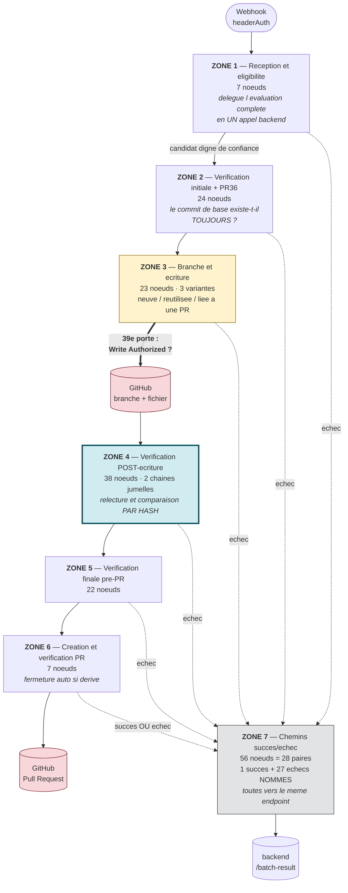
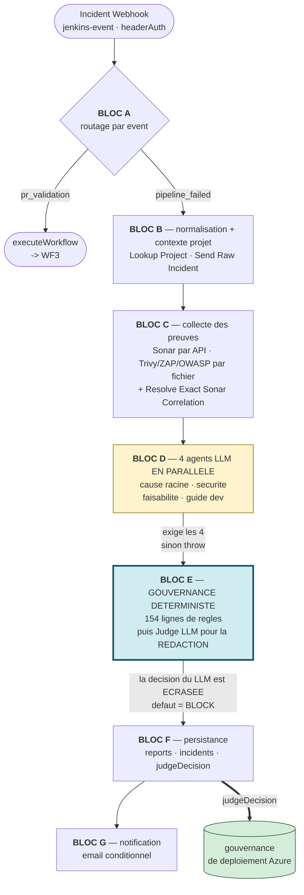

# 03 — GUIDE COMPLET n8n

> Le catalogue exhaustif des 539 nœuds vit dans `03b-N8N-NODE-CATALOG.md`.
> Ce document-ci explique **l'intention** : pourquoi chaque workflow existe, comment il
> est découpé, et ce qui se passe quand il échoue.

---

## 1. Pourquoi n8n dans ce projet ?

C'est **la** question que le jury posera. La réponse ne doit pas être « parce que c'est
pratique ».

Le backend NestJS *pourrait* techniquement orchestrer. Le choix de n8n repose sur trois
raisons structurelles :

1. **Séparation des privilèges.** Les écritures GitHub vivent dans n8n, pas dans le
   backend. Le backend détient le jeton, mais la **capacité d'écrire** est dans un autre
   processus, derrière une chaîne de portes explicites. On peut auditer la sûreté Git en
   regardant 4 nœuds, au lieu de relire tout un service.
2. **Lisibilité d'un processus long.** Une remédiation est une suite de dizaines de
   contrôles conditionnels. Sur un canevas, chaque garde est **visible** — et le projet
   s'en sert : WF6 porte 7 zones documentaires sur son canevas. Un jury peut voir la
   barrière pré-Git.
3. **Appels LLM isolés.** Les 3 appels Anthropic de WF2 sont des nœuds identifiés, avec
   leurs credentials dans n8n. Aucune clé de modèle ne traverse le backend.

**Le contre-argument à connaître** : n8n introduit un contrat réseau supplémentaire, donc
un risque de dérive entre backend et workflow. Le projet a réellement rencontré ce
risque (voir `16-ERROR-FAILURE-MATRIX.md`). La réponse de l'architecture est que le
backend **recalcule toujours** : un callback apporte un résultat, jamais une décision.

---

## 2. Inventaire complet des 24 workflows

Extrait de l'instance en cours d'exécution le 2026-10-08 — **1577 nœuds** au total,
**7 workflows actifs** totalisant **539 nœuds**.

| Statut | ID | Nom | Nœuds | Rôle |
|---|---|---|---|---|
| **ACTIF** | `vNOQiEgnXg9Zqn2q` | WF1 — Incident Intake & Analysis v5.1 | 50 | ingestion et analyse d'un incident de build |
| **ACTIF** | `u3eeMwTuhCsetfcS` | WF2 — Git Patch & PR v5 CANONICAL | 195 | correction d'incident assistée par LLM, puis PR |
| **ACTIF** | `4JiOKpyHhx1znTYw` | WF3 — Post-PR Validation v4 | 11 | revalidation après PR |
| **ACTIF** | `x4oTJ4HbkC1R526b` | WF4 — Jenkinsfile Optimizer v5 | 50 | analyse/optimisation de Jenkinsfile |
| **ACTIF** | `b7SEqPJK3weGXziV` | WF5 — Dockerfile Optimizer | 40 | analyse/optimisation de Dockerfile |
| **ACTIF** | `RdYyfjVpOm2LxS95` | WF6 — Security Remediation (Maven) | 184 | remédiation de CVE prouvée |
| **ACTIF** | `6BVXqAsePEPAjiIQ` | WF-Chat-V4 | 9 | assistant conversationnel |
| inactif | `DSwtkgWBK6qm2z8A` | WF2 v5 CANONICAL (**doublon de nom**) | 186 | ancienne copie |
| inactif | `9adcV31eaIgJyMR0` | WF2 v4.1 | 99 | génération précédente |
| inactif | `QvLjJGLX5V5mKXvX` | WF2 v4.1 — R19.3F Path Policy | 99 | candidat de correctif |
| inactif | `e96d6ee1-…` | WF2 v4.1 — R19.3O Post-Write Barrier | 99 | candidat de correctif |
| inactif | `WAiqNGhkGICvDh4A` | WF2 R22E TEST | 141 | banc d'essai |
| inactif | `vWWrhwuXjcAxmO2B` | WF2 v2.5 FIXED | 23 | génération ancienne |
| inactif | `AsSw576hITkPKsbR` | WF6-V1.7-ACK-VALIDATION | 151 | variante de validation |
| inactif | `OtiwddQrG21ZYo7t` | WF6-V1.7-CALLBACK-COMPLETENESS | 177 | variante de callback |
| inactif | `PRCreateProbe0001` | DEBUG-create-pr-only | 6 | **sonde créant une PR** — à supprimer |
| inactif | `DEBUGGhProbe0001` | DEBUG-github-fetch-probe | 4 | sonde de lecture |
| inactif | `r52…`→`r60SonarProbeTemp` (6) | R52→R60-SONAR-*-PROBE-TEMP | 7–9 chacun | sondes Sonar, nommées « safe to delete » |
| inactif | `Yh2VkmFbnk4kUBuT` | My workflow | 1 | vide |

**Lire la colonne « Nœuds »** : elle donne le nombre **total** d'objets du canevas,
annotations comprises. n8n stocke les pense-bêtes (`n8n-nodes-base.stickyNote`) dans le
même tableau `nodes` que les nœuds exécutables. Deux workflows en contiennent :

| Workflow | Total canevas | Annotations (`stickyNote`) | **Nœuds exécutables** |
|---|---|---|---|
| WF2 — Git Patch & PR v5 CANONICAL | 195 | 6 | **189** |
| WF6 — Security Remediation (Maven) | 184 | 7 | **177** |

Les cinq autres workflows actifs n'ont aucune annotation : leur total est donc aussi leur
nombre de nœuds exécutables. Sur les 7 workflows actifs : **539 objets de canevas, dont 13
annotations, soit 526 nœuds exécutables**. Le catalogue de nœuds (`03b`) ne liste que les
**526 exécutables** — c'est voulu : une annotation ne s'exécute pas, ne reçoit aucune
connexion et ne peut donc pas apparaître dans un chemin d'exécution.

**Ce que cet inventaire apprend** : l'instance porte l'historique complet des
générations de WF2 et WF6. C'est utile pour expliquer l'évolution du projet, mais
**deux workflows portent le même nom** (`WF2 v5 CANONICAL`) : en démonstration, il faut
ouvrir les workflows **par ID**, jamais par nom.

---

## 3. WF6 — Security Remediation *(section spéciale)*

### 3.1 Pourquoi WF6 existe

WF6 répond à une question précise : *« ce candidat corrige-t-il réellement la CVE, et
si oui, publie-le — sinon, n'écris rien. »*

WF6 **ne corrige pas** : la correction (bump de version Maven, build, scan) est déléguée
en **un seul appel** au backend. WF6 est le **gardien de la publication**.

### 3.2 Qui le démarre

Le backend, depuis
`backend/src/manual-remediation/manual-remediation.service.ts` →
`launchBatchRemediation()`, vers le webhook `wf6-security-remediation-evaluate`,
authentifié par `headerAuth`.

### 3.3 Les sept zones (structure documentée sur le canevas)

Les intitulés et les comptes ci-dessous sont **ceux que porte le canevas lui-même** ;
leur somme fait exactement les 177 nœuds fonctionnels.

#### Zone 1 — Réception et éligibilité (7 nœuds)

| Champ | Contenu |
|---|---|
| **But** | recevoir la demande, déléguer l'évaluation complète (bump Maven + build + scan Trivy) à **un seul** appel backend `evaluate-batch`, puis décider si le candidat est digne de confiance |
| **Entrée** | `projectId`, `taskId`, `attemptId`, `attemptNumber`, `batchId`, dépôt, SHA de base |
| **Nœuds clés** | `Webhook - Security Remediation Request` → `Evaluate Security Remediation` → `Evaluation HTTP OK?` → `Evaluation Not Technical Failure?` → `Candidate Ready?` → `Trusted Candidate` → `Trusted Candidate Valid?` |
| **Interaction backend** | `POST /api/internal/security-remediation/evaluate-batch` |
| **Si échec** | distingue explicitement **échec technique** (rejouable) de **candidat non prêt** (non rejouable) — c'est cette distinction qui alimente le retry |
| **Zone suivante** | Zone 2 |

**Point pédagogique.** `Evaluation Not Technical Failure?` est le nœud le plus important
du workflow pour comprendre le retry : un timeout du vérificateur n'est pas un
« candidat mauvais », c'est un « on ne sait pas ». Les deux ne mènent pas au même endroit.

#### Zone 2 — Vérification initiale et PR36/historique (24 nœuds)

| Champ | Contenu |
|---|---|
| **But** | vérifier que le commit de base **existe toujours**, que la branche par défaut est saine, et chercher une PR existante **avant de toucher à quoi que ce soit** |
| **Nœuds clés** | `Verify Base Commit Still Exists`, `Initial Repository Metadata`, `Initial Default Branch Head`, `Initial Compare Ancestry`, `Initial Ancestry Evidence`, `PR36 Protection Check (Target)`, `Early Historical PR Lookup`, `Historical Trusted PR State` |
| **Pourquoi** | entre le moment où le candidat a été validé et maintenant, le dépôt a pu bouger. Publier sur une base disparue produirait un correctif incohérent |
| **Si échec** | enveloppe d'échec nommée (ex. `Base SHA Unresolvable`) → Zone 7 |

#### Zone 3 — Branche et écriture, 3 variantes (23 nœuds)

| Champ | Contenu |
|---|---|
| **But** | trois variantes parallèles selon l'état de la branche (**neuve** / **réutilisée** / **liée à une PR**), **chacune revalidée juste avant d'écrire** |
| **Nœuds mutants** | `Create Missing Branch` (POST), `Write File To Branch` (PUT) |
| **Portes immédiates** | `Revalidate Before Write (New Branch)` → `Fresh Candidate Matches (New Branch)` → `Write Authorized? (New Branch)`, et les équivalents `(Reuse)` / `(PR)` |
| **Pourquoi 3 variantes** | parce que créer une branche, réutiliser une branche existante et écrire sur une branche déjà rattachée à une PR n'ont pas les mêmes préconditions |

**C'est ici que se situe la barrière pré-Git.** Chaque nœud mutant a **exactement un
prédécesseur**, qui est une porte `if` prise sur sa branche vraie.

#### Zone 4 — Vérification post-écriture (38 nœuds)

| Champ | Contenu |
|---|---|
| **But** | deux chaînes jumelles (**Authorized** / **Historical**) qui **recalculent par hash** que ce qui est réellement sur GitHub correspond exactement à ce qui était prévu |
| **Pourquoi** | une écriture peut « réussir » en HTTP et produire autre chose que prévu. La seule preuve acceptable est de **relire** et recomparer |
| **Si divergence** | enveloppe d'échec + nettoyage compensatoire |

C'est la zone la plus grosse du workflow (38 nœuds pour *vérifier après avoir écrit*),
ce qui résume la philosophie du projet.

#### Zone 5 — Vérification finale pré-PR (22 nœuds)

| Champ | Contenu |
|---|---|
| **But** | dernière série de contrôles — PR existante, branche par défaut, ascendance — **avant** de créer la Pull Request |
| **Nœud clé** | `Authorized Branch Unchanged?` → autorise `Create Pull Request` |

#### Zone 6 — Création et vérification de la PR (7 nœuds)

| Champ | Contenu |
|---|---|
| **But** | créer la PR **puis la relire** pour confirmer qu'elle pointe bien où prévu, avec fermeture automatique en cas de dérive |
| **Nœuds mutants** | `Create Pull Request` (POST), `Close Drifted Created PR` (PATCH) |
| **Particularité** | `Close Drifted Created PR` est branché sur la sortie **fausse** (`#1`) de `Created PR Head Exact?` : c'est une **action compensatoire**, pas une écriture de contenu |

#### Zone 7 — Chemins succès/échec, transversal (56 nœuds = 28 paires)

| Champ | Contenu |
|---|---|
| **But** | **1 succès + 27 échecs nommés**, chacun via sa propre paire `Record Batch Result` → `Respond` |
| **Convergence** | toutes les paires appellent le **même** endpoint : `POST /api/internal/security-remediation/batch-result` |
| **Pourquoi 27 échecs nommés** | pour que le backend reçoive une **raison typée** (`EVALUATION_FAILED`, `INVALID_CANDIDATE`, `CANDIDATE_DRIFTED`, `Base SHA Unresolvable`, `Branch Content Conflict`, `Write Conflict`…) et non un « ça a raté ». C'est cette raison qui détermine si la tentative est rejouable |

**Si tu ne retiens qu'une chose de WF6** : un tiers du workflow (56 nœuds sur 177) sert
uniquement à **rapporter précisément pourquoi ça n'a pas marché**.

### Schéma — les sept zones de WF6 et le point d'écriture



**Lecture.** Trois enseignements se lisent directement sur ce schéma.

D'abord, **la zone 4 est plus grosse que la barrière elle-même** (38 nœuds pour vérifier
après avoir écrit, contre 23 pour écrire). Le projet consacre plus d'effort à vérifier
qu'à agir.

Ensuite, **toutes les zones ont une flèche en pointillés vers la zone 7**. Aucun échec
n'est silencieux : chacun des 27 échecs porte un nom, et c'est ce nom qui détermine
ensuite si la tentative est rejouable.

Enfin, la zone 7 représente **un tiers du workflow** (56 nœuds sur 177) et ne sert qu'à
*rapporter correctement*. C'est contre-intuitif mais c'est exactement ce qu'on attend
d'un système dont les décisions doivent être auditables.

### 3.4 Qualité structurelle mesurée

| Mesure | Valeur |
|---|---|
| Nœuds fonctionnels atteignables | **177 / 177** |
| Arêtes pendantes | **0** |
| Nœuds désactivés | **0** |
| Nœuds HTTP avec timeout explicite | **58 / 58** |
| Nœuds HTTP avec gestion d'erreur explicite | **58 / 58** |
| Portes avant la première mutation GitHub | **39** |
| Prédécesseurs par nœud mutant | **1**, toujours une porte `if` |

### 3.5 Diagramme de séquence

```
Backend                        WF6                  Backend(evaluate)      candidate-verifier     builder-scanner        GitHub
   |                            |                         |                       |                     |                 |
   |-- POST webhook ----------->|                         |                       |                     |                 |
   |   {projectId, taskId,      |                         |                       |                     |                 |
   |    attemptId=A1,           |                         |                       |                     |                 |
   |    attemptNumber=1,        |                         |                       |                     |                 |
   |    batchId=B1, repo, sha}  |                         |                       |                     |                 |
   |                            |-- POST evaluate-batch ->|                       |                     |                 |
   |                            |                         |-- POST /verify ------>|                     |                 |
   |                            |                         |                       |- clone au SHA exact |                 |
   |                            |                         |                       |- patch pom.xml      |                 |
   |                            |                         |                       |- mvn build + tests  |                 |
   |                            |                         |                       |-- build+scan ------>|                 |
   |                            |                         |                       |                     |- podman build   |
   |                            |                         |                       |                     |- trivy image    |
   |                            |                         |                       |<-- rapport ---------|                 |
   |                            |                         |                       |- OWASP rescan       |                 |
   |                            |                         |<-- resultat ----------|                     |                 |
   |                            |<- CANDIDATE_READY ------ |  provesSecurityClosure()                    |                 |
   |                            |                                                                       |                 |
   |                            |== ZONES 2 a 5 : 39 portes =============================================|                 |
   |                            |                                                                                         |
   |                            |-- POST create branch ------------------------------------------------------------------->|
   |                            |-- PUT  write file --------------------------------------------------------------------->|
   |                            |-- relecture + comparaison par hash (Zone 4) ------------------------------------------->|
   |                            |-- POST create PR ---------------------------------------------------------------------->|
   |                            |-- relecture PR ; si derive : PATCH close ---------------------------------------------->|
   |                            |                                                                                         |
   |<- POST batch-result -------|  {attemptId=A1, batchId=B1, status, reasonCode}
   |   InternalSecretGuard      |
   v
 transition d'etat + liberation/quarantaine de la reservation
```

### 3.6 Ce que WF6 possède et ne possède pas

| WF6 **possède** | WF6 **ne possède pas** |
|---|---|
| la décision de **publier ou non** dans Git | l'état de la tâche en base |
| la vérification post-écriture par hash | la décision de rejouer |
| le nommage de la raison d'échec | la libération de la réservation |
| les credentials GitHub | les secrets de base de données |

---

## 4. WF2 — Git Patch & PR *(section spéciale)*

### 4.1 Rôle réel

WF2 traite les **incidents** (anomalies de code/qualité remontées par WF1), pas les CVE.
C'est le workflow **assisté par LLM** : il génère un plan de correction, le fait relire
par deux revues sémantiques indépendantes, puis le soumet à la même exigence de
vérification déterministe.

### 4.2 Les six zones (structure documentée sur le canevas)

| Zone | Intitulé du canevas | Nœuds | Rôle |
|---|---|---|---|
| 1 | Blocs 1, 2, 3 — Réception & corrélation, grounding des sources, planification | 34 | réception du webhook, corrélation, résolution des sources réelles |
| 2 | Blocs 4, 5 + extension cross-fichiers (6/7) — génération du patch, préflight, vérification multi-fichiers | 29 | génération du patch par LLM et contrôles préalables |
| 3 | Bloc 8 début — vérification du candidat et garde d'écriture | 15 | hash/assemblage du manifeste candidat, `write-guard` |
| 4 | Bloc 8 boucle Pass-2 — écriture et réconciliation Git | 16 | décision création/modification par fichier, écriture, vérification |
| 5 | Bloc 8 fin — complétude du lot et Pull Request | 10 | boucle sur les fichiers, contrôle de complétude, création de PR |
| 6 | Chemins d'échec, transversal, tous blocs | 78 | **74 enveloppes d'échec** + 4 gestionnaires/agrégateur |

Même enseignement que WF6 : **78 nœuds sur 189 servent à rapporter l'échec correctement.**

### 4.3 Interactions backend (6 appels)

| Nœud | Route | Rôle |
|---|---|---|
| `Call Candidate Verification` | `POST /api/candidate-verification/verify` | vérifier le candidat |
| `Call Cross-File COMPILE_MAIN` | `POST /api/candidate-verification/verify` | compilation principale |
| `Call Cross-File COMPILE_TESTS` | `POST /api/candidate-verification/verify` | compilation des tests |
| `Call Cross-File FULL_TEST` | `POST /api/candidate-verification/verify` | suite de tests complète |
| `Call Write Guard` | `POST /api/candidate-verification/write-guard` | autorisation d'écrire |
| `Call Remote Head Drift Guard` | `POST /api/candidate-verification/remote-head-drift` | détection de dérive distante |
| `Register WF2 Execution` | `POST /api/incidents/:id/remediation/:requestId/execution-started` | enregistrer l'exécution |
| `Pre-Git Cancellation Gate` | `POST /api/incidents/:id/remediation/:requestId/pre-write-gate` | **dernier point d'annulation** avant Git |
| `Save Execution Result to Backend` / `Persist WF2 Failure Status` | `POST /api/incidents/:id/...` | persistance du résultat |

### 4.4 L'annulation : comportement actuel

WF2 **supporte** l'annulation côté workflow, par le nœud `Pre-Git Cancellation Gate` :
juste avant toute écriture Git, il demande au backend *« dois-je continuer ? »*.

Deux précisions importantes et vérifiées :

1. Le nœud a `onError` **non défini**, donc le comportement par défaut de n8n : **arrêter
   l'exécution**. Si la porte ne répond pas, WF2 **ne publie pas**. C'est *fail-closed*.
2. Les deux routes requises (`execution-started`, `pre-write-gate`) n'existaient pas dans
   l'image backend déployée au 2026-10-07 ; elles ont été ajoutées depuis. C'est
   l'illustration concrète du risque de dérive de contrat mentionné en §1 — voir
   `16-ERROR-FAILURE-MATRIX.md`.

### 4.5 Pourquoi WF2 doit rester stable

- Il porte **74 enveloppes d'échec** : chacune est un contrat de reporting vers le backend.
- Il est le **seul** à appeler le LLM pour produire du code.
- Il détient 2 nœuds mutants GitHub.
- Il a **13 nœuds non atteignables** (voir `03b`) : un remaniement hâtif risquerait de
  casser des chemins vivants en voulant nettoyer des chemins morts.

### 4.6 Ce que WF2 possède et ne possède pas

| WF2 **possède** | WF2 **ne possède pas** |
|---|---|
| le plan de correction (via LLM) | le droit de décider que le patch est bon |
| les écritures Git de son périmètre | l'état de l'incident en base |
| le nommage de ses 74 échecs | la décision d'annulation (il la **demande**) |

---

## 5. WF1 — Incident Intake & Analysis *(section spéciale)*

| Champ | Valeur vérifiée sur l'instance publiée |
|---|---|
| **ID** | `vNOQiEgnXg9Zqn2q` — **actif**, 50 nœuds, `versionId 55ba20a0-f076-49df-89ee-753c511d3722` |
| **Dernière publication** | 2026-10-04T23:19:10Z |
| **Déclencheur** | webhook `jenkins-event`, `POST`, **`authentication: headerAuth`** |
| **Composition** | 23 `code` · 14 `httpRequest` · 3 `readWriteFile` · 3 `extractFromFile` · 2 `if` · 1 `switch` · 1 `merge` · 1 `executeWorkflow` · 1 `emailSend` |
| **Atteignabilité** | 50/50 — **aucun nœud mort** |

### 5.1 Pourquoi WF1 existe

WF1 répond à : *« un build vient de se terminer — que s'est-il réellement passé, et
qu'est-ce qu'on en fait ? »*

C'est **le point d'entrée de toute la plateforme**. Sans WF1, il n'y a ni incident
analysé, ni rapport, ni `judgeDecision` — donc pas de gouvernance de déploiement.

### 5.2 Les sept blocs logiques

#### Bloc A — Réception et routage (4 nœuds)

| | |
|---|---|
| **Nœuds** | `Incident Webhook` → `Is PR Validation` → `Validate PR Validation Contract` → `Call WF3 - Post-PR Validation` ; sinon `Switch3` |
| **Routage** | `Is PR Validation` teste `event === 'pr_validation'` ; `Switch3` teste `event === 'pipeline_failed'` |
| **Point notable** | WF1 **appelle WF3 directement** via un nœud `executeWorkflow` — c'est le seul endroit de la plateforme où un workflow en invoque un autre |
| **Si échec** | le contrat de validation de PR est vérifié par `Validate PR Validation Contract` avant tout appel |

#### Bloc B — Normalisation et contexte projet (6 nœuds)

| | |
|---|---|
| **Nœuds** | `Normalize Incident Payload` → `Lookup Project` → `Extract Project Config` → `Send Raw Incident to Backend` (+ 2 nœuds de journalisation d'erreur) |
| **Appels backend** | `GET /api/projects/internal/by-job/:jobName` puis `POST /api/webhooks/jenkins/by-job/:jobName` |
| **Pourquoi** | le payload Jenkins est hétérogène ; il faut d'abord le normaliser, puis **résoudre le projet** par son nom de job (avec la gestion du `/` des jobs multibranches) |
| **Gestion d'erreur** | `Log Lookup Project Error` et `Log Send Raw Incident Error` sont des lanes dédiées : un échec est **nommé**, pas silencieux |

#### Bloc C — Collecte des preuves de scanners (13 nœuds)

| | |
|---|---|
| **Nœuds** | `Prepare Fetch URLs` → `Fetch SonarQube Issues` → `Consolidate Baseline Sonar Snapshot` → `Resolve Exact Sonar Correlation` → puis trois triplets `Fetch/Read/Parse` pour **Trivy**, **ZAP** et **OWASP** → `Merge All Fetched Data` |
| **Sonar** | lu par **API** (`GET http://sonarqube:9000/api/issues/search`) |
| **Trivy / ZAP / OWASP** | lus depuis des **fichiers de rapport** (`readWriteFile` + `extractFromFile`) |
| **Le nœud décisif** | `Resolve Exact Sonar Correlation` → `GET /api/projects/internal/:id/sonar-correlation`. Il existe parce qu'une analyse Sonar est **asynchrone** : sans corrélation par `ceTaskId`, on afficherait la qualité d'un **autre** build |

#### Bloc D — Analyse multi-agents (13 nœuds)

C'est le bloc que j'avais entièrement omis dans la première version de cette
documentation, et c'est le plus intéressant.

Quatre agents spécialisés tournent **en parallèle**, chacun avec son propre prompt :

| Agent | Nœud de préparation | Appel | Nœud de lecture |
|---|---|---|---|
| Cause racine | `Prepare - Root Cause Body` | `Route cause Analysis1` | `Parse - Root Cause Output` |
| Risque de sécurité | `Prepare - Security Body` | `Security Risk Analysis1` | `Parse - Security Output` |
| Faisabilité de remédiation | `Prepare - Remediation Body` | `Remediation Feasibility 1` | `Parse - Remediation Output` |
| Guide développeur | `Prepare - Dev Guide Body` | `Developer Guidance Analysis` | `Parse - Dev Guide Output` |

Les quatre appellent `POST https://api.anthropic.com/v1/messages`, puis
`Merge Agent Reports` réunit les quatre sorties.

**Pourquoi quatre agents et pas un seul.** Quatre prompts spécialisés produisent des
analyses plus exploitables qu'un prompt généraliste, et surtout : le bloc suivant
**exige les quatre**. `Prepare - Judge Body` commence par :

```js
if (items.length < 4) {
  throw new Error(`Le Judge attend 4 résultats agents, reçu ${items.length}.`);
}
```

Une analyse partielle **échoue** au lieu de produire un verdict incomplet.

#### Bloc E — Gouvernance déterministe et « Judge » (3 nœuds)

**C'est le bloc le plus important de WF1, et il mérite d'être expliqué en détail en
soutenance** — parce qu'il paraît être une décision d'IA et n'en est pas une.

`Prepare - Judge Body` (**154 lignes de code déterministe**) calcule lui-même la
recommandation, **avant** tout appel au modèle :

```js
// ── LOGIQUE DE RECOMMANDATION — SÉCURITÉ D'ABORD ──
const requiredStageFailures = ['build','tests','sonar','trivy','owasp','zap'].filter(name => {
  const st = String((stages[name]||{}).status || '');
  if (st === 'NOT_RUN' || st === 'NOT_REACHED') return true;
  if (st !== 'FAILED') return false;
  return s.resultAvailable !== true;
});
if (requiredStageFailures.length > 0) {
  recommendation = 'BLOCK';
  reasonCode = 'REQUIRED_STAGE_UNAVAILABLE';
  reasonText = `… Aucun PASS implicite autorisé.`;
}
```

| Condition | Recommandation | `reasonCode` |
|---|---|---|
| une étape requise `NOT_RUN` / `NOT_REACHED`, ou `FAILED` **sans résultat utilisable** | `BLOCK` | `REQUIRED_STAGE_UNAVAILABLE` |
| au moins une CVE critique (Trivy **+** OWASP) | `BLOCK` | `CRITICAL_CVE` |
| blockers / vulnérabilités critiques / bugs Sonar, **et** `autoFixable === true` | `FIX_PROPOSED` + `requiresApproval` | `CODE_FIX_AVAILABLE` |
| idem mais `autoFixable === false` | `FIX_PROPOSED` + `requiresApproval` | `MANUAL_FIX_RECOMMENDED` |
| rien de critique | `NOTIFY_ONLY` | `NO_CRITICAL_ISSUE` |

Deux raffinements qui montrent la maturité du code :

**1. « Aucun PASS implicite autorisé ».** Une étape `NOT_RUN` **ou** `NOT_REACHED` bloque.
Le commentaire distingue les deux : `NOT_REACHED` signifie un échec *avant* l'étape (un
checkout SCM raté, par exemple) — « ce n'est PAS un stage désactivé par config, c'est un
stage jamais atteint du tout ».

**2. Un scanner en échec n'est pas un scanner indisponible.** Une étape `FAILED` qui porte
`resultAvailable === true` est « un scan complet et digne de confiance qui rapporte de
mauvaises nouvelles — pas une étape indisponible ». Elle ne compte donc **pas** comme
indisponible. C'est exactement la distinction entre *« le scanner dit non »* et *« le
scanner n'a rien dit »*.

Puis le modèle est appelé (`Judge - HTTP Request1`), avec ce commentaire dans le payload :

> *« Payload pour le Judge IA (validation + rédaction, **PAS décision**) »*

Et `Judge - Parse Output` **écrase** la réponse du modèle :

```js
// Governance decision is deterministic. The LLM may explain it but cannot replace it.
parsed.aiSuggestedDecision = parsed.decision || null;
parsed.decision      = String(governance.recommendation || 'BLOCK').toUpperCase();
parsed.requiresApproval = governance.requiresApproval === true;
parsed.reasonCode    = governance.reasonCode || 'GOVERNANCE_DATA_MISSING';
```

Trois propriétés à énoncer :

- la proposition du modèle est **conservée** sous `aiSuggestedDecision` — on peut donc
  comparer après coup ce que l'IA aurait fait et ce que la règle a fait ;
- la décision effective vient **uniquement** de `governance.recommendation` ;
- en l'absence de donnée de gouvernance, le défaut est **`BLOCK`** et
  `reasonCode = 'GOVERNANCE_DATA_MISSING'` — *fail-closed*.

Le bloc calcule enfin un score et un niveau de risque, également déterministes :

```js
securityScore = max(0, 100 - criticalCves*30 - highCves*10 - blockers*12 - criticalVulns*8 - bugs*5)
riskLevel     = criticalCves>0 || blockers>2 ? 'critical'
              : blockers>0 || criticalVulns>0 ? 'high' : bugs>0 ? 'medium' : 'low'
```

#### Bloc F — Persistance (5 nœuds)

| Nœud | Appel |
|---|---|
| `Save Agent Reports to Backend` | `POST /api/reports` |
| `Save Judge Decision to Report` | `PUT /api/reports/:id` |
| `Save Final Decision to Backend` | `PUT /api/incidents/:id` |
| `Update Incident AI Analysis` | `PUT /api/incidents/:id` |
| `Backend Error - Decision Save Failed` | `PUT /api/incidents/:id` — **lane d'erreur dédiée** |

Le dernier nœud est notable : si la sauvegarde de la décision échoue, WF1 **écrit
explicitement cet échec** sur l'incident au lieu de le laisser dans un état ambigu.

#### Bloc G — Notification (2 nœuds)

`If` → `Send an Email`. Notification conditionnelle à l'issue de l'analyse.

### 5.3 Le lien que WF1 crée avec la gouvernance du déploiement

C'est la boucle qu'il faut savoir tracer, parce qu'elle relie deux chapitres de cette
documentation :

```
WF1 bloc E -> governance.recommendation (deterministe)
           -> reports.judgeDecision  (persiste)
                     |
                     v
         azure-deploy/governance-decision.ts :
           if (r.judgeDecision === 'BLOCK')
             criticalRiskReasons.push('Décision de gouvernance : BLOCK')
                     |
                     v
              decision = CRITICAL_RISK
```

Autrement dit : le motif *« Décision de gouvernance : BLOCK »* que l'on voit dans les 11
motifs de `pfe-app-test` **vient de WF1**, et il a été produit par du code déterministe,
pas par un modèle de langage.

### 5.4 Ce que WF1 possède et ne possède pas

| WF1 **possède** | WF1 **ne possède pas** |
|---|---|
| la normalisation du payload Jenkins | la décision de corriger (c'est WF2/WF6) |
| la corrélation Sonar par `ceTaskId` | le droit d'écrire dans Git |
| l'agrégation des preuves des 4 scanners | l'état de la remédiation |
| le calcul **déterministe** de la recommandation | — |
| le texte narratif produit par les 5 appels LLM | — |

### 5.5 Diagramme — les sept blocs de WF1



**Lecture.** Le bloc D (jaune) est non déterministe : quatre modèles produisent du texte.
Le bloc E (bleu, encadré) est entièrement déterministe et **écrase** toute décision
venue du modèle. La flèche épaisse vers la droite montre que c'est ce bloc — et non le
LLM — qui alimente la gouvernance du déploiement.

## 6. WF3 — Post-PR Validation (11 nœuds)

| Champ | Valeur vérifiée |
|---|---|
| **ID** | `4JiOKpyHhx1znTYw` — **actif**, 11 nœuds, maj 2026-10-04T23:19:21Z |
| **Déclencheur** | **`executeWorkflowTrigger`** — WF3 n'a **pas** de webhook : il est appelé par **WF1** |
| **Composition** | 5 `code` · 4 `httpRequest` · **1 `postgres`** · 1 trigger |

### 6.1 Pourquoi WF3 existe

Pour répondre à : *« cette PR corrige-t-elle réellement le finding qu'elle prétend
corriger ? »* Une PR est une proposition ; WF3 est la mesure.

C'est aussi le workflow dont **dépend la gouvernance du déploiement** : son absence de
résultat produit `securityValidation.applicability = MISSING`, donc `CRITICAL_RISK`.
Quand `pfe-app-test` affiche « Validation de sécurité WF3 absente » comme premier motif,
c'est ce petit workflow de 11 nœuds qui manque.

### 6.2 Le déroulé

| # | Nœud | Rôle |
|---|---|---|
| 0 | `WF3 Trigger` | appelé par WF1 (`Call WF3 - Post-PR Validation`) |
| 1 | `Extract Validation Context` | reconstituer le contexte de validation |
| 2 | `Get SonarQube PR Quality Gate` | `GET sonarqube:9000/api/qualitygates/project_status?analysisId=…` |
| 3 | **`Get Incident From DB`** | **requête PostgreSQL directe** |
| 4 | `Prepare Approved Finding Validation` | cibler les findings approuvés |
| 5 | `Get SonarQube Approved Findings` | relire ces findings précis |
| 6 | `Collect Target Finding Evidence` | rassembler la preuve par finding |
| 7 | `Get Full Candidate Sonar Snapshot` | `GET /api/issues/search` — photo complète |
| 8 | `Consolidate Full Candidate Sonar Snapshot` | consolider |
| 9 | `Consolidate Validation Result` | produire le verdict |
| 10 | `Persist Correlated Validation` | `POST /api/incidents/:id/validation` (`InternalSecretGuard`) |

### 6.3 Le point à signaler honnêtement

WF3 contient un nœud **`postgres`** (`Get Incident From DB`) : il lit la base **sans
passer par le backend**. C'est la **seule** exception trouvée au principe « le backend
est la source de vérité unique », et il faut la connaître avant qu'un jury ne la trouve.

Ce qu'on peut dire pour la qualifier honnêtement :

- c'est une **lecture**, pas une écriture — WF3 ne mute rien en base directement ; son
  écriture passe par `POST /api/incidents/:id/validation`, donc par le backend et sa garde ;
- cela donne néanmoins à n8n un **credential PostgreSQL**, ce qui élargit la surface de
  confiance du plan de workflow par rapport au modèle décrit ailleurs dans cette
  documentation ;
- l'alternative propre serait une route backend en lecture, comme le font tous les autres
  workflows.

C'est une **limitation d'implémentation** à ajouter à la liste de `38`, pas un défaut de
conception : la décision reste calculée par du code, et l'écriture reste gardée.

### 6.4 Pourquoi `analysisId` plutôt que le projet

`Get SonarQube PR Quality Gate` interroge Sonar par **`analysisId`**, pas par clé de
projet. C'est la même préoccupation que `Resolve Exact Sonar Correlation` dans WF1 :
rattacher le Quality Gate à **la bonne analyse**, et non à la dernière en date.

---

## 7. WF4 — Jenkinsfile Optimizer (50 nœuds, 3 webhooks)

| Champ | Valeur vérifiée |
|---|---|
| **ID** | `x4oTJ4HbkC1R526b` — **actif**, 50 nœuds, maj 2026-10-04T23:18:16Z |
| **Points d'entrée** | 3 webhooks : `Webhook - Fetch`, `Webhook - Optimize`, `Webhook - Apply` |
| **Appels LLM** | **2** — `Jenkinsfile Optimizer Agent`, `Apply Agent` |
| **Nœuds mutants GitHub** | **3** — `Create Branch`, `Commit Jenkinsfile`, `Create Pull Request` |

### 7.1 Trois webhooks pour trois opérations

| Webhook | Opération | Écrit dans Git ? |
|---|---|---|
| `Webhook - Fetch` | lire le Jenkinsfile et son contexte | non |
| `Webhook - Optimize` | faire proposer une optimisation par le LLM | non |
| `Webhook - Apply` | appliquer la proposition et ouvrir une PR | **oui** |

La séparation est volontaire : analyser et appliquer sont deux décisions distinctes, et
seule la seconde touche au dépôt.

### 7.2 Le contexte que WF4 lit avant de proposer

WF4 ne lit pas seulement le Jenkinsfile. Il récupère aussi, par des nœuds `github` en
lecture : `pom.xml`, `build.gradle`, `Dockerfile`, `mvnw`, `gradlew`.

**Pourquoi** : proposer une optimisation de Jenkinsfile sans savoir si le projet est
Maven ou Gradle, s'il a un wrapper, s'il construit une image, produirait une proposition
hors-sol. Le workflow se donne donc le contexte réel du dépôt avant d'appeler le modèle.

### 7.3 La barrière avant écriture

```
Webhook - Apply
  -> Prepare - Apply Body
  -> Apply Input Valid ?                    (validation de forme)
  -> Authorize Backend Approval             <- AUTORISATION BACKEND
  -> Build Apply Prompt -> Apply Agent      (LLM)
  -> Parse Apply Output
  -> PR Input Valid ?                       (validation du resultat)
  -> Get Base SHA -> Create Branch -> Commit Jenkinsfile -> Create Pull Request
```

`Authorize Backend Approval` est la porte importante : l'application d'un correctif exige
une approbation côté backend, pas seulement un appel au webhook.

### 7.4 Callbacks

`POST /api/jenkins/optimize/:id/callback` et `POST /api/jenkins/apply/:applyId/callback`.
Tables : `jenkins_analyses`, `jenkins_applies`.

### 7.5 Déclenchement automatique

Depuis `webhooks.service.ts` → `routeToOptimizer()`, **uniquement** si `classify()`
retourne `jenkinsfile`, et sous garde anti-boucle
(`sha256(projectId:type:errorReason)` + TTL 24 h dans `routed_builds`).

---

## 8. WF5 — Dockerfile Optimizer (40 nœuds, 3 webhooks)

| Champ | Valeur vérifiée |
|---|---|
| **ID** | `b7SEqPJK3weGXziV` — **actif**, 40 nœuds, maj 2026-10-04T23:18:28Z |
| **Points d'entrée** | `Webhook - Dockerfile Fetch` / `Optimize` / `Apply`, **tous sans authentification** |
| **Appels LLM** | **2** — `Dockerfile Optimizer Agent`, `Dockerfile Apply Agent` |
| **Nœuds mutants GitHub** | **3** — `Create Branch (Docker)`, `Commit Dockerfile`, `Create Pull Request (Docker)` |

### 8.1 Deux gardes déterministes propres à WF5

WF5 est le workflow dont les portes sont les plus explicitement nommées, et c'est un bon
exemple à montrer.

| Nœud | Rôle |
|---|---|
| `Runtime Coherence Checker` | vérifie la cohérence du runtime **avant** d'appeler le modèle — l'image de base proposée doit être compatible avec ce que le projet construit réellement |
| **`Apply Gate — Docker Déterministe`** | porte **déterministe** après la proposition du LLM, suivie d'un `Apply Gate OK ?` |
| `Format Gate Rejected` | si la porte refuse, la réponse le dit explicitement |

Le nom du nœud dit tout : *« Apply Gate — Docker **Déterministe** »*. La proposition du
modèle est évaluée par une règle, pas acceptée telle quelle. C'est le même principe que
`provesSecurityClosure()` pour les CVE, appliqué aux Dockerfiles.

### 8.2 Le chemin d'application

```
Webhook - Dockerfile Apply
  -> Prepare - Apply Body -> Apply Input Valid ?
  -> Authorize Backend Approval              <- AUTORISATION BACKEND
  -> Build Apply Prompt -> Dockerfile Apply Agent   (LLM)
  -> Parse Apply Output
  -> Apply Gate — Docker Deterministe -> Apply Gate OK ?  <- PORTE DETERMINISTE
  -> Prepare PR Body -> PR Input Valid ?
  -> Get Base SHA (Docker) -> Create Branch (Docker)
  -> Commit Dockerfile -> Create Pull Request (Docker)
```

### 8.3 Callbacks et table

`POST /api/dockerfile/optimize/:id` (succès et erreur ont leurs propres nœuds :
`Send Result to Backend`, `Send Error to Backend`). Table : `dockerfile_analyses`.

### 8.4 Gestion d'erreur

WF5 porte **9 nœuds de formatage d'erreur** (`Format Fetch Error`, `Format Input Error`,
`Format Agent Error`, `Format Parse Error`, `Format Apply Agent Error`,
`Format Gate Rejected`, `Format PR Input Error`, `Format Apply Input Error`,
`Format Apply PR Result`) et 3 `respondToWebhook`. Chaque mode d'échec a sa réponse
nommée — même discipline que les 27 échecs nommés de WF6.

---

## 9. WF-Chat-V4 (9 nœuds)

| Champ | Valeur vérifiée |
|---|---|
| **ID** | `6BVXqAsePEPAjiIQ` — **actif**, 9 nœuds, maj 2026-10-04T23:17:43Z |
| **Déclencheur** | webhook `chat-agent`, `POST`, **sans authentification** |
| **Modèle** | **`api.anthropic.com`** — et **non** Ollama (voir ci-dessous) |

### 9.1 Le déroulé

```
Webhook (chat-agent)
  -> Fetch Context
  -> Get Incidents        GET /api/incidents?size=20[&projectId=...]   (backend)
  -> Build Prompt
  -> Prepare Claude Body
  -> Get Incidents1       POST api.anthropic.com/v1/messages           (LLM)
  -> Parse Response
  -> Respond to Webhook
  (lane d erreur : Chat Error Response -> Respond to Webhook)
```

### 9.2 Deux pièges de lecture à connaître

**1. `Get Incidents1` ne récupère pas d'incidents.** Malgré son nom, c'est le nœud qui
appelle le modèle. Le nom vient probablement d'une duplication de `Get Incidents`. À
savoir si on ouvre le canevas devant un jury.

**2. WF-Chat n'utilise pas Ollama.** Le conteneur `ollama` tourne, mais **aucun workflow
publié ni aucun code backend n'appelle le service `:11434`** — vérifié. WF1 porte des
variables nommées `ollamaBodyString`, mais ce sont des noms **hérités** d'une période où
Ollama était utilisé ; les requêtes partent vers Anthropic. Ollama est donc une capacité
installée et **non utilisée**.

### 9.3 Rôle sécurité

Lecture seule : il interroge `/api/incidents` et répond du texte. Aucun droit d'écriture,
aucune décision. Son webhook n'étant pas authentifié, il est toutefois déclenchable par
quiconque atteint le port 5678 — ce qui consomme des appels LLM. À ranger avec les
constats de `38`.

---

## 10. Dérive entre canevas et dépôt## 10. Dérive entre canevas et dépôt

Fait vérifié et important à connaître :

- La définition **vivante** de WF6 correspond exactement (0 différence de nœud, 0 de
  paramètre) au fichier `n8n-workflows/pending-live-update/WF6-SAFE-ATTEMPT-LIFECYCLE.OFFLINE.json`.
- Le seul export WF6 **suivi par Git** (`wf6-security-remediation-maven.OFFLINE-DRAFT.json`)
  a **149 nœuds** contre 184 en ligne.
- Une révision supplémentaire existe hors ligne
  (`WF6-SAFE-RETRY-E2E-HARNESS.OFFLINE.json`, 185 nœuds) : elle ajoute **un** nœud,
  `Operator Test Barrier?`, **non promu** en production.

**Conséquence pour la démonstration** : il ne faut pas activer le harnais de test E2E,
puisque la barrière correspondante n'est pas en ligne.
