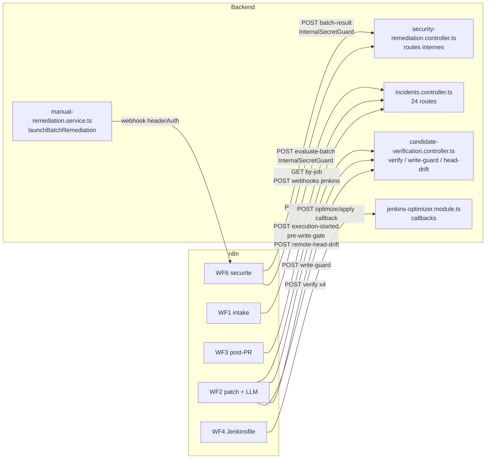

# 04 — CARTOGRAPHIE n8n ↔ BACKEND

Pièce maîtresse pour comprendre **comment n8n et le backend se parlent**. Chaque ligne
provient d'un nœud HTTP réel de l'instance n8n en cours d'exécution, résolu contre les
décorateurs NestJS réels du backend.

**25 appels n8n → backend** sur les workflows actifs, dont **21 résolus**
vers un contrôleur précis.

## Sens 1 — n8n appelle le backend

| WF | Nœud n8n | Méthode | Route backend | Contrôleur | Handler | Garde | Timeout | onError |
|---|---|---|---|---|---|---|---|---|
| WF1 | `Lookup Project` | `GET` | `=:p/api/projects/internal/by-job/:p` | `—` | `—` | `—` | `None` | `continueErrorOutput` |
| WF1 | `Send Raw Incident to Backend` | `POST` | `/api/webhooks/jenkins/by-job/:p` | `WebhooksController` | `jenkinsByJob()` | `-` | `None` | `continueErrorOutput` |
| WF1 | `Resolve Exact Sonar Correlation` | `GET` | `/api/projects/internal/:p/sonar-correlation` | `ProjectsController` | `sonarCorrelation()` | `-` | `310000` | `continueRegularOutput` |
| WF1 | `Save Agent Reports to Backend` | `POST` | `/api/reports` | `ReportsController` | `create()` | `JwtAuthGuard` | `None` | `continueErrorOutput` |
| WF1 | `Save Judge Decision to Report` | `PUT` | `/api/reports/:p` | `ReportsController` | `updateJudgeDecision()` | `-` | `None` | `continueRegularOutput` |
| WF1 | `Save Final Decision to Backend` | `PUT` | `/api/incidents/:p` | `IncidentsController` | `update()` | `JwtOrInternalSecretGuard` | `None` | `continueErrorOutput` |
| WF1 | `Update Incident AI Analysis` | `PUT` | `/api/incidents/:p` | `IncidentsController` | `update()` | `JwtOrInternalSecretGuard` | `None` | `None` |
| WF1 | `Backend Error - Decision Save Failed` | `PUT` | `/api/incidents/:p` | `IncidentsController` | `update()` | `JwtOrInternalSecretGuard` | `None` | `None` |
| WF2 | `Register WF2 Execution` | `POST` | `=:p` | `—` | `—` | `—` | `15000` | `None` |
| WF2 | `Persist WF2 Failure Status` | `POST` | `/api/incidents/:p/workflow-status` | `IncidentsController` | `saveWorkflowStatus()` | `InternalSecretGuard` | `15000` | `None` |
| WF2 | `Call Cross-File COMPILE_MAIN` | `POST` | `/api/candidate-verification/verify` | `CandidateVerificationController` | `verify()` | `InternalSecretGuard` | `300000` | `continueErrorOutput` |
| WF2 | `Call Candidate Verification` | `POST` | `/api/candidate-verification/verify` | `CandidateVerificationController` | `verify()` | `InternalSecretGuard` | `300000` | `continueErrorOutput` |
| WF2 | `Call Write Guard` | `POST` | `/api/candidate-verification/write-guard` | `CandidateVerificationController` | `writeGuard()` | `InternalSecretGuard` | `15000` | `continueErrorOutput` |
| WF2 | `Call Cross-File COMPILE_TESTS` | `POST` | `/api/candidate-verification/verify` | `CandidateVerificationController` | `verify()` | `InternalSecretGuard` | `300000` | `continueErrorOutput` |
| WF2 | `Call Remote Head Drift Guard` | `POST` | `/api/candidate-verification/remote-head-drift` | `CandidateVerificationController` | `remoteHeadDrift()` | `InternalSecretGuard` | `15000` | `continueErrorOutput` |
| WF2 | `Call Cross-File FULL_TEST` | `POST` | `/api/candidate-verification/verify` | `CandidateVerificationController` | `verify()` | `InternalSecretGuard` | `300000` | `continueErrorOutput` |
| WF2 | `Pre-Git Cancellation Gate` | `POST` | `=:p` | `—` | `—` | `—` | `15000` | `None` |
| WF2 | `Save Execution Result to Backend` | `POST` | `/api/incidents/:p/workflow-status` | `IncidentsController` | `saveWorkflowStatus()` | `InternalSecretGuard` | `None` | `continueErrorOutput` |
| WF3 | `Persist Correlated Validation` | `POST` | `/api/incidents/:p/validation` | `IncidentsController` | `saveValidation()` | `InternalSecretGuard` | `15000` | `continueRegularOutput` |
| WF4 | `Send Apply Callback` | `POST` | `/api/jenkins/apply/:p/callback` | `JenkinsOptimizerController` | `receiveApplyCallback()` | `-` | `10000` | `continueRegularOutput` |
| WF4 | `Send Result to Backend` | `POST` | `/api/jenkins/optimize/:p/callback` | `JenkinsOptimizerController` | `receiveOptimizeCallback()` | `-` | `None` | `continueRegularOutput` |
| WF4 | `Send Error to Backend` | `POST` | `/api/jenkins/optimize/:p/callback` | `JenkinsOptimizerController` | `receiveOptimizeCallback()` | `-` | `None` | `continueRegularOutput` |
| WF5 | `Send Result to Backend` | `POST` | `/api/dockerfile/optimize/:p/callback` | `DockerfileOptimizerController` | `receiveOptimizeCallback()` | `-` | `None` | `continueRegularOutput` |
| WF5 | `Send Error to Backend` | `POST` | `/api/dockerfile/optimize/:p/callback` | `DockerfileOptimizerController` | `receiveOptimizeCallback()` | `-` | `None` | `continueRegularOutput` |
| WF-Chat | `Get Incidents` | `GET` | `=:p` | `—` | `—` | `—` | `None` | `continueErrorOutput` |

### Comment lire cette table

- **`InternalSecretGuard`** : route appelable **uniquement** par n8n via l'en-tête
  `X-Internal-Secret`. Le navigateur ne peut pas l'atteindre. Le garde est *fail-closed* :
  si `N8N_INTERNAL_SECRET` n'est pas défini côté serveur, il refuse **toujours**
  (`backend/src/auth/internal-secret.guard.ts`).
- **`timeout`** : les 58 nœuds HTTP de WF6 portent tous un timeout explicite. C'est ce qui
  transforme une panne silencieuse en échec **typé**, donc classable comme rejouable ou non.
- **`onError = None`** : comportement par défaut de n8n, c'est-à-dire *arrêter l'exécution*.
  C'est voulu sur les nœuds de garde : mieux vaut s'arrêter que continuer sans preuve.

### Appels à URL dynamique

Ces URL sont assemblées par une expression n8n ; le chemin exact dépend de
l'exécution. Ils sont listés pour ne rien masquer.

| WF | Nœud | Méthode | Chemin extrait |
|---|---|---|---|
| WF1 | `Lookup Project` | `GET` | `=:p/api/projects/internal/by-job/:p` |
| WF2 | `Register WF2 Execution` | `POST` | `=:p` |
| WF2 | `Pre-Git Cancellation Gate` | `POST` | `=:p` |
| WF-Chat | `Get Incidents` | `GET` | `=:p` |

## Sens 2 — le backend appelle n8n

Le backend ne « pilote » pas n8n par une API générique : il déclenche des **webhooks**
précis et attend des **callbacks**.

| Déclencheur backend | Fichier | Cible n8n | Mécanisme |
|---|---|---|---|
| Dispatch de remédiation sécurité (lot) | `backend/src/manual-remediation/manual-remediation.service.ts` → `launchBatchRemediation()` | webhook WF6 `wf6-security-remediation-evaluate` | HTTP POST, authentifié par en-tête (`headerAuth` côté n8n) |
| Dispatch WF2 (correction d'incident) | variable `N8N_WF2_WEBHOOK` | webhook WF2 `wf2-r22e-test` | HTTP POST |
| Routage automatique WF4/WF5 | `backend/src/webhooks/webhooks.service.ts` → `routeToOptimizer()` | webhooks WF4/WF5 | HTTP POST, déclenché seulement si `classify()` retourne `jenkinsfile` ou `dockerfile` |
| Annulation d'exécution | `backend/src/incidents/n8n-execution-client.ts` | API n8n (arrêt d'exécution) | clé `N8N_API_KEY` |

> **Point pédagogique important.** Le backend ne fait jamais confiance à ce que n8n lui
> renvoie *sur le fond* : un callback apporte un **résultat**, pas une **décision**. La
> décision (succès sémantique, éligibilité au retry, autorisation d'écrire dans Git) est
> toujours recalculée côté backend. Voir `11-REMEDIATION-LIFECYCLE.md` et
> `37` dans `00-MASTER-GUIDE.md`.

---

## Diagramme — intégration n8n ↔ backend

**Lecture.** Le backend n'a qu'**un seul** point de sortie vers n8n par flux (un webhook),
alors que n8n a **beaucoup** de points de retour vers le backend. Cette asymétrie est
voulue : n8n demande au backend de décider à chaque étape sensible, au lieu de décider
lui-même et de prévenir à la fin.
