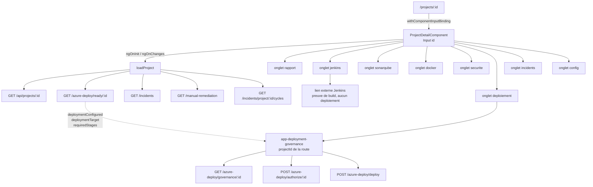

# 06 — GUIDE COMPLET DU FRONTEND

66 fichiers `.ts` sous `src/app`, dont **26 composants**. Angular standalone, routes *lazy*.
Catalogue exhaustif : `18-FILE-RESPONSIBILITY-CATALOG.md`.

---

## 1. Le principe directeur

Le frontend **n'invente aucune vérité métier**. `shared/status-labels.ts` l'écrit en
en-tête :

> *« Présentation uniquement : traduit les valeurs canoniques du backend en libellés
> humains FR pour l'affichage. Ne modifie jamais la valeur canonique elle-même. »*

Conséquence concrète et vérifiable : les composants comparent toujours la valeur **brute**
(`[class]="status.toLowerCase()"`), seul le **texte** passe par les fonctions de libellé.

---

## 2. Routage — `app.routes.ts`

```
/login                      LoginComponent (hors shell)
/                           authGuard → LayoutComponent
  ├── dashboard             DashboardComponent
  ├── projects              ProjectsComponent          (liste)
  ├── projects/new          editorGuard                (création)
  ├── projects/:id/edit     editorGuard + unsavedChangesGuard
  ├── projects/:id          ProjectDetailComponent     ← le shell projet
  ├── incidents             …
  └── …
```

### Le mécanisme central à comprendre

`app.config.ts` déclare `provideRouter(routes, withComponentInputBinding())`.

Cela signifie que le paramètre de route `:id` est injecté **directement** dans
`@Input() id!: string` de `ProjectDetailComponent`. Aucun registre de projets, aucune
route par projet. **C'est ce qui rend la plateforme multi-projet sans modification de
source.**

Les quatre gardes : `authGuard` (session), `editorGuard` (`developer`/`admin`),
`adminGuard` (`admin`), `unsavedChangesGuard` (confirmation de sortie).

---

## 3. Le shell projet — `/projects/:id`

`ProjectDetailComponent` implémente `OnInit`, `OnChanges`, `OnDestroy`.
`VALID_TABS` définit **huit** onglets :

```
/projects/:projectId
   ├── rapport       Rapport IA         (ti-report-analytics)
   ├── jenkins       Jenkins / CI-CD    (ti-settings-automation)
   ├── sonarqube     SonarQube          (ti-radar)
   ├── docker        Docker             (ti-brand-docker)
   ├── securite      Sécurité           (ti-shield-lock)
   ├── deploiement   Déploiement        (ti-cloud-upload)
   ├── incidents     Incidents          (ti-alert-triangle)
   └── config        Config             (ti-adjustments)
```

L'onglet actif est reflété dans l'URL (`?tab=…`, `replaceUrl: true`) afin de survivre à
un F5 sans polluer l'historique.

### Pourquoi `OnChanges` est indispensable

Avec `withComponentInputBinding()`, naviguer de `/projects/A` vers `/projects/B`
**réutilise la même instance** de composant et ne met à jour que `id`. Si le chargement
n'était fait qu'en `ngOnInit`, la page afficherait les données de A sous l'URL de B.
`ngOnChanges` appelle donc `resetProjectScopedState()` puis `loadProject()`.

`resetProjectScopedState()` remet à zéro : `project`, `incidents`, `allReports`,
`allReportsRaw`, `jenkinsBuilds`, `manualTasks`, `manualSummary`, `deployReadiness`,
`deployReady`, `deploymentConfigured`, `deploymentTarget`, `deployReasons`,
`convergenceCycles`, `dataErrors`, et arrête le polling de lot.

### Ce que `loadProject()` déclenche

```
GET /api/projects/:id
  ├── loadIncidents()
  ├── loadReports()
  ├── loadJenkinsBuilds()
  ├── loadJudgeStatus()
  ├── loadDeployReadiness()      → GET /api/azure-deploy/ready/:id
  ├── loadConvergence()          → GET /api/incidents/project/:id/cycles
  └── loadManualRemediation()    → GET /api/manual-remediation?projectId=…
```

`loadDeployReadiness()` est *fail-closed* : en cas d'erreur, `deployReady = false` et un
message explicite. Le front ne se déclare **jamais** « prêt » par défaut.

---

## 4. Section par section

| Onglet | Composant | API | Affiche | Source de vérité |
|---|---|---|---|---|
| Rapport IA | `project-overview.component.ts` + `project-detail` | `/reports`, `/azure-deploy/ready` | tuiles d'étapes, go/no-go, priorités | `deployReadiness` |
| Jenkins | inline + `jenkinsfile-optimizer.component.ts` | `/jenkins/*` | builds, KPI, lien Jenkins | Jenkins via backend |
| SonarQube | inline | rapports | bugs, vulnérabilités, QG, couverture | `reports.rawData` |
| Docker | `dockerfile-optimizer.component.ts` | `/dockerfile/*` | analyse Dockerfile | `dockerfile_analyses` |
| Sécurité | `cve-table.component.ts`, `zap-table.component.ts` | `/manual-remediation` | CVE Trivy/OWASP, findings ZAP | `manual_remediation_tasks` |
| **Déploiement** | `deployment-governance.component.ts` | `/azure-deploy/governance`, `/authorize`, `/deploy` | gouvernance, identité, contrôles | **backend** |
| Incidents | inline + `incident-detail.component.ts` | `/incidents` | incidents, corrections | `incidents` |
| Config | `project-form.component.ts` | `/projects/:id` | configuration du projet | `projects` |

### L'onglet Déploiement, en détail

`deployment-governance.component.ts` ne reçoit **que** des données :

```html
<app-deployment-governance
  [projectId]="id"                                            <!-- de la route -->
  [requiredStages]="deployReadiness?.requiredStages || null"
  [deploymentConfigured]="deploymentConfigured"
  [deploymentTarget]="deploymentTarget"
  [projectName]="project?.name || null"
  [jenkinsPipelineUrl]="toolUrl(jenkinsPublicUrl(), '/job/' + (project?.jenkinsJobName || '')) || null">
</app-deployment-governance>
```

Cinq états de capacité, tous **dérivés de champs backend** par
`deriveDeploymentCapability()` :

| Capacité | Condition | Action proposée |
|---|---|---|
| `DEPLOYMENT_GOVERNANCE_UNAVAILABLE` | appel de gouvernance en échec | aucune |
| `DEPLOYMENT_NOT_CONFIGURED` | `environment.resolved !== true` et pas de config | aucune |
| `DEPLOYMENT_CONFIGURATION_INVALID` | `environment.resolved !== true` mais config présente | aucune |
| `DEPLOYMENT_TECHNICALLY_IMPOSSIBLE` | environnement résolu, décision impossible | aucune |
| `DEPLOYMENT_CONFIGURED` | environnement résolu, décision actionnable | selon la décision |

Et quatre décisions de gouvernance, affichées avec **icône + texte** (jamais la couleur
seule) : `READY` → *Prêt au déploiement* / *Déployer sur Azure* ;
`CONDITIONAL` → *Déploiement conditionnel* / *Autoriser et déployer* ;
`CRITICAL_RISK` → *Risque critique* / *Forcer le déploiement* (admin) ;
`TECHNICALLY_IMPOSSIBLE` → aucune action + la phrase
*« Ce blocage ne peut pas être contourné par une acceptation de risque. »*

**Jenkins est explicitement séparé** : un lien « Voir le pipeline Jenkins ↗ », libellé
*« Preuve de build (CI/CD) — n'exécute aucun déploiement »*, stylé comme un lien sortant
et jamais comme un bouton d'action.

### Protection contre les réponses périmées

Le composant porte `loadGeneration` (compteur monotone) et `loadedForProjectId`. Une
réponse n'est appliquée que si **les deux** correspondent encore. Sans cela, une réponse
lente pour A pourrait peindre l'écran de B. De plus, `previewIsForCurrentProject` fait
retourner `null` au getter `decision` si la prévisualisation appartient à un autre
projet, et `ngOnChanges` jette l'autorisation détenue dès que le projet change — une
autorisation ne traverse **jamais** une frontière de projet.

---

## 5. Matrice frontend → backend

| Action UI | Service frontend | Endpoint | Contrôleur |
|---|---|---|---|
| Se connecter | `api.service.ts` | `POST /api/auth/login` | `AuthController` |
| Lister les projets | `getProjects()` | `GET /api/projects` | `ProjectsController` |
| Ouvrir un projet | `getProject(id)` | `GET /api/projects/:id` | `ProjectsController` |
| Préparation au déploiement | `getDeployReadiness(id)` | `GET /api/azure-deploy/ready/:id` | `AzureDeployController` |
| Gouvernance | `getGovernancePreview(id)` | `GET /api/azure-deploy/governance/:id` | `AzureDeployController` |
| **Déployer sur Azure** | `authorizeDeployment()` puis `deployGoverned()` | `POST /authorize/:id` puis `POST /deploy` | `AzureDeployController` |
| Approuver une correction | `approveFix()` / `approveFixBatch()` | `POST /api/incidents/:id/approve` | `IncidentsController` |
| Annuler une correction | `cancelFixRequest()` | `POST /api/incidents/:id/remediation/:requestId/cancel` | `IncidentsController` |
| Rejouer un lot | `retryFixBatch()` | `POST /api/incidents/:id/retry` | `IncidentsController` |
| Validation de PR | `requestPrValidation()` (+5 variantes) | `POST /api/incidents/:id/pr-validation…` | `IncidentsController` |
| Terminer une tâche | `completeManualRemediation()` | `POST /api/manual-remediation/:id/complete` | `ManualRemediationController` |
| Rouvrir une tâche | `reopenManualRemediation()` | `POST /api/manual-remediation/:id/reopen` | `ManualRemediationController` |
| Chat | `chat.service.ts` | `POST /api/chat` | `ChatController` |
| Paramètres | `settings.component.ts` | `/api/integrations`, `/api/config` | `IntegrationsController`, `EffectiveConfigController` |

### Ce que le frontend envoie pour une autorisation de déploiement

**Uniquement de l'intention** :

```ts
{ mode, reason?, acknowledgements?, confirmationPhrase?, mainBuildNumber?, tag? }
```

Jamais `decision`, `commitSha`, `artifactDigest`, `riskSnapshot` ou
`environmentIdentityHash` — ces champs **n'existent même pas** sur le DTO backend. Le
serveur recalcule tout.

---

## 5 bis. `shared/data-truth.ts` — l'invariant « absence ≠ propre » côté présentation

Module ajouté le 2026-10-08, utilisé par **5 composants** (`project-detail`,
`project-overview`, `incident-detail`, `dashboard`, `tools/security`) et couvert par sa
propre spécification, `frontend/scripts/data-truth-jury.spec.mjs`.

Son en-tête énonce la règle :

> *« Presentation only: absence and scanner failure must never become a clean count. »*

C'est le **même invariant que `provesSecurityClosure()` côté backend**, appliqué cette
fois à l'affichage. Le risque qu'il traite est subtil : un agrégat d'interface qui
additionne des compteurs peut transformer un scanner absent en « 0 vulnérabilité »,
c'est-à-dire fabriquer une bonne nouvelle par omission.

| Fonction | Rôle |
|---|---|
| `availableNumber(v)` | n'accepte qu'un nombre fini ≥ 0 ; **`'0'` (chaîne) devient `null`** |
| `scannerHasResult(block)` | un bloc ne « a un résultat » que si `status === 'COMPLETED'` ou `resultAvailable === true` ; `executed === false` ⇒ **non** |
| `scannerMetric(block, field)` | renvoie la métrique **seulement** si le scanner a un résultat, sinon `null` |
| `scannerState(block)` | libellés distincts : *Non configuré*, *Non exécuté*, *Indisponible*, *En attente*, *Résultat disponible*, *Non disponible* |
| `securitySummaryForDisplay(data)` | n'agrège **que** les projets et scanners que l'API déclare porteurs de résultats ; renvoie `null` plutôt que `0` quand aucune valeur n'est disponible |
| `qualityGatePresentation(block)` | si le statut n'est pas terminé, affiche l'**état** du scanner au lieu d'un verdict de gate |

### Deux détails qui méritent d'être cités en soutenance

**1. `totalMediumCves` est délibérément `null`**, avec ce commentaire dans le code :

> *« The API's residual count includes LOW/UNKNOWN; it is not a MEDIUM count. »*

Plutôt que d'afficher un nombre approximativement juste, le module affiche **rien**.
C'est exactement la bonne décision pour un outil de sécurité.

**2. `avgSecurityScore` devient `null` dès qu'un projet est sans données.** Une moyenne
calculée sur un sous-ensemble incomplet serait trompeuse — elle est donc supprimée.

### Ce que vérifie `data-truth-jury.spec.mjs`

Que `undefined`, `null`, `{}`, `{status:'FAILED',critical:0}`, `{status:'NOT_RUN',critical:0}`
et `{status:'COMPLETED',executed:false,critical:0}` donnent **tous** `null` — et que seul
`{status:'COMPLETED',critical:0}` donne `0`. Autrement dit : un zéro n'est affiché que
lorsqu'il a été réellement **mesuré**.

---

## 6. Sécurité côté frontend

| Point | État réel |
|---|---|
| XSS | `[innerHTML]` utilisé (chat markdown, table ZAP) mais **jamais** `bypassSecurityTrustHtml` ni `DomSanitizer` : la sanitisation Angular s'applique |
| Secrets | aucun ; `environment.ts` ne contient que `apiUrl: '/api'` et `wsUrl: '/socket.io'` |
| URL en dur | aucune ; tout est relatif et proxifié par nginx |
| Rôles | `auth.service.ts` + gardes ; **le backend revérifie toujours** |
| Identifiants de projet en dur | **0** dans le runtime ; les 157 occurrences d'UUID sont dans deux fixtures JSON importées **uniquement** par les tests et **absentes du bundle servi** |

---

## 7. Tests frontend

**30** fichiers de spécification sous `frontend/scripts/*.spec.mjs`. Convention
particulière à savoir expliquer : ils chargent le **vrai** composant TypeScript dans un
bac à sable VM (`loadFrontend()`), exercent ses **vraies** méthodes et vérifient le
**vrai** template — sans Angular TestBed. Le fichier de gouvernance du déploiement
contient à lui seul **45 cas** (F1–F26 + M1–M14 + 5 blocs).

---

## Diagramme — flux UI projet ↔ backend



**Lecture.** Un seul identifiant entre par la route et descend partout comme une
**donnée**. Aucun composant n'est enregistré par projet, et l'onglet Déploiement est
strictement séparé de l'onglet Jenkins : Jenkins est une **preuve de build**, pas une
interface de déploiement.
