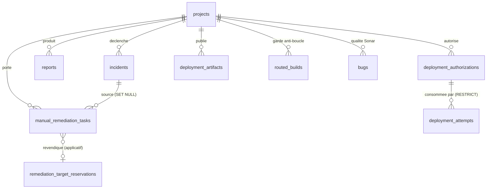

# 07 — MODÈLE DE DONNÉES

Détail colonne par colonne : `20-DATABASE-TABLE-CATALOG.md`.
Ici on explique les **relations** et le **pourquoi**.

---

## 1. Diagramme de relations (textuel)

```
                        ┌──────────────┐
                        │   projects   │  32 colonnes
                        │  (5 lignes)  │  azureConfig · azureDeploymentState
                        └──┬───┬───┬───┘
       ┌───────────────────┘   │   └────────────────────┐
       ▼                       ▼                        ▼
┌─────────────┐      ┌──────────────────┐     ┌──────────────────────────┐
│  incidents  │      │     reports      │     │ deployment_authorizations│
│ (249)       │      │ (63) rawData     │     │  TTL 15 min · usage      │
│ metadata.   │      │ = source des     │     │  unique                  │
│ sourceCommit│      │   signaux risque │     └────────────┬─────────────┘
│ Sha         │      └──────────────────┘                  │ ON DELETE RESTRICT
└──┬──────────┘                                            ▼
   │ ON DELETE SET NULL                          ┌──────────────────────┐
   ▼                                             │ deployment_attempts  │
┌────────────────────────────────┐               │ audit append-only    │
│  manual_remediation_tasks      │               └──────────────────────┘
│  (777 lignes)                  │
│  UNIQUE(projectId,             │     ┌──────────────────────────────────┐
│         findingFingerprint)    │     │ remediation_target_reservations  │
│  status | scannerStatus        │     │ UNIQUE(projectId,targetKey)      │
│  securityFindingRemediation ───┼────▶│   WHERE state='ACTIVE'           │
│    └── attempts[]              │     │ claims = { taskId: {...} }       │
│  securityRemediationBatchId    │     └──────────────────────────────────┘
└────────────────────────────────┘           (pas de FK — lien applicatif)

Tables satellites :
  bugs(0) ← Sonar     routed_builds(garde anti-boucle)     users(5)
  jenkins_analyses · jenkins_applies · dockerfile_analyses
  deployment_artifacts(provenance prouvée)
  security_remediation_retry_e2e_plans(harnais de test)
  integrations(configuration)
```

## 2. Diagramme Mermaid



---

## 3. La table centrale — `manual_remediation_tasks`

777 lignes. 25 colonnes. C'est elle qu'il faut savoir expliquer.

### Les colonnes qui portent la conception

| Colonne | Pourquoi elle existe |
|---|---|
| `findingFingerprint` (64 car., **NOT NULL**) | empreinte stable d'un finding, indépendante de l'ordre des rapports |
| **`UNIQUE (projectId, findingFingerprint)`** | **l'idempotence est garantie par la base** : rescanner dix fois ne crée pas dix tâches |
| `status` (enum) | cycle de vie du **travail** : `TODO`, `VERIFIED`, `REOPENED` |
| `scannerStatus` (enum) | vérité du **scanner** : `DETECTED`, `NOT_DETECTED`, `UNAVAILABLE` |
| `findingSnapshot` (jsonb, NOT NULL) | photo du finding au moment de la promotion |
| `securityFindingRemediation` (jsonb) | **toute la chaîne des tentatives** |
| `securityRemediationBatchId` (64 car.) | lot courant, indexé |
| `lastSeenBuild` / `verifiedBuild` / `verifiedAt` | **la preuve de vérification** |
| `events` (jsonb, NOT NULL, `[]`) | piste d'audit |

### Pourquoi deux colonnes de statut — l'exemple réel

Distribution réelle observée en base :

| `status` | `scannerStatus` | lignes | Lecture |
|---|---|---|---|
| `TODO` | `UNAVAILABLE` | 470 | à traiter, scanner muet sur ce build |
| `TODO` | `DETECTED` | 269 | à traiter, scanner confirme |
| `VERIFIED` | `NOT_DETECTED` | 32 | traité **et** scanner confirme la disparition |
| `VERIFIED` | `UNAVAILABLE` | 3 | traité, scanner actuellement muet |
| `REOPENED` | `DETECTED` | 1 | réapparu |
| `TODO` | `DETECTED` (+ `OPERATOR_TEST_STOPPED`) | 1 | test opérateur arrêté |

Les 3 lignes `VERIFIED` + `UNAVAILABLE` sont la combinaison que le jury pourrait
questionner. Elles sont **correctement fondées** : chacune a
`verifiedBuild` (120, 15, 15) **strictement supérieur** à `lastSeenBuild` (112, 14, 14),
plus un `verifiedAt`, et `completedAt IS NULL`. Traduction : *« le finding a été vu pour
la dernière fois au build N, un build ultérieur a tourné et ne l'a plus vu »*. La
vérification repose sur une **preuve de build**, et `scannerStatus` ne décrit que la
disponibilité **actuelle** du scanner. Ce sont deux faits différents, d'où deux colonnes.

### Structure de `securityFindingRemediation`

```json
{
  "status": "OPERATOR_TEST_STOPPED",
  "attemptCount": 2,
  "attempts": [
    { "attemptNumber": 1, "attemptId": "93c68aed-…", "batchId": "sec-batch-61727477-…",
      "status": "TECHNICAL_FAILURE", "reasonCode": "VERIFIER_TIMEOUT", "retryable": true },
    { "attemptNumber": 2, "attemptId": "39c77b06-…", "batchId": "sec-batch-4e6f6ec2-…",
      "status": "OPERATOR_TEST_STOPPED", "retryable": false }
  ]
}
```

Cet enregistrement réel **prouve** à lui seul quatre invariants : `attemptId` unique,
`batchId` **nouveau** à chaque tentative, `attemptNumber` incrémenté une seule fois, et
un échec non rejouable qui ne produit pas de troisième tentative.

---

## 4. Le verrou d'écrivain unique — `remediation_target_reservations`

14 colonnes, 2 lignes (toutes `RELEASED`).

### Les contraintes, mot pour mot

```sql
-- un seul propriétaire ACTIF par (projet, cible)
CREATE UNIQUE INDEX remediation_target_one_active
  ON remediation_target_reservations ("projectId","targetKey")
  WHERE state = 'ACTIVE';

-- cohérence d'état imposée par PostgreSQL
CHECK ( (state='ACTIVE'   AND claims <> '{}'::jsonb AND "releasedAt" IS NULL)
     OR (state='RELEASED' AND claims  = '{}'::jsonb AND "releasedAt" IS NOT NULL) )

-- index de détection des réservations bloquées
CREATE INDEX remediation_target_stale ON … ("updatedAt") WHERE state = 'ACTIVE';
```

**Pourquoi c'est important.** L'index unique est **partiel** (`WHERE state='ACTIVE'`) :
on peut donc conserver l'historique de toutes les réservations relâchées tout en
n'autorisant qu'un seul propriétaire actif. Et le `CHECK` rend **impossible** une ligne
incohérente du type « ACTIVE mais déjà relâchée ». L'invariant n'est pas une convention
de code : c'est une règle de la base.

### Détails de schéma à connaître

- `targetKey` = `JSON.stringify(['v1','FILE',file])` — clé **versionnée**, qui permettra
  d'introduire un autre `targetType` sans casser les lignes existantes.
- `claims` (jsonb) = `{ "<taskId>": { attemptId, batchId, status } }` — plusieurs tâches
  d'un même lot peuvent partager un écrivain.
- `expiresAt` existe mais est **forcée à NULL** par un `CHECK` : colonne vestigiale,
  pas d'expiration automatique (voir `38`).
- **Aucune clé étrangère** sur `projectId` / `ownerTaskId` : le lien est applicatif.

---

## 5. Les tables de déploiement

### `deployment_authorizations` (25 colonnes)

Gèle au moment de l'autorisation : `commitSha`, `artifactDigest`, `registry`,
`repository`, `artifactTag`, `environmentIdentityHash`, `decisionAtAuthorization`,
`riskSnapshot`, `failedControls`, `warnings`, plus l'intention humaine
(`authorizationMode`, `reason`, `acknowledgements`) et le cycle de vie
(`status` ∈ `CREATED|CONSUMED|EXPIRED|REVOKED`, `consumedAt`, `expiresAt`).

**Pourquoi geler ?** Pour pouvoir, au moment du dispatch, **recalculer** et comparer.
Si le digest ou le commit a bougé entre-temps, l'autorisation est refusée
(`DEPLOY_AUTHORIZATION_IDENTITY_CHANGED`) : on ne déploie jamais autre chose que ce qui
a été autorisé.

### `deployment_attempts` (21 colonnes)

Piste d'audit : identité immuable + instantané de risque + `dispatchStatus`
(`DISPATCHING` → `DEPLOYED` | `FAILED`) + `dispatchResult` + `completedAt`.
FK vers l'autorisation en **`ON DELETE RESTRICT`** : on ne peut pas supprimer une
autorisation qui a produit une tentative. L'audit est protégé.

---

## 6. Qui écrit, qui lit

| Table | Écrivains | Lecteurs |
|---|---|---|
| `projects` | `ProjectsController`, `seed` | tout |
| `incidents` | `webhooks.service`, `incidents.service` | front, WF1–WF3, gouvernance |
| `reports` | ingestion de rapports | gouvernance, dashboard, front |
| `manual_remediation_tasks` | `manual-remediation.service` (`syncIncident`, `launchBatch…`, `recordWf6*`) | front, gouvernance |
| `remediation_target_reservations` | `remediation-target-reservation.ts` **uniquement** | `staleTargets()`, diagnostics |
| `deployment_authorizations` | `deployment-authorization.service` **uniquement** | `azure-deploy.module` |
| `deployment_attempts` | `deployment-authorization.service` (dans la transaction de réservation) | audit |
| `routed_builds` | `webhooks.service` → `routeToOptimizer()` | lui-même |
| `bugs` | `webhooks.service` → `handleSonarqube()` | front |

**Observation de conception** : chaque table sensible a **un seul** écrivain. Pour
comprendre comment une réservation peut changer, il suffit de lire un fichier.

---

## 7. Migrations

Sept fichiers dans `backend/migrations/` :

| Fichier | Objet |
|---|---|
| `20260829_add_manual_remediation_tasks.sql` | table centrale |
| `20260831_add_jenkins_internal_public_url.sql` | URL Jenkins interne/publique |
| `20260928_add_security_remediation_batch_id.sql` | `securityRemediationBatchId` + index |
| `20261005_add_retry_e2e_test_plans.sql` | plans du harnais E2E |
| `20261005_add_deployment_authorization_and_attempt.sql` | gouvernance de déploiement |
| `20261006_add_remediation_target_reservations.sql` | **Phase 4G**, écrivain unique |
| `20261006_add_remediation_target_reservations.down.sql` | le **seul** script de retour arrière |

`DB_SYNCHRONIZE=false` : TypeORM ne modifie **jamais** le schéma au démarrage. Le schéma
est appliqué par procédure opérateur.

**Limitation assumée** : il n'existe **aucune table de registre de migrations**. L'état
appliqué n'est donc pas lisible depuis la base ; il est attesté par les rapports de
campagne sous `docs/qa/`. Les migrations sont en revanche largement idempotentes
(gardes `IF NOT EXISTS`).
