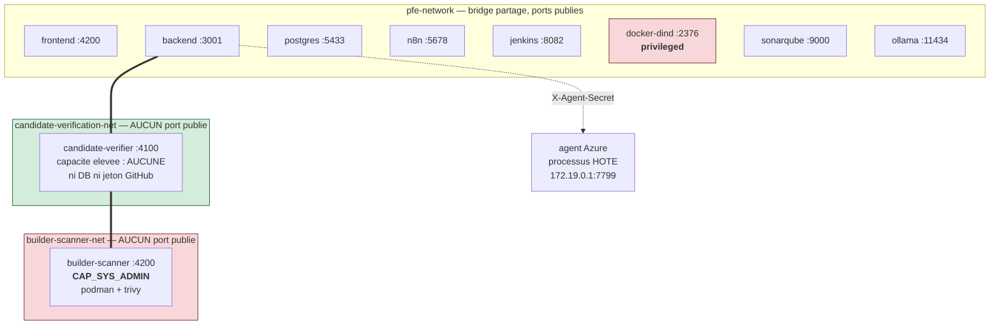

# 09 — DOCKER ET RUNTIME

**14 conteneurs** en marche, répartis sur **deux fichiers Compose**.

---

## 1. Pourquoi deux fichiers Compose ?

| Fichier | Services | Nature |
|---|---|---|
| `platform/docker-compose.yml` | 5 : `postgres`, `backend`, `candidate-verifier`, `builder-scanner`, `frontend` | **le produit** : plan de contrôle + plan d'exécution |
| `/home/souhaiel/pfe-2026/docker-compose.yml` | 9 : `n8n`, `jenkins`, `docker-dind`, `sonarqube`, `nexus`, `prometheus`, `grafana`, `ollama`, `minikube` | **l'outillage** autour |

Cette séparation est un choix défendable : on peut redéployer le produit sans toucher à
l'outillage, et les postures de sécurité des deux plans sont différentes (DinD
privilégié d'un côté, capacité minimale de l'autre).

---

## 2. Inventaire des services

| Service | Image | Dockerfile | Port publié | Réseaux | Volumes | Healthcheck | Rôle |
|---|---|---|---|---|---|---|---|
| `postgres` | `postgres:16-alpine` | — | `0.0.0.0:5433` | `pfe-network` | `postgres_data` | `pg_isready` | état durable |
| `backend` | construite | `backend/Dockerfile` | `0.0.0.0:3001` | `pfe-network`, `candidate-verification-net` | — | `/healthz` | décisions |
| `candidate-verifier` | construite | `candidate-verifier/Dockerfile` (contexte = racine) | **aucun** | `candidate-verification-net`, `builder-scanner-net` | workspace, cache dépôts | — | build/test d'un candidat |
| `builder-scanner` | construite | `builder-scanner/Dockerfile` | **aucun** | `builder-scanner-net` | trivy, maven, podman | oui (`healthy`) | podman + trivy |
| `frontend` | `nginx:alpine` | — | `0.0.0.0:4200` | `pfe-network` | **bind-mount** de `dist/.../browser` + `nginx.conf` (ro) | — | présentation |
| `n8n` | `n8nio/n8n:latest` | — | `0.0.0.0:5678` | `pfe-network` | `n8n_data` | `wget /healthz` | workflows |
| `jenkins` | `pfe-jenkins-with-docker-cli:2.568.1-jdk21` | `Dockerfile.jenkins` | `:8082`, `:50000` | `pfe-network` | `jenkins_home` | — | CI |
| `docker-dind` | `docker:dind` | — | `0.0.0.0:2376` | `pfe-network` | `jenkins_certs`, `jenkins_home` | — | moteur de build CI (**privileged**) |
| `sonarqube` | `sonarqube:latest` | — | `0.0.0.0:9000` | `pfe-network` | 3 volumes | — | qualité/sécurité du code |
| `nexus` | `sonatype/nexus3:latest` | — | `0.0.0.0:8081` | `pfe-network` | `nexus_data` | — | artefacts |
| `prometheus` | `prom/prometheus:latest` | — | `:9090` | `pfe-network` | `prometheus_data` | — | métriques |
| `grafana` | `grafana/grafana:latest` | — | `:3000` | `pfe-network` | `grafana_data` | — | tableaux de bord |
| `ollama` | `ollama/ollama:latest` | — | `:11434` | `pfe-network` | `ollama_data` | oui | LLM local |
| `minikube` | `kicbase:v0.0.50` | — | `127.0.0.1` seulement | — | — | — | Kubernetes local |

---

## 3. Topologie réseau — le point le plus intéressant

```
            pfe-network  (bridge partagé)
  ┌───────────────────────────────────────────────────────┐
  │ frontend · backend · postgres · n8n · jenkins · dind  │
  │ sonarqube · nexus · prometheus · grafana · ollama     │
  └──────────────────────┬────────────────────────────────┘
                         │  backend appartient aussi à :
                         ▼
          candidate-verification-net
  ┌───────────────────────────────────────┐
  │  backend  ↔  candidate-verifier       │
  └──────────────────┬────────────────────┘
                     │  candidate-verifier appartient aussi à :
                     ▼
            builder-scanner-net
  ┌───────────────────────────────────────┐
  │  candidate-verifier ↔ builder-scanner │
  └───────────────────────────────────────┘
```

### Schéma — la topologie des trois réseaux



**Lecture.** `builder-scanner` — le seul conteneur avec une capacité élevée — n'est
**pas** sur `pfe-network`. Il n'est joignable que depuis `candidate-verifier`, lui-même
joignable uniquement depuis le backend. Ni le frontend, ni n8n, ni Jenkins ne peuvent
l'atteindre, et aucun des deux n'a de port publié sur l'hôte : ils sont **invisibles
depuis le LAN**. C'est une défense en profondeur par la topologie, pas seulement par
l'authentification.

**Ce que cette topologie garantit.** `builder-scanner` — le seul conteneur avec
`CAP_SYS_ADMIN` — n'est joignable que depuis `candidate-verifier`. Il n'est **pas** sur
`pfe-network`, donc ni le frontend, ni n8n, ni Jenkins ne peuvent l'atteindre. Et aucun
des deux n'a de port publié sur l'hôte : ils sont invisibles depuis le LAN.

---

## 4. Posture de sécurité du plan de remédiation

Le fichier Compose documente ses propres choix. Faits vérifiés :

| Contrôle | État |
|---|---|
| `docker.sock` monté | **nulle part** dans `platform/docker-compose.yml` |
| `privileged` | **non défini** sur les 5 services du plan plateforme |
| `cap_add` | **uniquement** `SYS_ADMIN` sur `builder-scanner` |
| `security_opt` | non défini → profil seccomp Docker **par défaut** appliqué |
| `pid: host` / `network_mode: host` | non définis |
| ports publiés pour verifier/scanner | **aucun** |
| secrets détenus par verifier/scanner | **un seul** : `BUILDER_INTERNAL_SECRET` |
| `init: true` | sur `builder-scanner` |

### Pourquoi `init: true` sur builder-scanner

Le commentaire du Compose l'explique : le PID 1 de l'image est `node`, qui ne réape pas
un processus qu'il n'a pas lui-même créé. Quand un `podman build` tué au SIGKILL laisse
un `mvn` orphelin, celui-ci devient un **zombie permanent**. `init: true` (le tini
intégré de Docker) corrige cela. Et le commentaire précise que ça ne remplace **pas** le
balayage applicatif de `security-artifact-validator.ts`, qui tue proactivement un
orphelin encore vivant : tini réape les morts, il ne poursuit pas les vivants.

C'est exactement le genre de détail qui démontre une vraie maîtrise opérationnelle.

---

## 5. Les Dockerfiles

### `backend/Dockerfile` — multi-étapes

```dockerfile
FROM node@sha256:2cf067cf…  AS build          # base épinglée par DIGEST
RUN npm ci --no-audit --no-fund               # lockfile, reproductible
COPY tsconfig.json nest-cli.json ./
COPY src ./src
RUN npm run build                             # aucune tolérance d'erreur

FROM node@sha256:2cf067cf…
ARG SOURCE_COMMIT / SOURCE_TREE_SHA
LABEL org.opencontainers.image.revision=$SOURCE_COMMIT platform.source-tree=$SOURCE_TREE_SHA
ENV NODE_ENV=production
    SECURITY_REMEDIATION_DISPATCH_ENABLED=false
    SECURITY_REMEDIATION_E2E_TEST_HARNESS_ENABLED=false
    DB_SYNCHRONIZE=false
COPY --from=build … ; COPY migrations ./migrations
USER node                                     # non-root
EXPOSE 3001
```

Sept propriétés à savoir citer : base épinglée par **digest** (pas par tag), `npm ci`
avec lockfile, **erreur de build fatale**, **défauts sûrs cuits dans l'image**,
**labels OCI de provenance**, utilisateur **non-root**, migrations embarquées.

### `candidate-verifier/Dockerfile`

Points remarquables : Debian bookworm (et non Alpine, car musl pose des problèmes
documentés avec certains builds JVM/Maven) ; JDK 17 + Maven + **Gradle 8.10.2 épinglé et
vérifié par SHA-256** ; Python 3.11 + venv ; **Podman + uidmap** pour le rootless ;
**Trivy 0.72.0 épinglé et vérifié par SHA-256** depuis l'upstream, jamais via apt ;
`USER node` ; `WORKDIR /candidate-verifier` (et non `/app`, pour une raison de `rootDir`
TypeScript expliquée en commentaire).

Le Dockerfile **n'importe pas tout `backend/src`** : il copie une **liste explicite de
fichiers**, décrite comme la fermeture de compilation minimale obtenue par
`tsc --listFilesOnly`. C'est une décision de sécurité (surface minimale) documentée dans
le fichier.

---

## 6. Le frontend est un bind-mount — conséquence importante

```yaml
frontend:
  image: nginx:alpine
  volumes:
    - ./frontend/dist/devsecops-frontend/browser:/usr/share/nginx/html
    - ./docker/nginx.conf:/etc/nginx/conf.d/default.conf:ro
```

Il n'y a **pas d'image frontend**. Conséquence pratique : `ng build` **est** le
déploiement du frontend. Il n'y a ni reconstruction d'image ni redémarrage de conteneur.
À savoir expliquer si on demande « comment déployez-vous le front ? ».

---

## 7. Volumes persistants

| Volume | Service | Contenu | Survit à une reconstruction ? |
|---|---|---|---|
| `postgres_data` | postgres | **toutes les données** | oui |
| `n8n_data` | n8n | **définitions des workflows** | oui |
| `jenkins_home` | jenkins / dind | jobs, builds, credentials | oui |
| `sonarqube_data/_extensions/_logs` | sonarqube | analyses | oui |
| `nexus_data`, `prometheus_data`, `grafana_data`, `ollama_data` | — | — | oui |
| `candidate_repo_cache` | verifier | cache de dépôts | oui |
| `candidate_workspace_shared` | verifier ↔ scanner | espaces de travail | oui |
| `trivy_scanner_cache` | scanner | base Trivy | oui |
| `builder_maven_cache`, `builder_podman_storage` | scanner | caches de build | oui |

**Point critique à connaître** : les définitions WF1→WF6 vivent dans `n8n_data`. Perdre
ce volume sans export suivi par Git fait perdre les workflows — c'est pourquoi la dérive
canevas/dépôt signalée en `03` §10 est un vrai sujet.
