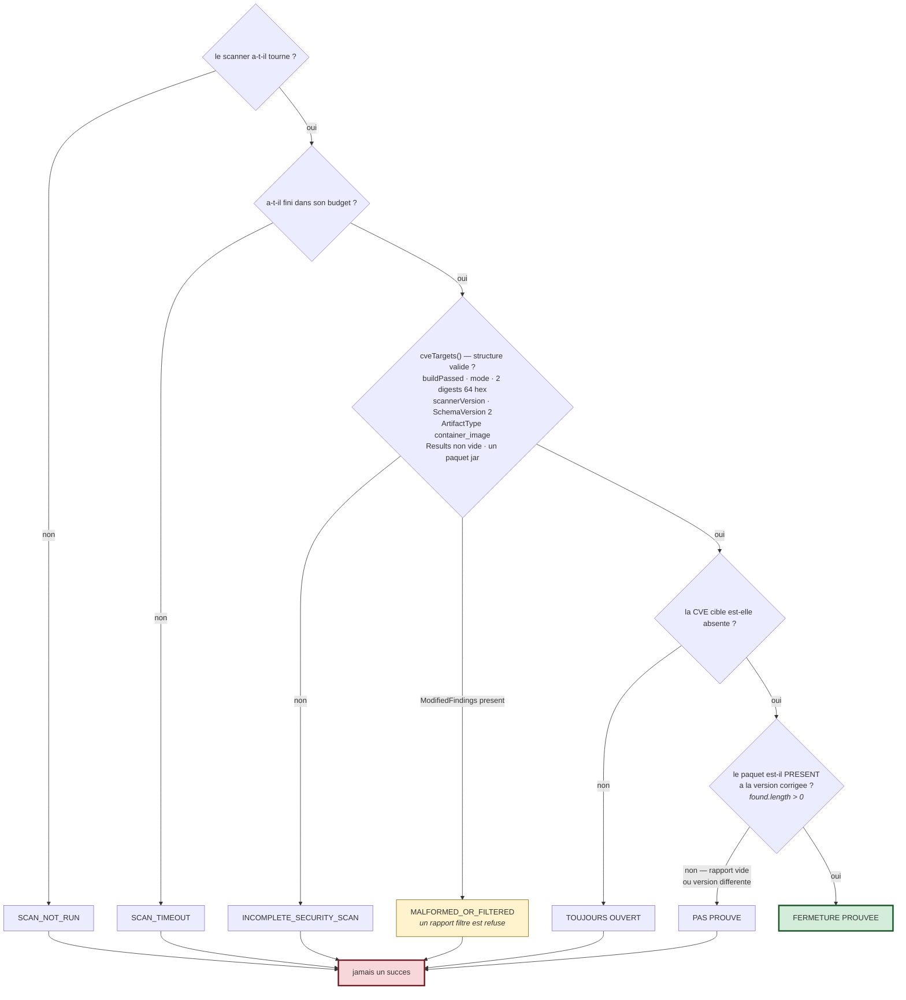
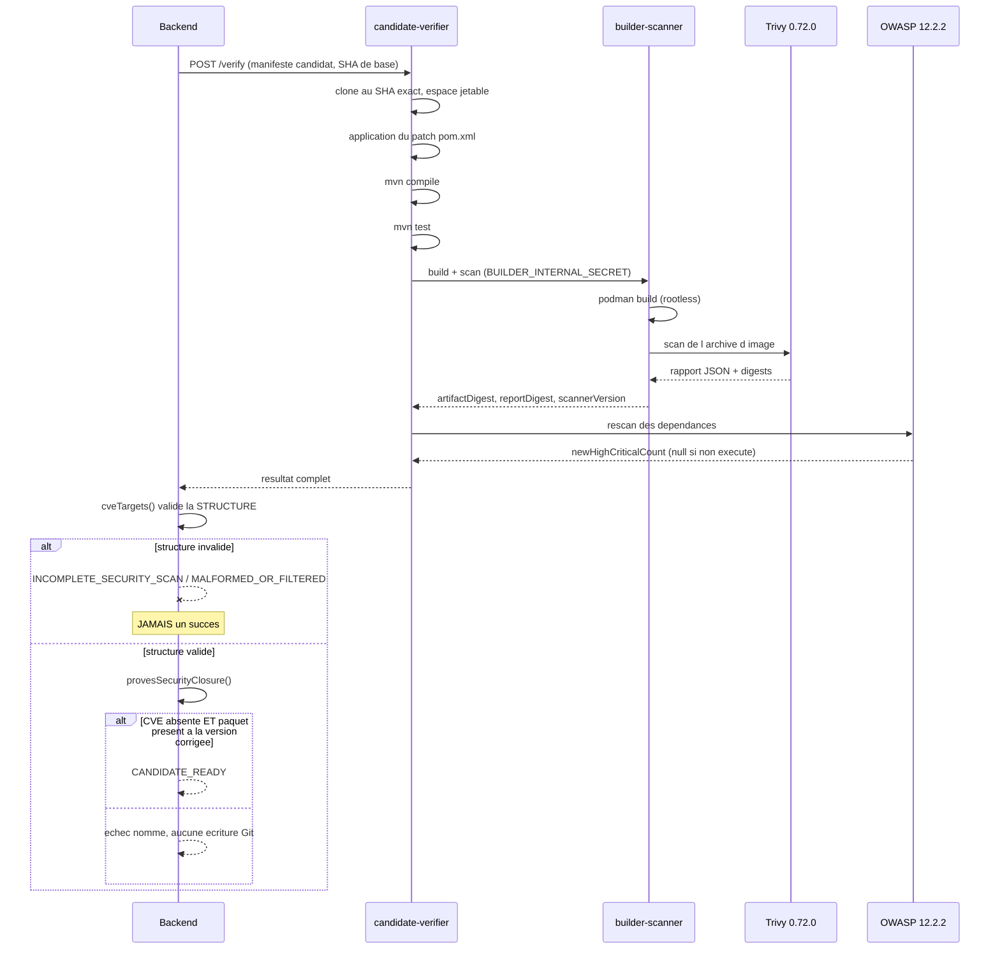

# 10 — SCANNERS DE SÉCURITÉ

Quatre scanners, quatre axes différents. Le point commun : **aucun n'a le droit de dire
« c'est bon » par omission.**

---

## 1. Pourquoi plusieurs scanners ?

| Scanner | Axe | Objet analysé | Famille |
|---|---|---|---|
| **Trivy** | vulnérabilités de l'**image** | une archive d'image construite | SCA / image |
| **OWASP Dependency-Check** | vulnérabilités des **dépendances déclarées** | l'arbre de dépendances Maven | SCA / dépendances |
| **SonarQube** | qualité et sécurité du **code source** | le code | SAST |
| **ZAP** | vulnérabilités de l'**application en marche** | l'app déployée | DAST |

Ils ne se recouvrent pas. Trivy voit ce qui est *réellement embarqué dans l'image*
(y compris une dépendance transitive remontée par un POM parent). OWASP voit ce que le
projet *déclare*. Un correctif peut satisfaire l'un et pas l'autre — d'où l'exigence
**des deux**.

---

## 2. Trivy

| Champ | Valeur réelle |
|---|---|
| **Version** | **0.72.0**, épinglée dans `builder-scanner/Dockerfile` |
| **Provenance** | binaire upstream GitHub, **vérifié par SHA-256** ; *jamais* via apt |
| **Qui l'exécute** | `builder-scanner` **uniquement** |
| **Mode** | `TRIVY_IMAGE_ARCHIVE` — scan d'une **archive d'image**, pas d'un système de fichiers |
| **Cache** | volume `trivy_scanner_cache` |

### Ce que Trivy renvoie et comment c'est lu

Le rapport JSON est consommé par `cveTargets()` dans
`backend/src/security-remediation/security-artifact-scan.ts`. **Avant** de lire le
moindre résultat, la fonction valide la structure :

```ts
if (!scan.buildPassed || scan.mode !== 'TRIVY_IMAGE_ARCHIVE'
  || !/^[0-9a-f]{64}$/.test(scan.artifactDigest) || !/^[0-9a-f]{64}$/.test(scan.reportDigest)
  || !scan.scannerVersion || scan.report?.SchemaVersion !== 2
  || scan.report?.ArtifactType !== 'container_image'
  || !Array.isArray(scan.report.Results) || !scan.report.Results.length
  || !scan.report.Results.some(r => r.Type === 'jar' && r.Packages?.length)) {
  throw new Error('INCOMPLETE_SECURITY_SCAN');
}
```

Chaque condition a une raison :

| Condition | Ce qu'elle empêche |
|---|---|
| `buildPassed` | juger un scan dont le build a échoué |
| `mode` | confondre un scan de système de fichiers avec un scan d'image |
| les deux digests en 64 hex | accepter un rapport non lié à un artefact précis |
| `scannerVersion` | accepter un rapport sans traçabilité d'outil |
| `SchemaVersion !== 2` | lire un format inattendu |
| `ArtifactType !== 'container_image'` | juger autre chose que l'image |
| `Results` vide | conclure depuis un rapport vide |
| aucun paquet `jar` | conclure alors que le scanner n'a rien vu du contenu Java |

### Les quatre états qui ne doivent jamais être confondus

| État | Comment il se manifeste | Verdict |
|---|---|---|
| `NO_FINDINGS` | rapport complet et valide, pas de CVE cible | peut mener à la fermeture **si** la présence positive est prouvée |
| `SCAN_FAILED` | `INCOMPLETE_SECURITY_SCAN` / `MALFORMED_SECURITY_SCAN` | **jamais** un succès |
| `SCAN_NOT_RUN` | pas de rapport du tout | **jamais** un succès |
| `SCAN_TIMEOUT` | budget de délai dépassé | **jamais** un succès |

### Le filtrage de rapport est refusé

```ts
if (r.ModifiedFindings !== undefined && (!Array.isArray(r.ModifiedFindings) || r.ModifiedFindings.length))
  throw new Error('MALFORMED_OR_FILTERED_SECURITY_SCAN');
```

Si le rapport porte des findings **supprimés/filtrés**, il est rejeté. On ne peut donc
pas « corriger » une CVE en la mettant sur une liste d'exclusion.

### Corrélation de la version corrigée

`cveTargets()` produit, pour la CVE visée :
`{ package, installedVersion, fixedVersions, location }`, `fixedVersions` étant obtenu en
découpant `v.FixedVersion` sur virgules/espaces. `location` combine
`Results[].Target` et `PkgPath`, ce qui permet de savoir **où** dans l'image la
dépendance se trouve.

---

## 3. OWASP Dependency-Check

| Champ | Valeur réelle |
|---|---|
| **Version** | plugin Maven **12.2.2** (`org.owasp:dependency-check-maven:12.2.2`) |
| **Pré-chargement** | téléchargé dans l'image du vérificateur au build (`QualifiedArtifact.Dockerfile`) pour éviter un aléa réseau au moment de l'évaluation |
| **Qui l'exécute** | `candidate-verifier` (module `owasp-rescan.ts`) |
| **Preuves réelles disponibles** | `docs/qa/practical-closure-20261007/baseline-owasp.log` et `real-owasp-candidate.log` |

### Le rescan du candidat, et la distinction clé

Le principe est le même que Trivy : on ne compare pas des listes, on exige une
**preuve positive** sur le candidat. Et surtout, `dependency-compatibility-decision.ts`
distingue explicitement l'absence de mesure de l'absence de problème :

```ts
if (evidence.newHighCriticalCount === null)
  return { status: 'NOT_TESTED', reason: 'SECURITY_RESCAN_NOT_RUN' };
if (evidence.newHighCriticalCount > 0)
  return { status: 'REJECTED', reason: `NEW_SECURITY_REGRESSION: …` };
```

`null` ⇒ **non testé**. `0` ⇒ testé, pas de régression. Ce sont deux choses différentes,
et le code le dit.

### Trivy vs OWASP — tableau de comparaison

| | Trivy | OWASP Dependency-Check |
|---|---|---|
| Analyse | l'**image construite** | l'**arbre de dépendances** |
| Voit les transitives réellement embarquées | **oui** | selon la résolution Maven |
| Voit une dépendance déclarée mais non embarquée | non | **oui** |
| Source de données | base Trivy | données NVD |
| Rôle dans la fermeture | juge n°1 (`provesSecurityClosure`) | juge n°2 (rescan du candidat) |
| Exécuté par | `builder-scanner` | `candidate-verifier` |

**Pourquoi les deux** : une correction peut faire disparaître une CVE de l'image tout en
laissant une déclaration vulnérable dans le POM, ou l'inverse (un `dependencyManagement`
qui déclare une version saine mais une transitive qui remonte l'ancienne). Exiger les
deux ferme les deux angles morts.

---

## 4. SonarQube

| Champ | Valeur |
|---|---|
| Conteneur | `sonarqube`, image `sonarqube:latest` (tag flottant) |
| Déclenchement | par le pipeline Jenkins |
| Remontée | `POST /api/webhooks/sonarqube/:projectId` → `bugs` |
| Signaux lus par la gouvernance | `normalized.sonar.quality_gate` |

### La corrélation `ceTaskId` — le point à savoir expliquer

Sonar est **asynchrone** : le scanner soumet une analyse et reçoit un `ceTaskId`
(Compute Engine task). Le Quality Gate n'est connu qu'après traitement. Deux faits
peuvent donc diverger :

- `analysisSubmitted` : l'analyse a bien été soumise ;
- `qualityGateResolved` : Jenkins a réussi à récupérer le résultat.

`backend/src/common/scanner-diagnostics.ts` modélise explicitement cette divergence, et
`phase-diagnostics.ts` produit le message opérateur :

> *« Sonar a bien soumis l'analyse au serveur (ANALYSIS SUCCESSFUL côté Sonar) mais
> Jenkins n'a pas pu obtenir le ceTaskId au moment requis — la corrélation quality gate
> est donc indisponible pour ce build, ce n'est pas un défaut du code analysé. »*

**C'est la bonne sémantique** : une mesure manquante n'est pas un défaut du code. Sans
cette distinction, un aléa de CI se transformerait en faux positif de sécurité.

### Dans la gouvernance

```ts
if (r.sonarQualityGate != null && BLOCKING_QUALITY_GATES_FOR_GOVERNANCE.includes(r.sonarQualityGate))
  criticalRiskReasons.push(`Quality Gate SonarQube en échec (${r.sonarQualityGate})`);
else if (r.sonarQualityGate == null || !OK_QUALITY_GATES_FOR_GOVERNANCE.includes(r.sonarQualityGate))
  criticalRiskReasons.push(`Quality Gate SonarQube indéterminé (${r.sonarQualityGate ?? 'valeur indisponible'})`);
```

Noter le `else if` : un Quality Gate **indéterminé** est aussi un motif de risque
critique. L'inconnu n'est pas traité comme un succès.

---

## 5. ZAP — état réel

| Champ | Valeur |
|---|---|
| **Actif ?** | **non.** Les conteneurs `sec4c-zap`, `sec4d-zap`, `sec4f-zap` sont `Exited` |
| Données en base | findings ZAP **historiques** |
| Vue gouvernance | `zap: WARNING`, étape **non bloquante** |
| Affichage | `zap-table.component.ts`, via `[innerHTML]` sanitisé par Angular |

**À dire au jury** : *« ZAP (DAST) a été intégré et a produit des résultats réels qui sont
toujours en base, mais il n'est pas lancé en continu dans l'environnement actuel. Les
findings affichés sont historiques, et la gouvernance les traite comme un avertissement
non bloquant. »* Ne pas le présenter comme actif.

---

## 6. Le principe transversal

```
     Scanner s'execute ?
            │
      non ──┴── oui
       │         │
       ▼         ▼
  NOT_RUN   Rapport structurellement valide ?
  (jamais        │
  un succes) non ─┴── oui
              │        │
              ▼        ▼
         SCAN_FAILED   CVE cible absente ?
         (jamais            │
         un succes)   non ──┴── oui
                       │        │
                       ▼        ▼
                   TOUJOURS   Paquet present a la version corrigee ?
                   OUVERT          │
                               non ─┴── oui
                                │        │
                                ▼        ▼
                           PAS PROUVE   FERMETURE PROUVEE
```

### Le même principe est appliqué côté affichage

`frontend/src/app/shared/data-truth.ts` porte l'invariant jusqu'à l'interface :
`scannerMetric()` renvoie `null` plutôt que `0` quand le scanner n'a pas de résultat, et
`securitySummaryForDisplay()` n'agrège que les scanners déclarés porteurs de résultats.
Sans cela, un agrégat d'interface pourrait transformer un scanner absent en
« 0 vulnérabilité » — fabriquer une bonne nouvelle par omission. Voir
`06-FRONTEND-COMPLETE-GUIDE.md` §5 bis.

### Schéma — pourquoi un scan silencieux n'est jamais une bonne nouvelle



**Lecture.** Six chemins mènent au refus, **un seul** mène à la preuve. Et le dernier
embranchement est le plus important : même avec une CVE absente, il faut encore la
**présence positive** du paquet à la version corrigée. C'est ce qui empêche un rapport
vide — produit par un scanner en panne — de valoir une correction.

**La phrase à retenir** : *« Un scanner silencieux n'est jamais une bonne nouvelle. La
plateforme exige une preuve positive, pas une absence de mauvaise nouvelle. »*

---

## Diagramme — séquence de validation par les scanners



**Lecture.** La validation de **structure** précède toujours la lecture des résultats.
Et la dernière porte exige deux faits simultanés : l'absence de la CVE **et** la présence
positive du paquet corrigé.
