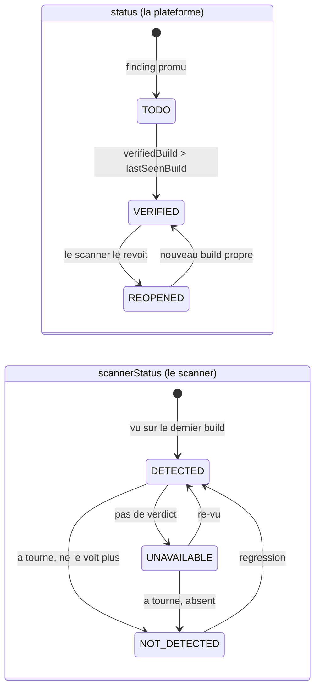
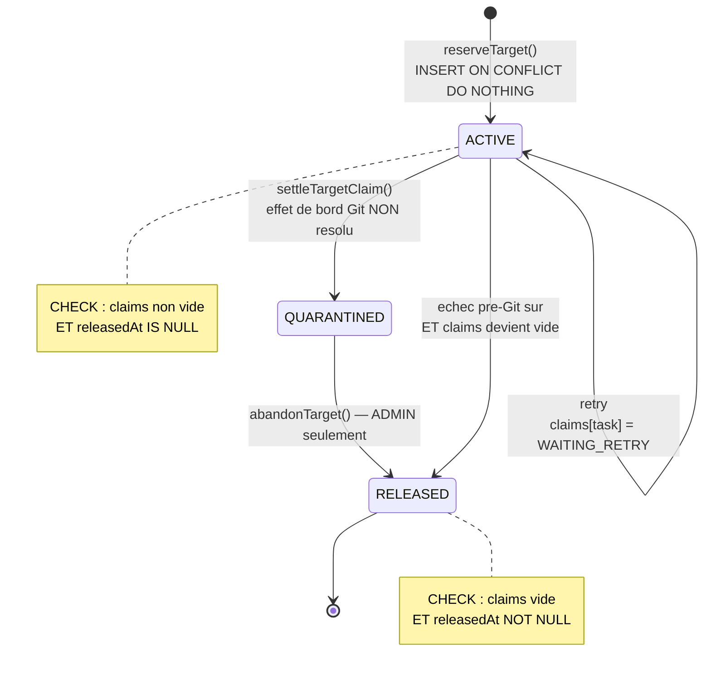
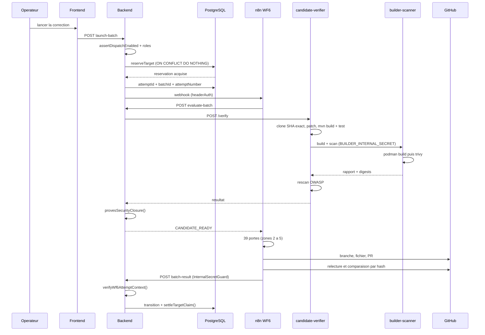
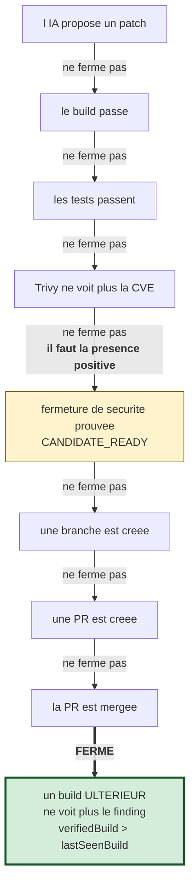

# 11 — CYCLE DE VIE COMPLET DE LA REMÉDIATION

De la détection à la fermeture, étape par étape, avec à chaque fois : le composant, le
fichier, la table et l'identifiant.

---

## 1. Le scénario numéroté

### Étape 1 — Un scanner détecte

| | |
|---|---|
| **Composant** | Jenkins (pipeline), Trivy / OWASP / Sonar / ZAP |
| **Résultat** | un rapport |
| **Table** | `reports` (`rawData`) |
| **Identifiant** | `projectId` + `buildNumber` |

### Étape 2 — Le backend ingère et normalise

| | |
|---|---|
| **Composant** | backend |
| **Fichier** | `webhooks/webhooks.service.ts` → `handleJenkins()` ; `common/report-normalizer.ts` |
| **Entrée** | corps du webhook Jenkins |
| **Sortie** | un `incident` ; `metadata.sourceCommitSha` = **commit de confiance** |
| **Table** | `incidents` |
| **Si échec** | rien n'est créé ; le build reste visible côté Jenkins |

### Étape 3 — Les findings sont promus en tâches

| | |
|---|---|
| **Fichier** | `manual-remediation/manual-remediation.service.ts` → `syncIncident()` (ligne 215) |
| **Mécanisme** | calcul de `findingFingerprint`, puis insertion idempotente |
| **Table** | `manual_remediation_tasks` — `UNIQUE (projectId, findingFingerprint)` |
| **État initial** | `status = TODO`, `scannerStatus = DETECTED` |
| **Pourquoi** | rejouer dix builds ne crée pas dix tâches : **la base refuse le doublon** |

### Étape 4 — Un opérateur demande la correction

| | |
|---|---|
| **Composant** | frontend, onglet Sécurité |
| **Appel** | `POST /api/manual-remediation/launch-batch` (ou équivalent de lot) |
| **Backend** | `launchBatchRemediation()` (ligne 472) |
| **Contrôle 1** | `assertSecurityRemediationDispatchEnabled()` → **503** si le dispatch est gelé |
| **Contrôle 2** | rôle `developer`/`admin` ; `admin` seul si `remediationType = ADMIN_ACTION_REQUIRED` |

### Étape 5 — La cible est résolue

| | |
|---|---|
| **Fichier** | `manual-remediation/remediation-target-reservation.ts` |
| **Fonctions** | `productionTarget()` → `canonicalTarget()` → `normalizeTargetFile()` |
| **Sortie** | `targetKey = ["v1","FILE","pom.xml"]` |
| **Refus possibles** | `REMEDIATION_TARGET_PATH_INVALID`, `…_PROJECT_INVALID`, `…_COORDINATE_INVALID` |

### Étape 6 — La réservation est acquise (écrivain unique)

| | |
|---|---|
| **Fonction** | `reserveTarget()` |
| **SQL** | `INSERT … ON CONFLICT ("projectId","targetKey") WHERE state='ACTIVE' DO NOTHING` puis `SELECT … FOR UPDATE` |
| **Table** | `remediation_target_reservations` |
| **Si déjà pris** | `409 REMEDIATION_TARGET_ALREADY_IN_PROGRESS` / `status: TARGET_BUSY`, message *« Correction déjà en cours sur le même fichier de dépendances »* |

### Étape 7 — La tentative est créée

| | |
|---|---|
| **Sortie** | `attemptId` (nouveau), `attemptNumber` (incrémenté **une fois**), `batchId` (nouveau) |
| **Borne** | `MAX_AUTOMATIC_ATTEMPTS = 3`, surchargeable par `SECURITY_REMEDIATION_MAX_ATTEMPTS` ∈ 1…3 |
| **Liaison** | `bindTargetAttempt()` inscrit `{attemptId, batchId, status:'DISPATCHING'}` dans `claims[taskId]` |
| **Transaction** | étapes 5-7 dans **une seule** transaction ; le dispatch HTTP vient **après** le commit |

### Étape 8 — WF6 est déclenché

| | |
|---|---|
| **Transport** | `POST http://n8n:5678/webhook/wf6-security-remediation-evaluate` |
| **Authentification** | `headerAuth` (credential `httpHeaderAuth`) |
| **Charge utile** | `projectId`, `taskId`(s), `attemptId`, `attemptNumber`, `batchId`, dépôt, SHA de base |
| **Si échec** | `DISPATCH_FAILED`, **rejouable** |

### Étape 9 — WF6 délègue l'évaluation

| | |
|---|---|
| **Zone WF6** | Zone 1 (7 nœuds) |
| **Appel** | `POST /api/internal/security-remediation/evaluate-batch` (garde `InternalSecretGuard`) |
| **Point clé** | un **seul** appel couvre bump de version + build + scan |

### Étape 10 — Le candidat est matérialisé et construit

| | |
|---|---|
| **Composant** | `candidate-verifier` |
| **Étapes réelles** | clone au **SHA exact** → espace jetable → application du patch → `mvn` compile → `mvn` test → empaquetage |
| **Garde** | `trackedSourceDigest()` refuse un fichier non régulier (`NON_REGULAR_SOURCE_FILE`) et un dépôt sans source suivie (`NO_TRACKED_SOURCE`) |
| **Si dépassement** | `VERIFIER_TIMEOUT` → **rejouable** |

### Étape 11 — L'image est construite et scannée par Trivy

| | |
|---|---|
| **Composant** | `builder-scanner` (**seul** à exécuter podman/trivy) |
| **Authentification** | `BUILDER_INTERNAL_SECRET`, *fail-closed* |
| **Sortie** | `artifactDigest`, `reportDigest`, `scannerVersion`, rapport JSON |

### Étape 12 — OWASP rescanne le candidat

| | |
|---|---|
| **Composant** | `candidate-verifier` (`owasp-rescan.ts`) |
| **Sortie** | `newHighCriticalCount` ; **`null` = non exécuté**, jamais « 0 problème » |

### Étape 13 — La fermeture de sécurité est jugée

| | |
|---|---|
| **Fichier** | `security-remediation/security-artifact-scan.ts` |
| **Fonction** | `provesSecurityClosure(scan, scope)` |
| **Exigences** | CVE cible absente **et** paquet présent à la version corrigée |
| **Verdict** | `CANDIDATE_READY` ou un échec **nommé** |

### Étape 14 — WF6 franchit (ou non) la barrière pré-Git

| | |
|---|---|
| **Zones** | 2 → 5, **39 portes** |
| **Dernières portes** | `Revalidate Before Write` → `Fresh Candidate Matches` → `Write Authorized?` |
| **Si une porte refuse** | enveloppe d'échec nommée → Zone 7, **aucune écriture** |

### Étape 15 — Git est touché (et relu)

| | |
|---|---|
| **Nœuds** | `Create Missing Branch`, `Write File To Branch`, `Create Pull Request` |
| **Vérification** | Zone 4 (38 nœuds) recalcule **par hash** que GitHub contient exactement le prévu |
| **Compensation** | `Close Drifted Created PR` si la PR dérive |

### Étape 16 — Le callback revient au backend

| | |
|---|---|
| **Route** | `POST /api/internal/security-remediation/batch-result` |
| **Garde** | `InternalSecretGuard` |
| **Backend** | `recordWf6BatchResult()` (ligne 666) |
| **Validation** | `verifyWf6AttemptContext()` vérifie `(projectId, taskIds, batchId)` |
| **Idempotence** | `completionDigest` neutralise un doublon |

### Étape 17 — Transition d'état et règlement de la réservation

| | |
|---|---|
| **Fonction** | `settleTargetClaim()` |
| **Trois issues** | `QUARANTINED` si effet Git non résolu ; `WAITING_RETRY` si rejouable ; libération si échec pré-Git **sûr** |
| **Libération** | `releaseTargetClaim()` ; `RELEASED` **seulement** quand `claims` devient vide |

### Étape 18 — Fermeture réelle

| | |
|---|---|
| **Qui ferme** | **un build ultérieur**, pas la plateforme |
| **Preuve** | `verifiedBuild > lastSeenBuild` + `verifiedAt` |
| **Effet** | `status = VERIFIED`, `scannerStatus = NOT_DETECTED` |

**C'est l'étape la plus importante conceptuellement** : la plateforme ne se décerne pas
le succès. Elle propose une correction ; c'est un **scan ultérieur indépendant** qui
constate que le finding a disparu.

---

## 2. Machines à états réelles *(PART 19)*

### Tâche — `manual_remediation_tasks.status`

| État | Signification | Entré quand | Suivants | Terminal ? |
|---|---|---|---|---|
| `TODO` | à traiter | création depuis un finding | `VERIFIED` | non |
| `VERIFIED` | traité **et** prouvé par un build ultérieur | `verifiedBuild > lastSeenBuild` | `REOPENED` | oui (révocable) |
| `REOPENED` | réapparu après vérification | le scanner le revoit | `VERIFIED` | non |

### Scanner — `manual_remediation_tasks.scannerStatus`

| État | Signification |
|---|---|
| `DETECTED` | le scanner voit le finding sur le dernier build |
| `NOT_DETECTED` | le scanner a tourné et ne le voit plus |
| `UNAVAILABLE` | **le scanner n'a pas fourni de verdict** — ni bon, ni mauvais |

`UNAVAILABLE` est l'état le plus important : il refuse de choisir. 470 lignes sur 777
sont dans cet état.

### Tentative — `attempts[].status`

| État | Rejouable ? | Sens |
|---|---|---|
| `DISPATCHING` | — | envoyée à WF6, en cours |
| `CANDIDATE_READY` | non | candidat prouvé |
| `TECHNICAL_FAILURE` | **oui** | `VERIFIER_TIMEOUT`, réseau, etc. |
| `EVALUATION_FAILED` | selon le motif | l'évaluation a échoué |
| `INVALID_CANDIDATE` | non | candidat structurellement invalide |
| `CANDIDATE_DRIFTED` | non | la base a bougé |
| `STILL_OPEN` | non | la CVE reste ouverte dans le candidat |
| `CLOSED` | non | clôturée |
| `PROJECT_VERIFIED` | non | projet vérifié |
| `OPERATOR_TEST_STOPPED` | **non** | arrêt opérateur |
| `ADMIN_ABANDONED` | non | abandon administrateur |
| `DISPATCH_FAILED` | **oui** | WF6 injoignable |

### Réservation — `remediation_target_reservations.state`

| État | Signification | Contrainte associée |
|---|---|---|
| `ACTIVE` | un écrivain détient la cible | `claims <> '{}'` **et** `releasedAt IS NULL` |
| `RELEASED` | libérée | `claims = '{}'` **et** `releasedAt IS NOT NULL` |

Seuls deux états, et **PostgreSQL rend toute combinaison incohérente impossible**.

Statuts de revendication dans `claims[taskId].status` : `RESERVED` → `DISPATCHING` →
puis `WAITING_RETRY` (rejouable), `QUARANTINED` (effet Git non résolu), ou retrait.

### Schéma — machine à états de la tâche et du scanner

**Lecture.** Les deux machines tournent **en parallèle et indépendamment**. C'est
exactement pourquoi il faut deux colonnes : `VERIFIED` + `UNAVAILABLE` est un état
parfaitement légitime (traité, prouvé par un build, mais le scanner est actuellement
muet). Un seul champ rendrait cet état inexprimable, et obligerait à mentir dans un sens
ou dans l'autre.

### Schéma — machine à états de la réservation

**Lecture.** `QUARANTINED` n'est pas un `state` de la colonne — c'est un statut de
*claim* à l'intérieur d'une réservation qui reste `ACTIVE`. Le schéma le montre comme
une impasse volontaire : dès qu'une branche ou une PR existe sans être réconciliée, la
cible reste bloquée jusqu'à une intervention administrateur. Mieux vaut bloquer que
reprendre à l'aveugle sur un état Git inconnu.

### Autorisation de déploiement — `deployment_authorizations.status`

| État | Entré quand | Terminal ? |
|---|---|---|
| `CREATED` | autorisation accordée | non |
| `CONSUMED` | un dispatch l'a réservée | **oui** |
| `EXPIRED` | TTL dépassé au moment de la consommation | **oui** |
| `REVOKED` | révoquée | **oui** |

### Tentative de déploiement — `deployment_attempts.dispatchStatus`

| État | Entré quand | Terminal ? |
|---|---|---|
| `DISPATCHING` | réservation effectuée | non |
| `DEPLOYED` | `classifyAgentDeploymentResult()` ⇒ `success && healthOk` | oui |
| `FAILED` | tout le reste | oui |

---

## 3. Diagramme de séquence Mermaid

---

## 4. Ce qui *ne* ferme *pas* une vulnérabilité

| Événement | Ferme la vulnérabilité ? | Pourquoi |
|---|---|---|
| Le LLM propose un patch | **non** | une proposition n'est pas une preuve |
| Le build passe | **non** | compiler ne corrige pas une CVE |
| Les tests passent | **non** | idem |
| Trivy ne voit plus la CVE | **non, pas seul** | il faut la **présence positive** du paquet corrigé |
| Une branche est créée | **non** | aucun contenu validé n'en découle |
| Une PR est créée | **non** | une PR est une **proposition** |
| La PR est mergée | **non** | il faut un scan ultérieur |
| **Un build ultérieur ne voit plus le finding** | **oui** | `verifiedBuild > lastSeenBuild` |

### Schéma — l'échelle de ce qui ferme (et ce qui ne ferme pas)

**Lecture.** Huit étapes qui ne ferment rien, une seule qui ferme. Le point de bascule
n'est ni la validation, ni la PR, ni le merge : c'est une **mesure indépendante
ultérieure**. La plateforme ne se décerne jamais son propre succès.

Ce tableau est probablement la meilleure réponse courte à la question
« comment savez-vous que c'est vraiment corrigé ? ».
