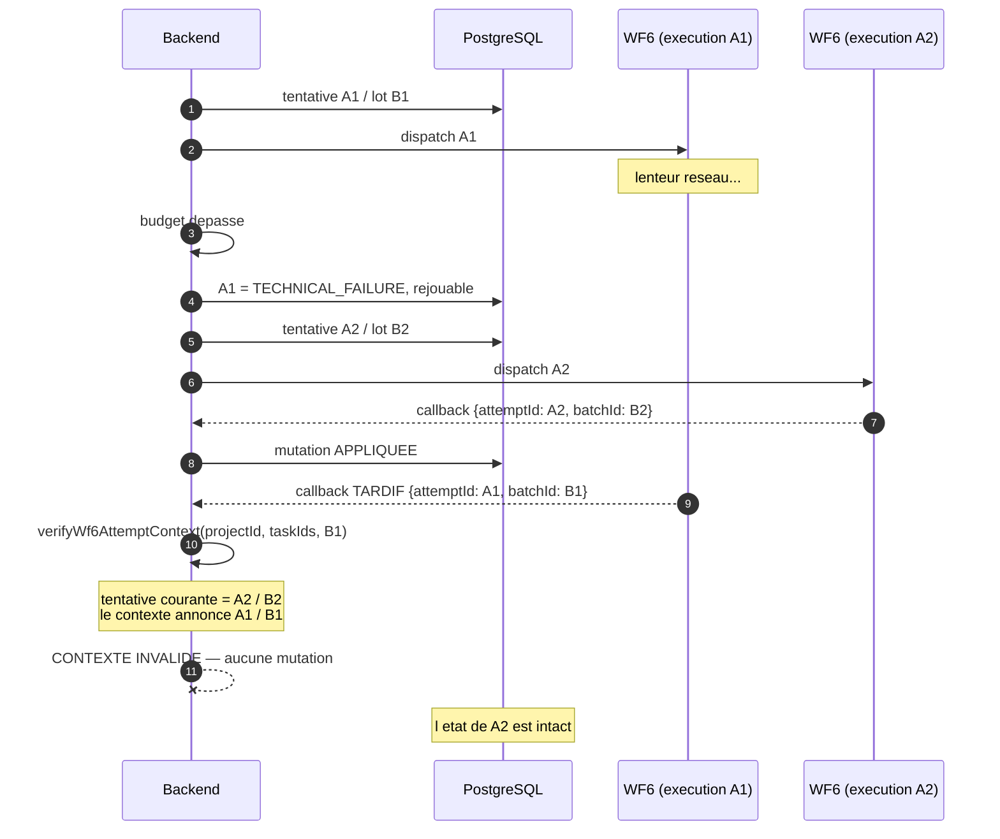
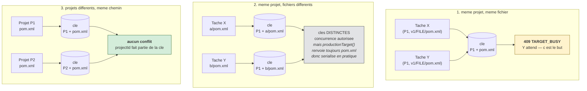
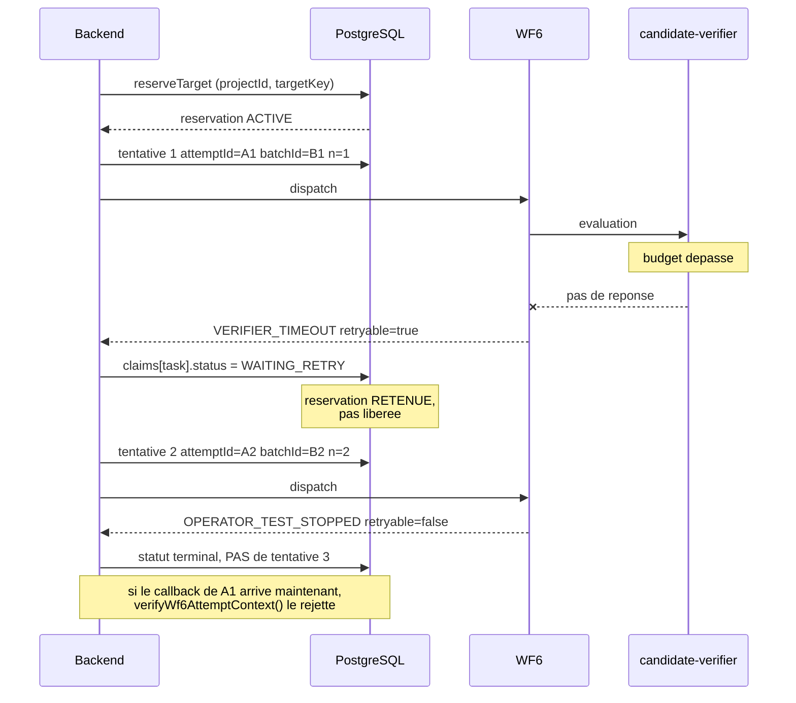
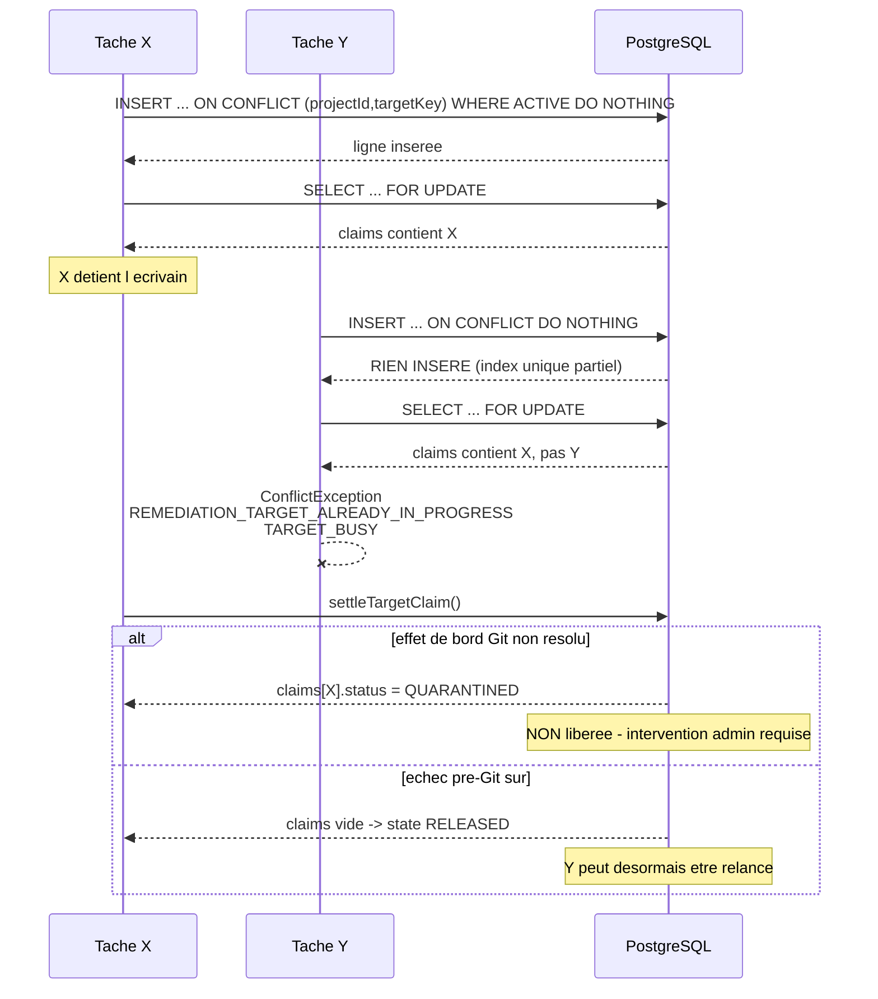

# 12 — RETRY, CONCURRENCE ET IDEMPOTENCE

Trois problèmes distribués classiques, trois réponses précises dans le code.

---

## 1. Le retry *(PART 20)*

### Pourquoi le retry existe

Une remédiation traverse une dizaine de composants. Certains échecs sont des **verdicts**
(« ce candidat ne corrige pas la CVE »), d'autres sont des **accidents** (« le
vérificateur n'a pas répondu à temps »). Confondre les deux, c'est soit abandonner une
correction valable, soit boucler indéfiniment sur un candidat mauvais.

### La règle

| Catégorie | Exemples | Rejouable ? |
|---|---|---|
| **Échec technique** | `VERIFIER_TIMEOUT`, `DISPATCH_FAILED`, `AGENT_TRANSPORT_FAILED` | **oui** |
| **Verdict métier** | `INVALID_CANDIDATE`, `STILL_OPEN`, `TARGET_CVE_STILL_OPEN_AFTER_PATCH`, `APPLICATION_TESTS_FAILED`, `MAVEN_RESOLUTION_MISMATCH` | **non** |
| **Décision humaine** | `OPERATOR_TEST_STOPPED`, `ADMIN_ABANDONED` | **non** |
| **Dérive** | `CANDIDATE_DRIFTED` | non (il faut réévaluer) |

La liste des échecs **pré-Git sûrs à libérer** est explicite dans
`remediation-target-reservation.ts` :

```ts
const preGitFinalFailures = new Set([
  'APPLICATION_TESTS_FAILED','APPLICATION_TESTS_NOT_EXECUTED',
  'MAVEN_RESOLUTION_MISMATCH','TARGET_CVE_STILL_OPEN_AFTER_PATCH',
  'TARGET_CVE_NEVER_OBSERVED_IN_BASELINE','INVALID_CANDIDATE',
  'MAVEN_MUTATED_CANDIDATE_SOURCE']);
```

**C'est une liste blanche, pas une liste noire.** Un code d'échec inconnu n'est donc
*pas* considéré comme sûr : il mène à la quarantaine. C'est la bonne orientation du
défaut.

### Les bornes

```ts
export const MAX_AUTOMATIC_ATTEMPTS = 3;

export function maxAutomaticAttempts(): number {
  const configured = process.env.SECURITY_REMEDIATION_MAX_ATTEMPTS;
  if (configured === undefined) return MAX_AUTOMATIC_ATTEMPTS;
  if (!/^[1-3]$/.test(configured))
    throw new ServiceUnavailableException('La limite de tentatives automatiques est invalide.');
  return Number(configured);
}
```

Deux détails de qualité : la surcharge est **bornée à 1–3** (on ne peut pas mettre 99), et
une valeur invalide **refuse de servir** au lieu de retomber silencieusement sur un défaut.

### Ce que change une nouvelle tentative

| Élément | Comportement |
|---|---|
| `attemptId` | **nouveau** (uuid) |
| `batchId` | **nouveau** |
| `attemptNumber` | incrémenté **exactement une fois** |
| réservation | **retenue** (claim passe à `WAITING_RETRY`), pas relâchée |
| tentative précédente | **conservée** dans `attempts[]` |

**Pourquoi retenir la réservation ?** Parce que relâcher puis réacquérir ouvrirait une
fenêtre dans laquelle une autre tâche pourrait prendre la cible entre deux tentatives
d'un même lot. Le commentaire du code le dit : *« Existing multi-finding batches share
one writer. Their retries must also be serialized »*.

### Séquence concrète, vérifiée sur données réelles

Tâche `a390e383-42b7-4348-894c-5e02a7e5f98d` :

```
t0  tentative 1 : attemptId 93c68aed…  batchId sec-batch-61727477…
    -> TECHNICAL_FAILURE / VERIFIER_TIMEOUT / retryable = true
       claims[taskId].status = WAITING_RETRY        (reservation RETENUE)

t1  tentative 2 : attemptId 39c77b06…  batchId sec-batch-4e6f6ec2…   (identites NEUVES)
    -> OPERATOR_TEST_STOPPED / retryable = false
       status terminal, pas de tentative 3

Etat final : task.status = TODO  ·  scannerStatus = DETECTED
             securityRemediationBatchId = sec-batch-4e6f6ec2…  (le lot COURANT)
```

Cette seule ligne de base prouve cinq invariants : identité unique par tentative, lot
neuf à chaque retry, incrément unique, retry sur échec technique, **absence** de retry
sur échec non rejouable. C'est l'exemple à citer en soutenance.

### Retry manuel

`retrySecurityRemediation(taskId, { expectedAttemptId }, user)` (ligne 464) exige
`expectedAttemptId` : l'opérateur doit déclarer **quelle** tentative il croit rejouer.
Si une autre tentative a démarré entre-temps, la demande est refusée. C'est un
verrouillage optimiste appliqué à une action humaine.

---

## 2. Les callbacks périmés et dupliqués *(PART 21)*

### Le problème, posé proprement

```
t0   Tentative A1 part vers WF6
t1   A1 depasse son budget -> le backend la marque TECHNICAL_FAILURE, rejouable
t2   Tentative A2 part
t3   Le callback de A1 arrive ENFIN (le reseau avait juste du retard)
```

Sans protection, le callback de A1 écrase l'état de A2 : **une tentative morte corrompt
une tentative vivante**. C'est le bug distribué classique, et il est silencieux.

### Schéma — le callback périmé, et pourquoi il est inoffensif



**Lecture.** Les deux dernières étapes sont le cœur du mécanisme. Le callback de A1 est
**authentique** — il passe la garde `InternalSecretGuard` sans problème. Ce n'est pas un
problème d'authentification mais de **fraîcheur**. La protection ne consiste donc pas à
refuser l'appelant, mais à comparer l'identité annoncée à l'identité courante. Deux
dimensions sont comparées (`attemptId` **et** `batchId`), ce qui rend l'erreur
pratiquement impossible à produire par hasard.

### La protection réellement implémentée

**Trois couches :**

1. **Identité par tentative.** Le callback annonce `attemptId = A1`. Le backend sait que
   la tentative courante est A2 : l'écriture est refusée.
2. **Identité par lot.** `batchId` diffère aussi (B1 ≠ B2). Deux dimensions
   indépendantes pour détecter la péremption.
3. **Vérification explicite.** `verifyWf6AttemptContext(projectId, findingTaskIds, batchId, …)`
   (ligne 413) valide le contexte **avant** toute mutation, et
   `verifyWf6TargetOwnership(projectId, ids, modern)` (ligne 427) vérifie que l'appelant
   détient encore la cible.

### Le callback dupliqué

Cas différent : **même** tentative, livré **deux fois** (retry réseau de n8n).
Ici il ne faut pas refuser — il faut être **idempotent**. Le mécanisme est
`completionDigest` sur la tentative : le second callback est reconnu comme déjà traité et
ne produit aucun effet supplémentaire.

### Le choix du contrat de callback

```ts
export function callbackContract(payload): 1 | 2 {
  // Any partial modern identity selects v2. It can never fall back to v1.
  return [payload, ...(payload.findings || [])]
    .some(f => f.attemptId !== undefined || f.attemptNumber !== undefined) ? 2 : 1;
}
```

À savoir expliquer : dès qu'une **parcelle** d'identité moderne est présente, le contrat
v2 est choisi, et le commentaire insiste — *« It can never fall back to v1 »*. La
compatibilité avec l'ancien format existe, mais elle ne peut pas être exploitée pour
**contourner** les contrôles modernes en omettant un champ.

---

## 3. L'écrivain unique — Phase 4G *(PART 22)*

### Pourquoi, depuis les premiers principes

Deux CVE différentes peuvent toucher le **même** `pom.xml`. Si deux remédiations
s'exécutent en parallèle :

```
Remediation A lit pom.xml (v1)      Remediation B lit pom.xml (v1)
A ecrit pom.xml (v1 + correctif A)
                                     B ecrit pom.xml (v1 + correctif B)
                                     -> le correctif A est ECRASE
```

Résultat : une PR qui prétend corriger A alors que le correctif A a disparu. Pire : Trivy
avait validé A sur un candidat qui n'existe plus. **La preuve devient fausse.**

La solution n'est pas « faire attention » mais **empêcher structurellement** le cas.

### La clé de propriété

```
(projectId normalisé en minuscules, targetKey)
   où targetKey = JSON.stringify(['v1', 'FILE', trustedTargetPath])
```

Trois composantes : **projet**, **type de cible** (`FILE`), **chemin de confiance**.

Le chemin passe par `normalizeTargetFile()`, qui **rejette** plutôt que de normaliser :

```ts
if (typeof value !== 'string' || value.length > 512
  || !/^[A-Za-z0-9_.-]+(?:\/[A-Za-z0-9_.-]+)*$/.test(value)
  || value.split('/').some(s => s === '.' || s === '..' || s.toLowerCase() === '.git'))
  throw new ConflictException('REMEDIATION_TARGET_PATH_INVALID');
```

Commentaire du code : *« Reject aliases rather than silently collapse them. Git paths are
case-sensitive. »* Deux chemins qui *paraissent* identiques ne doivent pas se faire
passer pour la même cible.

### La contrainte, du côté de la base

```sql
CREATE UNIQUE INDEX remediation_target_one_active
  ON remediation_target_reservations ("projectId","targetKey")
  WHERE state = 'ACTIVE';
```

**L'invariant est garanti par PostgreSQL, pas par du code applicatif.** Même deux
processus backend concurrents, dans deux transactions, sur deux connexions, ne peuvent
pas créer deux propriétaires actifs.

### L'acquisition

```ts
await tx.query(`INSERT INTO remediation_target_reservations (…)
  VALUES (…) ON CONFLICT ("projectId","targetKey") WHERE state='ACTIVE' DO NOTHING`);
const [reservation] = await tx.query(`SELECT * FROM remediation_target_reservations
  WHERE "projectId"=$1 AND "targetKey"=$2 AND state='ACTIVE' FOR UPDATE`, […]);
if (!reservation || taskIds.some(id => !hasOwnProperty(reservation.claims, id)) ||
    Object.entries(reservation.claims).some(([id, claim]) =>
      !taskIds.includes(id) && claim.status !== 'WAITING_RETRY'))
  throw new ConflictException({ code: 'REMEDIATION_TARGET_ALREADY_IN_PROGRESS', … });
```

Trois temps à expliquer : `DO NOTHING` (pas d'erreur si quelqu'un a déjà la cible),
`FOR UPDATE` (verrou de ligne pour la suite de la transaction), puis **vérification que
nos tâches sont bien dans `claims`**. Ce n'est pas parce que l'insertion n'a pas levé
d'erreur que nous sommes propriétaires : il faut le constater.

### Les transitions

| Fonction | Effet |
|---|---|
| `bindTargetAttempt()` | inscrit `{attemptId, batchId, status:'DISPATCHING'}` dans `claims[taskId]` |
| `settleTargetClaim()` | **décide** : quarantaine, attente de retry, ou libération |
| `releaseTargetClaim()` | retire la revendication ; `RELEASED` **seulement** si `claims` devient vide |
| `safeTerminalTargetRelease()` | liste blanche des échecs pré-Git sûrs |

### `settleTargetClaim()` — la fonction la plus prudente du projet

```ts
const effects = r.unresolvedGitSideEffect || r.prUrl || r.prNumber || r.branchName ||
  (r.attempts||[]).some(a => a.unresolvedGitSideEffect || a.prUrl || a.prNumber || a.branchName);
if (effects || r.retryable || ['DISPATCHING','CANDIDATE_READY','CLOSED','PROJECT_VERIFIED'].includes(r.status)
    || !r.finishedAt || !safeTerminalTargetRelease(r)) {
  const status = effects || (!r.retryable && !safeTerminalTargetRelease(r)) ? 'QUARANTINED'
               : r.retryable ? 'WAITING_RETRY' : r.status;
  // … on NE libere PAS
}
```

**La règle** : s'il existe **le moindre** effet de bord Git non résolu — une branche, un
numéro de PR, une URL de PR, sur la tentative courante **ou n'importe quelle tentative
passée** — la réservation passe en **`QUARANTINED`** et n'est **pas** libérée.

Pourquoi : si une branche a été créée puis que le processus a échoué, libérer la cible
laisserait une autre remédiation écrire par-dessus un état Git inconnu. Mieux vaut
bloquer et demander une intervention (`abandonTarget()`, réservé à l'admin) que de
reprendre à l'aveugle.

### Schéma — les trois scénarios de concurrence



**Lecture.** Le troisième cas est celui qui **prouve** que la conception est
multi-projet : deux projets ne se bloquent jamais, même sur un chemin de fichier
identique, parce que `projectId` est dans la clé. Le deuxième cas montre la limitation
assumée : la clé *permettrait* la concurrence, mais le résolveur de la branche de travail
renvoie toujours `pom.xml`. Sur-sérialiser est **sûr** ; c'est sous-sérialiser qui
corromprait la preuve.

### Les trois scénarios de concurrence

| Scénario | Clés | Résultat | Correct ? |
|---|---|---|---|
| **Même projet, même fichier** | `(P1, ["v1","FILE","pom.xml"])` × 2 | le second reçoit `409 TARGET_BUSY` | **oui** — c'est le but |
| **Même projet, fichiers différents** | `(P1, …"a/pom.xml")` vs `(P1, …"b/pom.xml")` | concurrence autorisée **par la clé** ; mais `productionTarget()` renvoie toujours `'pom.xml'`, donc en pratique sérialisé | **sûr**, trop prudent (voir `38`) |
| **Projets différents, même chemin** | `(P1, …"pom.xml")` vs `(P2, …"pom.xml")` | **concurrence autorisée** | **oui** — `projectId` fait partie de la clé |

Le troisième cas est celui qui prouve que la conception est multi-projet : deux projets
distincts ne se bloquent jamais, même sur un chemin de fichier identique.

### Détection des réservations bloquées

`staleTargets(user)` (ligne 825) s'appuie sur l'index partiel
`remediation_target_stale ON ("updatedAt") WHERE state='ACTIVE'`, et
`reconcileStaleWf6Dispatch()` (ligne 724, **admin**) permet de réconcilier un dispatch
resté en vol.

---

## 4. L'idempotence du déploiement

Le même raisonnement, appliqué au déploiement Azure.

| Mécanisme | Implémentation |
|---|---|
| Clé d'idempotence | `requestId`, fourni par l'appelant |
| Détection du rejeu | `if (existing?.requestId === input.requestId) return { ok: true, duplicate: true, existingState }` |
| Verrous | pessimistes, **toujours dans le même ordre** : autorisation **puis** projet |
| Usage unique | `status !== 'CREATED'` ⇒ `DEPLOY_AUTHORIZATION_<status>` |
| Anti-dérive | recalcul et comparaison à l'instantané gelé |
| Concurrence prouvée | gate PostgreSQL réelle : deux processus, deux backends PG distincts ⇒ **une seule** consommation, **une seule** ligne `deployment_attempts` |

**L'ordre de verrouillage constant est essentiel** : verrouiller toujours l'autorisation
puis le projet élimine la possibilité d'un interblocage entre deux dispatches.

### L'enveloppe de rejeu

Un rejeu renvoie `{ duplicate: true, ...azureDeploymentState }`, qui porte `status`
(`DISPATCHING` | `DEPLOYED` | `FAILED`) et **pas** de champ `success`. Un client qui
lirait `success` conclurait donc à tort à un échec sur un déploiement réellement réussi.
Le frontend traite cette enveloppe **sur ses propres termes** (voir `14` §7).

---

## Diagramme — séquence de retry



**Lecture.** Deux choses à remarquer. La réservation est **retenue** entre les deux
tentatives (sinon une autre tâche pourrait prendre la cible). Et l'identité change
**entièrement** à chaque tentative, ce qui rend inoffensif un callback tardif de A1.

---

## Diagramme — séquence de réservation (écrivain unique)



**Lecture.** Le point essentiel est que l'insertion qui « ne fait rien » ne suffit pas :
il faut **ensuite constater** que nos tâches sont bien dans `claims`. Ne pas avoir reçu
d'erreur n'est pas une preuve de propriété.
