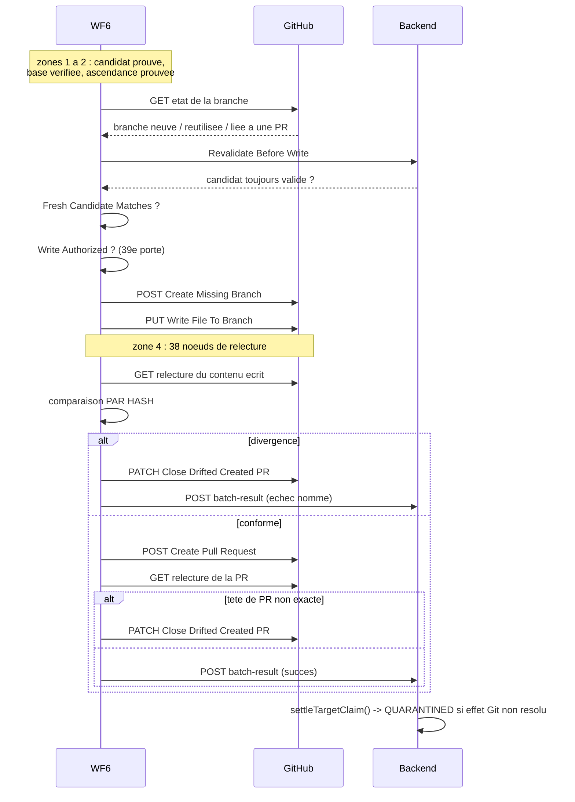

# 13 — INTÉGRATION GIT / GITHUB

---

## 1. Le principe : le backend détient le jeton mais n'écrit jamais

Fait vérifié : **aucun chemin de code backend ne crée de branche, de commit ou de Pull
Request.** Toutes les mutations GitHub vivent dans n8n.

Pourquoi c'est une bonne conception : la **capacité** d'écrire est séparée de
l'**autorité** de décider. Pour auditer la sûreté Git de la plateforme, il suffit
d'examiner **14 nœuds** répartis sur 4 workflows, pas 217 fichiers de runtime.

---

## 2. Inventaire complet des écrivains Git

> **Correction importante.** Une première version de ce document ne recensait que 6 nœuds
> mutants (4 dans WF6, 2 dans WF2). Une vérification systématique de **tous** les
> workflows publiés en donne **14**, répartis sur **quatre** workflows. WF4 et WF5
> écrivent eux aussi dans GitHub, et WF2 en a 4 et non 2 (deux de ses écritures passent
> par le nœud natif `github` avec les opérations `edit` et `create`, et non par une URL
> `api.github.com`, ce qui les rendait invisibles à une recherche par URL).

### Les 14 nœuds mutants des workflows publiés

| WF | Nœud | Type d'écriture | Rôle |
|---|---|---|---|
| **WF6** | `Create Missing Branch` | `POST` git/refs | créer la branche |
| **WF6** | `Write File To Branch` | `PUT` contents | écrire le `pom.xml` patché |
| **WF6** | `Create Pull Request` | `POST` pulls | ouvrir la PR |
| **WF6** | `Close Drifted Created PR` | `PATCH` pulls | **compensation** si dérive |
| **WF2** | `Create Missing Branch` | `POST` git/refs | créer la branche |
| **WF2** | `Create File in Branch` | nœud `github` · `create` | créer un fichier |
| **WF2** | `Update File in Branch` | nœud `github` · `edit` | modifier un fichier |
| **WF2** | `Create Pull Request1` | `POST` pulls | ouvrir la PR |
| **WF4** | `Create Branch` | `POST` git/refs | créer la branche |
| **WF4** | `Commit Jenkinsfile` | nœud `github` · `edit` | commiter le Jenkinsfile |
| **WF4** | `Create Pull Request` | `POST` pulls | ouvrir la PR |
| **WF5** | `Create Branch (Docker)` | `POST` git/refs | créer la branche |
| **WF5** | `Commit Dockerfile` | nœud `github` · `edit` | commiter le Dockerfile |
| **WF5** | `Create Pull Request (Docker)` | `POST` pulls | ouvrir la PR |

### Les préconditions, par workflow

| Workflow | Objet écrit | Portes avant écriture | Autorisation backend |
|---|---|---|---|
| **WF6** | `pom.xml` (CVE) | **39 portes**, dont `Revalidate Before Write` → `Fresh Candidate Matches` → `Write Authorized?` | oui — l'évaluation vient du backend |
| **WF2** | fichiers de code (incident) | plan LLM + 2 revues sémantiques + `verify` ×4 + `write-guard` + `remote-head-drift` + **`Pre-Git Cancellation Gate`** | oui — `write-guard` et la porte d'annulation |
| **WF4** | `Jenkinsfile` | `Input Valid?` → agent → `Apply Input Valid?` → **`Authorize Backend Approval`** → `PR Input Valid?` | oui — `Authorize Backend Approval` |
| **WF5** | `Dockerfile` | `Input Valid?` → `Runtime Coherence Checker` → agent → **`Apply Gate — Docker Déterministe`** → `Apply Gate OK ?` → `PR Input Valid?` | oui — `Authorize Backend Approval` |

### Ce que cette correction ne change pas

Le principe architectural tient toujours, et c'est l'essentiel :

- **aucun chemin backend n'écrit dans Git** — les 14 nœuds sont tous dans n8n ;
- **chacun des quatre workflows a sa propre porte déterministe** avant d'écrire. WF5 est
  explicite sur ce point : son nœud s'appelle littéralement
  `Apply Gate — Docker Déterministe`, suivi d'un `Apply Gate OK ?` ;
- **chacun exige une autorisation backend** avant la phase d'application
  (`Authorize Backend Approval` pour WF4/WF5, `write-guard` pour WF2, l'évaluation
  complète pour WF6).

### Ce que cette correction change

| Avant | Après |
|---|---|
| « 6 nœuds mutants, dans 2 workflows » | **14 nœuds mutants, dans 4 workflows** |
| « les deux seules flèches qui écrivent à l'extérieur » | **cinq** : WF2, WF4, WF5, WF6 → GitHub, et l'agent → Azure |
| WF4/WF5 présentés comme de simples « optimiseurs » | ce sont aussi des **écrivains Git**, avec leur propre barrière |

**La leçon méthodologique**, qui vaut d'être dite en soutenance : chercher les écritures
GitHub par l'URL `api.github.com` est insuffisant, parce que n8n propose un **nœud natif
`github`** dont l'URL n'apparaît pas dans les paramètres. Il faut chercher **à la fois**
les URL et les nœuds de type `github` dont l'`operation` est `edit`, `create` ou
`delete`. C'est précisément ce qui avait masqué 8 des 14 écrivains.

### Les écrivains inactifs

| Workflow | Nœuds | État |
|---|---|---|
| `DEBUG-create-pr-only` (`PRCreateProbe0001`) | 6 nœuds, crée une PR **sans aucune porte** | **inactif** — à supprimer |

## 3. La barrière pré-Git de WF6, en détail## 3. La barrière pré-Git de WF6, en détail

Chemin le plus court du webhook jusqu'à la première mutation GitHub — **39 sauts** :

```
 0  Webhook - Security Remediation Request
 1  Evaluate Security Remediation                 (appel backend evaluate-batch)
 2  Evaluation HTTP OK?
 3  Evaluation Not Technical Failure?             <- separe accident et verdict
 4  Candidate Ready?
 5  Trusted Candidate
 6  Trusted Candidate Valid?
 7  Verify Base Commit Still Exists               <- le depot a-t-il bouge ?
 8  Verify Base Commit Still Exists OK?
 9  Base SHA Resolvable?
10  Initial Repository Metadata
11  Initial Repository Metadata OK?
12  Initial Trusted Default Branch
13  Initial Default Branch Valid?
14  Initial Default Branch Head
15  Initial Default Branch Head OK?
16  Initial Head Valid?
17  Initial Compare Ancestry                      <- la base est-elle un ancetre ?
18  Initial Compare Ancestry OK?
19  Initial Ancestry Evidence
20  Initial Ancestry Valid?
21  PR36 Protection Check (Target)
22  PR36 Protection Passed? (Target)
23  Early Historical PR Lookup                    <- une PR existe-t-elle deja ?
24  Early Historical PR Lookup OK?
25  Historical Trusted PR State
26  PR36 Protection Check (Resolved PR)
27  PR36 Protection Passed? (Resolved PR)
28  Historical PR Shape Valid?
29  Historical PR Head Valid?
30  No Historical PR?
31  Get Branch Ref
32  Branch Lookup Resolved?
33  Branch Exists?
34  Revalidate Before Write (New Branch)          <- RE-verification juste avant
35  Revalidation HTTP OK? (New Branch)
36  Revalidation Not Technical? (New Branch)
37  Fresh Candidate Matches (New Branch)          <- le candidat est-il toujours le meme ?
38  Write Authorized? (New Branch)                <- DERNIERE porte
39  >>> Create Missing Branch  (premiere mutation GitHub)
```

### Les trois propriétés structurelles vérifiées

1. **Chaque nœud mutant a exactement un prédécesseur**, et c'est une porte `if`.
2. Les trois nœuds d'écriture de contenu sont pris sur la **branche vraie** (`main#0`) ;
   seul `Close Drifted Created PR` est pris sur la branche **fausse** (`#1`), ce qui est
   correct pour une compensation.
3. Les étapes 34 à 38 sont une **revalidation** : on ne se contente pas de la validation
   faite au début. Entre-temps, le dépôt a pu bouger.

---

## 4. Ce qui doit être prouvé avant la première écriture

| Preuve | Nœud(s) |
|---|---|
| le candidat est prêt (build + tests + Trivy + OWASP) | 1–6 |
| le commit de base existe **toujours** | 7–9 |
| la branche par défaut est saine | 10–16 |
| la base est bien un **ancêtre** | 17–20 |
| la protection PR36 est satisfaite | 21–22, 26–27 |
| une PR historique ne crée pas de conflit | 23–30 |
| l'état de la branche est connu | 31–33 |
| **le candidat n'a pas changé depuis** | 34–37 |
| l'écriture est explicitement autorisée | 38 |

---

## 5. La vérification **après** écriture — Zone 4

C'est la particularité la plus forte de WF6 : **38 nœuds** (plus que la barrière
elle-même) servent à relire GitHub après avoir écrit.

Deux chaînes jumelles — **Authorized** et **Historical** — recalculent **par hash** que
ce qui est réellement sur GitHub correspond exactement à ce qui était prévu.

Pourquoi : un `PUT` peut renvoyer 200 tout en produisant un contenu différent (encodage,
conflit, course). La seule preuve acceptable est de **relire** et de recomparer les
empreintes.

Et si ça diverge : `Close Drifted Created PR` ferme la PR créée. Le workflow **nettoie
derrière lui** plutôt que de laisser une PR qui ment.

---

## 6. Les quatre niveaux qu'il ne faut pas confondre

| Niveau | Ce que ça prouve | Ce que ça ne prouve **pas** |
|---|---|---|
| **candidat validé** | build + tests + Trivy + OWASP sur un clone jetable | que le dépôt réel est modifié |
| **branche créée** | un point d'écriture existe | qu'elle contient le correctif |
| **PR créée** | une **proposition** est soumise à revue humaine | que le correctif est accepté |
| **PR mergée** | le code est dans la branche par défaut | que le scanner ne voit plus la CVE |
| **build ultérieur propre** | **le finding a disparu** | — |

Seul le dernier niveau fait passer une tâche en `VERIFIED`, et il demande
`verifiedBuild > lastSeenBuild`.

**Phrase de soutenance** : *« Une Pull Request est une proposition, pas une preuve. La
plateforme ne déclare une vulnérabilité corrigée que lorsqu'un scan ultérieur et
indépendant ne la voit plus. »*

---

## 7. Dépôts réels configurés

| Projet | Dépôt GitHub |
|---|---|
| pfe-app-test | `souhaiel11/pfe-app-test` |
| devsecops-testbed | `souhaiel11/devsecops-testbed` |
| devsecops-platform-testbed | `souhaiel11/devsecops-platform-testbed` |
| vuln-testapp | `souhaiel11/vuln-testapp` |
| remediation-retry-e2e-fixture | `souhaiel11/remediation-retry-e2e-fixture` |

Le dépôt n'est **pas** codé dans le frontend ni dans les workflows : il vient de
`projects.githubRepo`, et `TrustedTargetResolver` (dans la révision déployée) **vérifie**
son format (`^[A-Za-z0-9_.-]+/[A-Za-z0-9_.-]+$`) avant toute résolution de cible.

---

## 8. Les credentials

| Credential | Où | Qui l'utilise |
|---|---|---|
| jeton GitHub | magasin de credentials **n8n** | les 6 nœuds mutants + nœuds de lecture |
| `~/.git-credentials` | **hôte** | opérations git locales de l'opérateur |
| **candidate-verifier** | — | **aucun jeton GitHub** : il clone en lecture, il n'écrit jamais |

Le point à souligner : le worker qui manipule du code potentiellement hostile n'a
**aucun** moyen d'écrire dans le dépôt, même s'il était compromis.

---

## Diagramme — séquence de publication Git



**Lecture.** La publication n'est pas « écrire puis espérer ». Chaque écriture est suivie
d'une **relecture comparée par hash**, et toute divergence déclenche une **fermeture
compensatoire** de la PR. Le workflow nettoie derrière lui.
