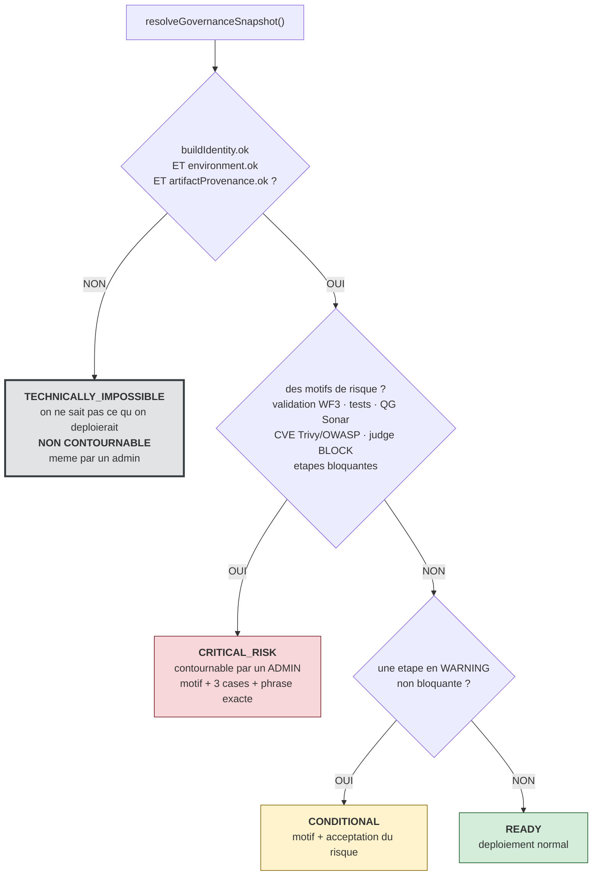
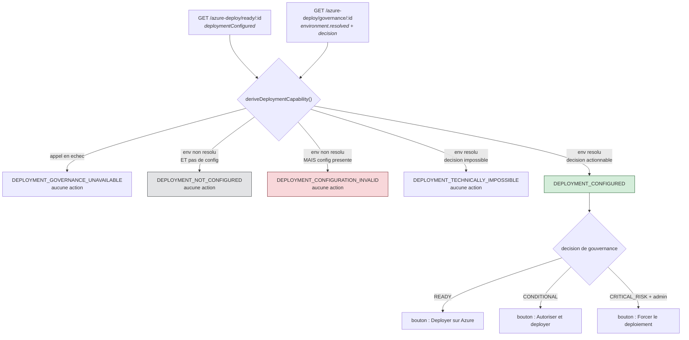
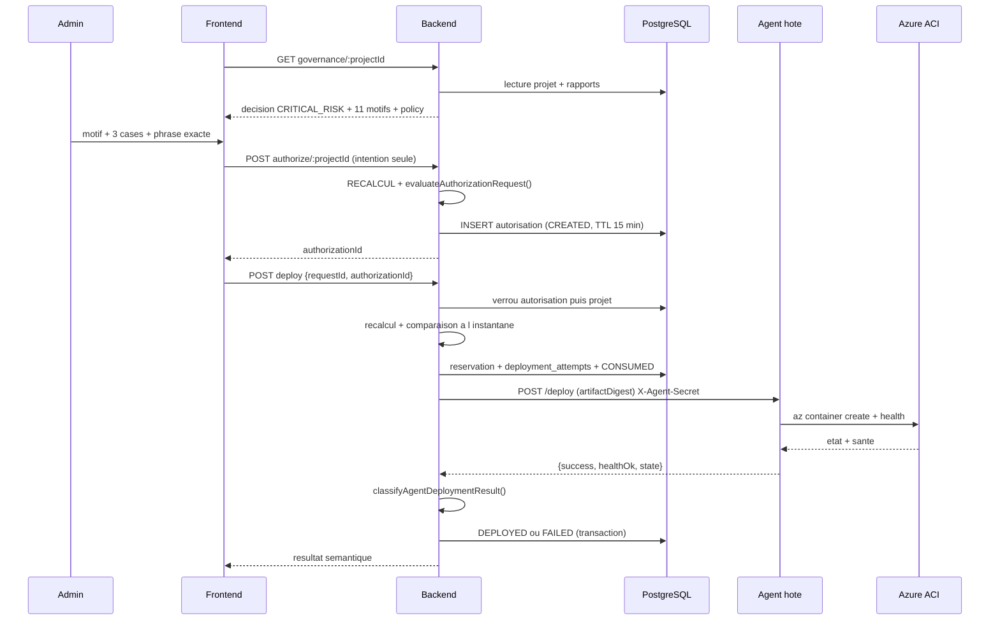

# 14 — DÉPLOIEMENT AZURE

28 fichiers dans `backend/src/azure-deploy/`, 10 routes, 3 tables.
Révision déployée : `f212d19b…`, image `sha256:3835d850…`.

---

## 1. La question à laquelle ce sous-système répond

*« Ce projet, dans cet état précis, peut-il être déployé en production — et si oui, qui
a le droit de l'autoriser, et sous quelles conditions ? »*

Le déploiement n'est pas traité comme un bouton, mais comme une **décision gouvernée**.

---

## 2. Les quatre états de gouvernance

Calculés par `evaluateGovernanceDecision()` dans `azure-deploy/governance-decision.ts`.
L'ordre d'évaluation est important.

### a) `TECHNICALLY_IMPOSSIBLE` — non contournable

```ts
if (!input.buildIdentity.ok)        → `Identité de build non résolue (${failureCode})`
if (!input.environment.ok)          → `Identité d'environnement non résolue (${failureCode})`
if (artifactProvenance && !ok)      → `Provenance de l'artefact non résolue (${failureCode})`
if (technicallyImpossibleReasons.length > 0) return { class: 'TECHNICALLY_IMPOSSIBLE', … };
```

**Pourquoi non contournable** : ce ne sont pas des jugements de risque, c'est
« on ne sait pas ce qu'on déploierait ». Le commentaire du code le dit : *« never a risk
judgment, always "we don't know what we'd be deploying" »*. Accepter un risque n'a pas de
sens quand l'objet du risque est inconnu.

### b) `CRITICAL_RISK` — contournable par un administrateur

Motifs accumulés :

| Motif | Condition |
|---|---|
| `Validation de sécurité WF3 absente` | applicabilité `MISSING` |
| `… existante mais non applicable à cet artefact exact` | `NOT_APPLICABLE` |
| `… applicable mais en échec` | `FAILED` |
| `… applicabilité indéterminée` | `AMBIGUOUS` |
| `Tests applicatifs en échec` | `testsStatus === 'FAILED'` |
| `Tests applicatifs non exécutés` | `testsStatus === 'NOT_RUN'` **ou `null`** |
| `Quality Gate SonarQube en échec (X)` | QG bloquant |
| `Quality Gate SonarQube indéterminé (X)` | QG `null` ou non reconnu |
| `N CVE critique(s) Trivy` | `trivyCritical > 0` |
| `N CVE critique(s) OWASP` | `owaspCritical > 0` |
| `Décision de gouvernance : BLOCK` | `judgeDecision === 'BLOCK'` |
| `N problème(s) bloquant(s) non résolu(s)` | `unresolvedBlockingCount > 0` |
| `Étape requise bloquante : X (statut)` | pour chaque étape bloquante |

**Seul `APPLICABLE` libère** le contrôle de validation de sécurité. `MISSING`,
`NOT_APPLICABLE`, `FAILED` et `AMBIGUOUS` sont **tous** traités comme « aucune preuve de
sécurité utilisable pour **cet artefact exact** ».

### c) `CONDITIONAL` — un seul signal défendable

```ts
for (const stage of r.requiredStages)
  if (stage.status === 'WARNING' && !stage.blocking)
    conditionalReasons.push(`Étape en avertissement, non bloquante : ${stage.stage}`);
```

Volontairement minimal : une étape en avertissement, non bloquante. Le projet n'a pas
inventé une catégorie « moyennement risqué » : il s'appuie sur le seul signal déjà
existant et justifiable.

### Schéma — l'arbre de décision de la gouvernance



**Lecture.** L'ordre d'évaluation est la clé. `TECHNICALLY_IMPOSSIBLE` est testé
**en premier** et court-circuite tout le reste : si l'identité n'est pas résolue, il est
inutile — et dangereux — de parler de risque. Accepter un risque suppose de savoir sur
quoi on l'accepte. C'est pour cela que cette branche n'a aucune sortie vers une
autorisation, contrairement aux trois autres.

### d) `READY`

Aucun motif. Aucune.

---

## 3. Exemple réel, lu en direct

`pfe-app-test`, build **#151**, commit `393816c2…`, digest `sha256:6dc3cdba…`,
cible `aci-pfe-app-test` (francecentral) :

```
decision = CRITICAL_RISK   (11 motifs bloquants)
  Validation de sécurité WF3 absente
  Tests applicatifs non exécutés
  Quality Gate SonarQube en échec (ERROR)
  14 CVE critique(s) Trivy
  23 CVE critique(s) OWASP Dependency-Check
  Décision de gouvernance : BLOCK
  38 problème(s) bloquant(s) non résolu(s)
  Étape requise bloquante : owasp (FAILED)
  Étape requise bloquante : sonar (FAILED)
  Étape requise bloquante : trivy (FAILED)
  Étape en avertissement, non bloquante : zap

authorizationPolicy = { requiredMode: 'CRITICAL_OVERRIDE', rolesAllowed: ['admin'],
                        adminRequired: true, reasonRequired: true,
                        acknowledgementRequirements: [3 cases],
                        confirmationPhraseRequired: true }
```

Et pour les cinq projets réels :

| Projet | `deploymentConfigured` | `environment.resolved` | Décision | Capacité UI |
|---|---|---|---|---|
| pfe-app-test | true | true | `CRITICAL_RISK` | `DEPLOYMENT_CONFIGURED` |
| devsecops-testbed | true | true | `TECHNICALLY_IMPOSSIBLE` | `DEPLOYMENT_TECHNICALLY_IMPOSSIBLE` |
| devsecops-platform-testbed | false | false | `TECHNICALLY_IMPOSSIBLE` | `DEPLOYMENT_NOT_CONFIGURED` |
| vuln-testapp | false | false | `TECHNICALLY_IMPOSSIBLE` | `DEPLOYMENT_NOT_CONFIGURED` |
| remediation-retry-e2e-fixture | false | false | `TECHNICALLY_IMPOSSIBLE` | `DEPLOYMENT_NOT_CONFIGURED` |

### Schéma — capacité de déploiement vs décision de gouvernance



**Lecture.** Deux questions **distinctes** sont posées, et c'est la nuance que l'interface
devait rendre visible. *« Une cible de déploiement existe-t-elle ? »* est un état de
**configuration**. *« Est-ce prudent de déployer ? »* est un **verdict** de gouvernance.
Un projet peut être parfaitement configuré et rester indéployable — c'est le cas de
`devsecops-testbed`. Et un projet non configuré ne doit pas être présenté comme
« risqué » : il n'est simplement pas encore prêt.

**Le cas `devsecops-testbed` est pédagogiquement précieux** : configuration **valide**
(environnement résolu, cible `aci-devsecops-testbed`) mais identité de build non résolue.
C'est un `TECHNICALLY_IMPOSSIBLE` qui n'est **pas** un défaut de configuration. L'UI les
distingue donc correctement.

---

## 4. Le modèle de configuration par projet

`Project.azureConfig` (`AzureDeploymentConfig`), jsonb, **sans aucun secret** :

```ts
provider: 'azure-container-instances'
resourceGroup, targetName, registry, imageRepository
region?, subscriptionRef?, cpu?, memoryInGb?, ports?
healthCheck?: { path, port, client: 'curl'|'wget', expectedBody }
```

Valeur réelle pour `pfe-app-test` :

```json
{ "provider": "azure-container-instances", "resourceGroup": "rg-pfe-devsecops",
  "targetName": "aci-pfe-app-test", "registry": "acrpfedevsecops",
  "imageRepository": "pfe-app-test", "region": "francecentral" }
```

`deriveDeploymentEnvironmentIdentity()` exige `provider`, `resourceGroup`, `registry` et
`targetName` ; sinon `DEPLOY_ENVIRONMENT_UNRESOLVED`. L'identité canonique est hachée en
`environmentIdentityHash` (sha256), afin de détecter tout changement de cible.

> `subscriptionRef` est déclaré dans le type mais aucune lecture n'a été trouvée dans le
> code : **usage non déterminé à partir du code actuel.**

---

## 5. L'autorisation — le cœur du sous-système

### Ce que le frontend peut envoyer

**Uniquement de l'intention** :
`{ mode, reason?, acknowledgements?, confirmationPhrase?, mainBuildNumber?, tag? }`.

Les champs `decision`, `commitSha`, `artifactDigest`, `riskSnapshot`,
`environmentIdentityHash` **n'existent même pas** sur `AuthorizeDeploymentDto`. Le
serveur recalcule **tout**.

### Les préconditions, par mode

| Mode | Rôles | Motif | Reconnaissances | Phrase |
|---|---|---|---|---|
| `NORMAL` | admin, developer | non | — | non |
| `CONDITIONAL_EXCEPTION` | admin, developer | **oui** | `conditionalRiskAccepted` | non |
| `CRITICAL_OVERRIDE` | **admin seul** | **oui** | `criticalRiskAccepted`, `securityControlsMayHaveFailed`, `deploymentMayExposeKnownRisk` | **`DEPLOYER MALGRÉ LES RISQUES`** |

Codes de refus réellement observés en test sur PostgreSQL :
`DEPLOY_AUTHORIZATION_ROLE_FORBIDDEN`, `…_REASON_REQUIRED`,
`…_ACKNOWLEDGEMENT_MISSING`, `…_PHRASE_MISMATCH`, `…_MODE_MISMATCH`, et
`DEPLOY_TECHNICALLY_IMPOSSIBLE_NO_OVERRIDE` (*« aucun mode d'autorisation ne peut la
satisfaire, y compris pour un administrateur »*).

**Point vérifié** : aucune demande refusée ne laisse de ligne d'autorisation en base.

### Ce qui est gelé dans l'autorisation

`commitSha`, `artifactDigest`, `registry`, `repository`, `artifactTag`,
`environmentIdentityHash`, `decisionAtAuthorization`, `riskSnapshot`, `failedControls`,
`warnings`, `authorizationIdentityHash`, plus l'intention humaine.

TTL : `AUTHORIZATION_TTL_MINUTES = 15`. Usage **unique**.

---

## 6. La consommation — `reserveAndConsumeAuthorization()`

Une **seule** transaction, dans un ordre de verrouillage **constant** :

```
1. verrou pessimiste sur DeploymentAuthorization
2. status !== 'CREATED'      -> DEPLOY_AUTHORIZATION_<status>          (rien consomme)
3. expiresAt depasse         -> marque EXPIRED, refuse                 (rien consomme)
4. verrou pessimiste sur Project   (TOUJOURS dans cet ordre)
5. requestId deja vu         -> { duplicate: true, existingState }     (rien consomme)
6. un autre dispatch en vol  -> DEPLOY_DEPLOYMENT_IN_PROGRESS          (rien consomme)
7. RECALCUL complet de l'instantane de gouvernance
8. comparaison : commitSha, artifactDigest, registry, repository, environmentIdentityHash
      divergence -> DEPLOY_AUTHORIZATION_IDENTITY_CHANGED              (rien consomme)
   comparaison : decision.class vs decisionAtAuthorization
      divergence -> DEPLOY_AUTHORIZATION_RISK_CHANGED                  (rien consomme)
9. reservation : azureDeploymentState = { requestId, status: 'DISPATCHING', imageTag }
10. creation de la ligne deployment_attempts
11. consommation de l'autorisation (CONSUMED)
   -- fin de transaction, APRES le commit seulement : appel a l'agent
```

Trois propriétés à savoir énoncer :

1. **Rien n'est consommé avant d'être réservé.** Une autorisation ne passe `CONSUMED` que
   si un dispatch a réellement été réservé durablement dans la même transaction.
2. **Un refus ne consomme pas.** Dérive d'identité, dérive de risque, dispatch concurrent :
   l'autorisation reste `CREATED` et réutilisable pour une requête légitime ultérieure.
3. **L'agent n'est appelé qu'après le commit.** Pas d'appel réseau dans la transaction.

### Résultats de la gate PostgreSQL réelle

| Vérification | Résultat |
|---|---|
| deux consommateurs concurrents (processus distincts, PID backend PG distincts) | **exactement 1** succès, l'autre `DEPLOY_AUTHORIZATION_CONSUMED` |
| lignes `deployment_attempts` créées | **exactement 1** |
| seconde consommation séquentielle | refusée |
| TTL effectif | **900 s** = les 15 min contractuelles |
| expiration | marquée `EXPIRED` durablement |
| dérive de digest / de commit | refusée, autorisation **restée `CREATED`** |
| autorisation inconnue | `DEPLOY_AUTHORIZATION_NOT_FOUND` |

---

## 7. Le succès sémantique — `classifyAgentDeploymentResult()`

**Le point le plus important du sous-système.** Un HTTP 200 n'est jamais un succès.

```ts
const transportSuccess = httpStatus !== null && httpStatus >= 200 && httpStatus < 300;
if (httpStatus === null)                      → AGENT_TRANSPORT_FAILED
if (!transportSuccess)                        → AGENT_HTTP_ERROR
if (typeof data.success !== 'boolean'
 || typeof data.healthOk !== 'boolean')       → AGENT_RESULT_INVALID
if (!data.success)                            → AGENT_DEPLOYMENT_FAILED
if (!data.healthOk)                           → AGENT_HEALTH_FAILED
return { deploymentSuccess: true, … }
```

| Cas | Résultat |
|---|---|
| 200 + `success:true` + `healthOk:true` | **`DEPLOYED`** |
| 200 + `success:false` | `FAILED` / `AGENT_DEPLOYMENT_FAILED` |
| 200 + `healthOk:false` | `FAILED` / `AGENT_HEALTH_FAILED` |
| 200 sans les deux booléens | `FAILED` / `AGENT_RESULT_INVALID` |
| non-2xx | `FAILED` / `AGENT_HTTP_ERROR` |
| aucune réponse | `FAILED` / `AGENT_TRANSPORT_FAILED` |

Et sur un échec sémantique, le backend **lève** une HttpException — le frontend prend donc
sa branche d'erreur. Un conteneur démarré dont le contrôle de santé échoue n'est **pas**
un déploiement réussi.

> Note de contrat importante : un **rejeu** renvoie
> `{ duplicate: true, ...azureDeploymentState }`, qui porte `status` et **pas** `success`.
> Lire `success` sur cette enveloppe conduirait à annoncer un échec sur un déploiement
> réellement réussi — le frontend la traite donc séparément.

---

## 8. L'agent hôte

| Champ | Valeur |
|---|---|
| Fichier | `infra/azure-deploy-agent/agent.py` |
| Écoute | `172.19.0.1:7799` — passerelle du bridge Docker, **jamais `0.0.0.0`** |
| Authentification | `X-Agent-Secret` |
| Pourquoi un agent | la politique du tenant interdit de créer un service principal ; la session `az` a le rôle *Owner* sur toute la souscription |
| Garantie | **le jeton ne quitte jamais l'hôte** ; le backend ne détient aucun credential Azure |
| `assertConfigured()` | si `AZURE_DEPLOY_AGENT_SECRET` est absent ⇒ **503** (*fail-closed*) |
| Timeout du dispatch | 180 s (un déploiement ACI réel prend des dizaines de secondes) |

Ce qui est envoyé à l'agent : `projectId`, `requestId`, `imageTag` (**affichage/audit
seulement**), **`artifactDigest`** et la cible. L'agent construit la référence d'image
lui-même et **préfère le digest** ; le tag ne sélectionne plus rien.

---

## 9. Le chemin complet, du bouton à Azure

```
[Forcer le déploiement]  (visible admin seulement, capacite DEPLOYMENT_CONFIGURED)
   │  deployment-governance.component.ts  -> openCriticalForm()
   │     exige : motif >= 10 car. + 3 cases + phrase exacte
   ▼
POST /api/azure-deploy/authorize/:projectId   {mode:'CRITICAL_OVERRIDE', reason, acks, phrase}
   │  AzureDeployController.authorize()
   ▼
DeploymentAuthorizationService.createAuthorization()
   │  resolveGovernanceSnapshot()  -> RECALCUL intégral
   │  evaluateAuthorizationRequest() -> rôle, motif, reconnaissances, phrase, mode
   ▼
deployment_authorizations  (CREATED, TTL 15 min, instantané gelé)
   │  -> authorizationId
   ▼
POST /api/azure-deploy/deploy  {projectId, requestId, authorizationId, confirmed:true}
   │  rôle admin|developer exigé
   ▼
reserveAndConsumeAuthorization()   (1 transaction, verrous ordonnés, recalcul+comparaison)
   │  -> deployment_attempts (DISPATCHING) + autorisation CONSUMED
   ▼
POST http://172.19.0.1:7799/deploy   {artifactDigest, cible}   X-Agent-Secret
   │
   ▼
agent.py -> az -> Azure Container Instances -> contrôle de santé
   │
   ▼
classifyAgentDeploymentResult()  ⇒ DEPLOYED | FAILED
   │  persistance atomique : deployment_attempts + azureDeploymentState
   ▼
UI : phase AUTHORISING → AUTHORIZED → DISPATCHING → DEPLOYED | FAILED
```

---

## 10. Diagramme Mermaid



---

## 11. État actuel : rien n'est déployé

Vérifié : **0** autorisation, **0** tentative, **0** `azureDeploymentState` non nul.
Aucun déploiement Azure n'a été exécuté. Les drapeaux
`SECURITY_REMEDIATION_DISPATCH_ENABLED=false`,
`SECURITY_REMEDIATION_E2E_TEST_HARNESS_ENABLED=false` et
`DEPLOYMENT_AUTHORIZATION_REQUIRED=true` sont actifs.

**Démonstration recommandée** : montrer la décision `CRITICAL_RISK` avec ses 11 motifs,
ouvrir le formulaire de dérogation critique, puis **expliquer sans valider** que la
soumission exigerait un recalcul serveur complet. Et prouver le *fail-closed* en
appelant `POST /deploy` sans `authorizationId` → **409 `DEPLOY_AUTHORIZATION_REQUIRED`**.
