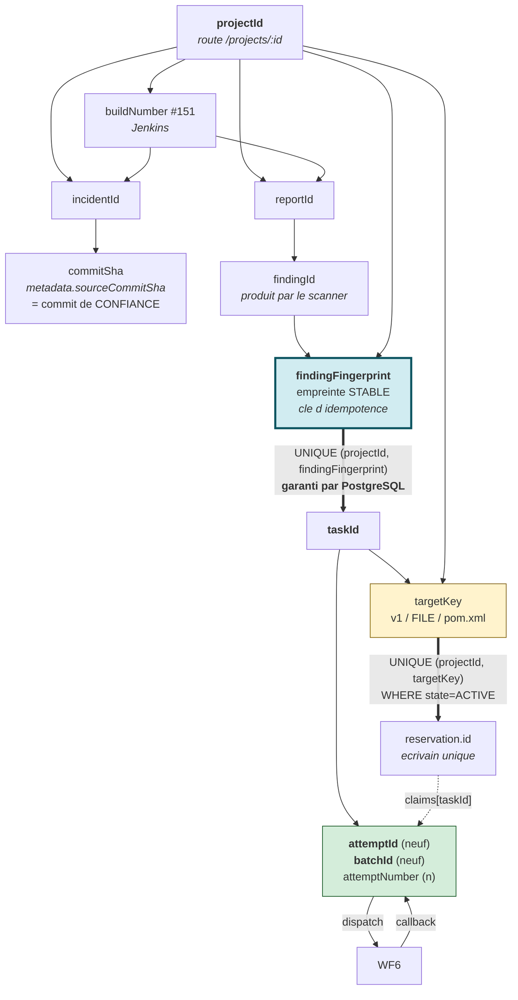

# 21 — IDENTIFIANTS ET CIRCULATION DES DONNÉES

> **Si tu ne devais maîtriser qu'un seul document technique, ce serait celui-ci.**
> Les identifiants sont la colonne vertébrale de la plateforme : ils expliquent le
> retry, l'idempotence, la protection contre les callbacks périmés, l'écrivain unique
> et l'audit.

---

## 1. Tableau de référence

| Identifiant | Créé par | Stocké dans | Durée de vie | Mutable ? | Rôle de corrélation |
|---|---|---|---|---|---|
| `projectId` | base (uuid) à la création du projet | `projects.id` | permanente | non | **racine** de tout ; vient de la route `/projects/:id` |
| `incidentId` | base, à l'ingestion d'un build | `incidents.id` | permanente | non | relie build ↔ findings ↔ tâches |
| `reportId` | base, à l'ingestion d'un rapport | `reports.id` | permanente | non | source des signaux de risque |
| `buildNumber` | **Jenkins** | `incidents.buildNumber`, `reports.rawData` | permanente | non | relie rapport ↔ analyse ↔ gouvernance |
| `findingId` | le **scanner** | `manual_remediation_tasks.findingId` | celle du rapport | oui (dépend du scanner) | identité brute du finding |
| `findingFingerprint` | backend (`finding-fingerprint.ts`) | `manual_remediation_tasks.findingFingerprint` (**NOT NULL**) | permanente | **non** | **clé d'idempotence** : `UNIQUE (projectId, findingFingerprint)` |
| `taskId` | base (uuid) | `manual_remediation_tasks.id` | permanente | non | l'élément de travail |
| `attemptId` | backend, à chaque tentative | `securityFindingRemediation.attempts[].attemptId` | celle de la tentative | non | **anti-callback-périmé** |
| `attemptNumber` | backend, incrément | idem | idem | non (une seule incrémentation) | borne les 3 tentatives max |
| `batchId` | backend, **nouveau à chaque tentative** | `securityRemediationBatchId` + dans chaque tentative | celle du lot | non | corrèle plusieurs tâches d'un même dispatch |
| `requestId` | appelant (uuid) | `azureDeploymentState.requestId` | celle de la requête | non | **idempotence du dispatch** |
| id de réservation | base (uuid) | `remediation_target_reservations.id` | jusqu'à libération | non | le verrou d'écrivain |
| `targetKey` | backend (`canonicalTarget`) | `remediation_target_reservations.targetKey` | — | non | `['v1','FILE',file]` — la **clé de propriété** |
| id de plan E2E | base | `security_remediation_retry_e2e_plans.id` | courte, usage unique | non | autorisation de test |
| `authorizationId` | base (uuid) | `deployment_authorizations.id` | **TTL 15 min**, usage unique | non | droit de déployer |
| `attemptId` de déploiement | base | `deployment_attempts.id` | permanente | non | audit du dispatch |
| `commitSha` | **Git** | `incidents.metadata.sourceCommitSha`, autorisations, tentatives | permanente | non | ancrage d'identité du code |
| `artifactDigest` | **registre** (`sha256:…`) | autorisations, tentatives, artefacts | permanente | **non, par nature** | identité **immuable** de l'image |
| `environmentIdentityHash` | backend (sha256 d'un objet canonique) | autorisations | — | non | identité de la cible de déploiement |
| `executionId` | **n8n** | `metadata.fixRequest.n8nExecutionId` | celle de l'exécution | non | permet d'**arrêter** une exécution |
| `ceTaskId` | **SonarQube** | données de validation | celle de l'analyse | non | corréler le bon Quality Gate |
| `evidenceId` | générateur de preuves | magasin de preuves v1.8 | — | non | `''` si inconnu — **jamais** un faux identifiant |

---

## 2. Les trois identifiants qu'il faut absolument savoir expliquer

### 2.1 `findingFingerprint` — pourquoi l'idempotence est en base

Un scanner rejoue à chaque build. Si l'identité d'un finding dépendait de l'ordre du
rapport ou d'un index, chaque build créerait des doublons.

La solution du projet : une **empreinte stable** (`finding-fingerprint.ts`) et une
contrainte **`UNIQUE (projectId, findingFingerprint)`**.

**Point de soutenance** : l'idempotence n'est pas une politesse applicative, c'est une
contrainte PostgreSQL. Même un bug dans le code de synchronisation ne peut pas créer deux
tâches pour le même finding.

### 2.2 `attemptId` + `batchId` — pourquoi un callback périmé est inoffensif

Le scénario redouté :

```
t0  Tentative A1 (batchId=B1) part vers WF6
t1  A1 depasse son budget -> VERIFIER_TIMEOUT, marquee rejouable
t2  Tentative A2 (batchId=B2) part
t3  LE CALLBACK DE A1 ARRIVE ENFIN
```

Sans identité par tentative, le callback de A1 écraserait l'état de A2 : une tentative
morte corromprait une tentative vivante.

La protection est **triple** :

1. **Nouveau `attemptId`** à chaque tentative : le callback annonce A1, le backend sait
   que la tentative courante est A2.
2. **Nouveau `batchId`** à chaque tentative : le lot lui-même diffère.
3. `verifyWf6AttemptContext()` (ligne 413 de `manual-remediation.service.ts`) valide le
   triplet `(projectId, findingTaskIds, batchId)` **avant** toute mutation.

À quoi s'ajoute `completionDigest` pour l'idempotence d'un callback **dupliqué** (même
tentative, livré deux fois) : le second est reconnu et ne produit pas d'effet.

**Donnée réelle à citer** : la tâche `a390e383-42b7-4348-894c-5e02a7e5f98d` porte
`attemptId 93c68aed…` / `batchId sec-batch-61727477…` puis
`attemptId 39c77b06…` / `batchId sec-batch-4e6f6ec2…`. Deux identités **entièrement**
disjointes.

### 2.3 `targetKey` — pourquoi la propriété est versionnée

```ts
targetKey = JSON.stringify(['v1', 'FILE', file])   // ex. ["v1","FILE","pom.xml"]
```

Trois éléments :

- `'v1'` : version du schéma de clé. Pouvoir changer la granularité demain sans
  invalider les lignes d'aujourd'hui.
- `'FILE'` : le `targetType`. Aujourd'hui seul `FILE` existe ; la place est prévue pour
  un verrou par module ou par coordonnée.
- `file` : le chemin **normalisé et de confiance** (voir `23-…` et `05` §7).

Et la clé de propriété complète est le **couple** `(projectId, targetKey)`, ce qui donne
exactement la bonne sémantique de concurrence (voir `12`).

---

## 3. Circulation complète pour une remédiation de CVE

```
projectId  (route /projects/:id)
   │
   ├── buildNumber #151 ─── incidentId ─── reportId
   │                            │              └── rawData : findings bruts
   │                            │
   │                            └── metadata.sourceCommitSha = commit de confiance
   │
   └── pour chaque finding :
        findingId (scanner) ──► findingFingerprint ──► taskId
                                  (UNIQUE avec projectId)
                                        │
                                        ├── targetKey = ["v1","FILE","pom.xml"]
                                        │      └── (projectId,targetKey) ──► reservation.id
                                        │              └── claims[taskId] = {attemptId,batchId,status}
                                        │
                                        └── tentative n :
                                             attemptId (nouveau)
                                             attemptNumber (n)
                                             batchId (nouveau)
                                                  │
                                                  ├──► WF6  (webhook, headerAuth)
                                                  │      └──► evaluate-batch ──► verifier ──► scanner
                                                  │               └── artifactDigest + reportDigest
                                                  │
                                                  └──◄ callback batch-result
                                                         {attemptId, batchId, status, reasonCode}
                                                         └── verifyWf6AttemptContext()
                                                               └── transition + reglement de reservation
```

---

### Schéma — la circulation des identifiants



**Lecture.** Les deux flèches épaisses sont les deux endroits où **PostgreSQL** garantit
un invariant que le code n'aurait pas pu garantir seul : l'unicité d'une tâche par
finding, et l'unicité d'un écrivain par cible. Tout le reste est de la corrélation.

Le `projectId` (en haut) alimente **trois** branches indépendantes : l'identité du code
(`commitSha`), l'identité du travail (`taskId`) et l'identité de la propriété
(`targetKey`). C'est cette séparation qui permet de rejouer une tentative sans perdre le
lien au finding d'origine.

## 4. Circulation complète pour un déploiement Azure

```
projectId
   │
   ├── GET /azure-deploy/ready/:projectId
   │     └── deploymentConfigured + deploymentTarget + requiredStages
   │
   ├── GET /azure-deploy/governance/:projectId
   │     └── mainBuildNumber (#151) + commitSha (393816c2…) + artifactDigest (sha256:6dc3cdba…)
   │         + environmentIdentityHash (bb61953c…) + decision + failedControls
   │
   ├── POST /azure-deploy/authorize/:projectId   {mode, reason, acknowledgements, confirmationPhrase}
   │     └── recalcul integral cote serveur, puis GEL de l'instantane
   │           └── authorizationId  (TTL 15 min, usage unique)
   │
   └── POST /azure-deploy/deploy  {projectId, requestId, authorizationId, confirmed}
         └── reserveAndConsumeAuthorization()
               ├── verrou pessimiste sur l'autorisation, puis sur le projet
               ├── recalcul et COMPARAISON a l'instantane gele
               │     └── divergence ⇒ DEPLOY_AUTHORIZATION_IDENTITY_CHANGED (rien consomme)
               ├── reservation : azureDeploymentState.requestId = DISPATCHING
               ├── creation de deployment_attempts.id
               └── consommation de l'autorisation (CONSUMED)
                     └── dispatch vers l'agent, avec artifactDigest (jamais le tag)
                           └── classifyAgentDeploymentResult() ⇒ DEPLOYED | FAILED
```

---

## 5. Pourquoi le dispatch utilise le digest et pas le tag

Un tag d'image est **mutable** : `:151` peut être repoussé sur un autre contenu. Un
digest `sha256:…` est **immuable par construction**.

Au moment du dispatch, le backend envoie à l'agent le `registry`, le `repository` et
l'`artifactDigest` **de l'autorisation**, et laisse l'agent construire la référence
lui-même. Le commentaire du code est explicite : le tag ne voyage plus que pour
l'affichage et l'audit, jamais pour **sélectionner** le contenu.

**Conséquence** : entre l'autorisation et le dispatch, même si quelqu'un repousse le tag
`:151`, c'est toujours l'image autorisée qui est déployée. Et si le digest résolu a
changé, l'autorisation est refusée.

---

## 6. Reconstituer l'histoire d'un finding *(PART 30)*

Question d'opérateur : *« que s'est-il passé pour le finding X ? »*

| Étape | Où regarder | Quelle clé |
|---|---|---|
| 1. Le finding a-t-il été vu ? | `reports.rawData` | `projectId` + `buildNumber` |
| 2. A-t-il été promu en tâche ? | `manual_remediation_tasks` | `UNIQUE (projectId, findingFingerprint)` |
| 3. Quel est l'état du travail ? | `status` | `taskId` |
| 4. Que voit le scanner ? | `scannerStatus` | `taskId` |
| 5. Combien de tentatives ? | `securityFindingRemediation.attempts[]` | `attemptId`, `attemptNumber` |
| 6. Pourquoi chaque échec ? | `attempts[].reasonCode` + `retryable` | — |
| 7. Quel lot ? | `securityRemediationBatchId` (indexé) | `batchId` |
| 8. Qui détenait l'écrivain ? | `remediation_target_reservations.claims` | `(projectId, targetKey)` |
| 9. Quelle exécution n8n ? | `metadata.fixRequest.n8nExecutionId` | `executionId` |
| 10. Git a-t-il été touché ? | `attempts[].prUrl` / `branchName` / `unresolvedGitSideEffect` | — |
| 11. Est-ce vérifié ? | `verifiedBuild` > `lastSeenBuild` + `verifiedAt` | `buildNumber` |
| 12. Piste d'audit | `events` (jsonb) | `taskId` |

**Verdict d'observabilité** : la base permet une reconstitution **complète**.
C'est d'ailleurs la vraie force d'observabilité du projet — les logs applicatifs sont,
eux, non structurés (voir `38`).

Pour un déploiement, le chemin est le même avec
`deployment_authorizations` → `deployment_attempts` → `azureDeploymentState`, corrélés
par `authorizationId` et `requestId`.
