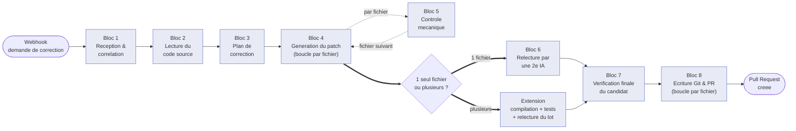

# WF2 — comprendre et expliquer le flux de correction automatique

Document écrit pour pouvoir **expliquer WF2 à l'oral**, par exemple à un jury. Il ne vise pas à apprendre à le modifier — les détails techniques sont en annexe pour qui veut creuser.

**Vérifié le 2026-10-04**, directement sur le flux tel qu'il tourne réellement (version publiée en production, identifiant interne `4fa669b4-20ce-4d66-a003-af21c0d9de61`, pas un brouillon). Le flux compte **189 étapes actives** ("nœuds") + 6 notes explicatives collées sur le schéma visuel (195 au total), reliées par 279 liaisons.

> **Note de vérification.** Deux informations qui m'avaient été communiquées pour préparer la première version de ce document ne correspondaient pas à ce que j'ai trouvé en vérifiant directement le flux en production : l'identifiant de version annoncé (`f1aa7b25`) n'existait pas dans l'historique du flux — l'identifiant alors réellement actif était `642844c5` (tout le reste des chiffres annoncés à cette date — 182 nœuds, 188 au total, 6 zones, 74 filets — était, lui, exact et confirmé) ; et deux noms de nœuds annoncés (« Fetch Reconciled File », « Collect Reconciled Updates ») n'existaient pas dans les 182 nœuds du flux. Je n'ai rien inventé à leur place : voir la note en fin de section 3 pour les nœuds réels qui occupent cette zone du schéma.

> **Mise à jour depuis la première vérification (`642844c5` → `4fa669b4-20ce-4d66-a003-af21c0d9de61`).** Deux changements réels ont été publiés en production depuis :
> - **R90** — un seul nœud du Bloc 2, `Expand Referenced API Sources`, a été remplacé par une version qui sait retrouver le fichier d'entité correspondant à un DTO nommé par convention (`<Nom>DTO.java` → `<Nom>.java`), même quand ce DTO est volontairement découplé de l'entité (aucun import, aucun type partagé ne permettait de le relier automatiquement). Avant R90, ce cas précis faisait manquer une source de contexte à l'IA sans le signaler comme une anomalie. Zéro autre nœud touché — vérifié par comparaison intégrale du graphe avant/après.
> - **R91** — un mécanisme d'annulation réelle d'une correction en cours a été ajouté : 7 nœuds nouveaux, aucun nœud existant supprimé ou renommé. Détail en **section 6**.

---

## 1. Vue d'ensemble — ce que fait WF2, en 3 minutes

**En une phrase :** WF2 reçoit une demande de correction de code déjà autorisée (un correctif de sécurité, par exemple) et produit une Pull Request — mais seulement après avoir construit un candidat de correction et l'avoir vérifié à plusieurs reprises. À aucun moment une IA n'écrit directement sur GitHub : elle propose, des contrôles automatiques et une deuxième IA vérifient, et seul un résultat validé devient une Pull Request.

WF2 avance en **8 grandes étapes** ("blocs"), toujours dans le même ordre pour un correctif simple :

1. **Réception & corrélation** — reçoit la demande, vérifie qu'elle est autorisée, prépare la branche Git.
2. **Lecture du code source** ("grounding") — lit pour de vrai le code concerné sur GitHub, jamais de supposition.
3. **Plan de correction** — une IA propose quels fichiers toucher et comment, avant d'écrire le moindre code.
4. **Génération du patch** — une IA écrit le code corrigé, fichier par fichier, dans une boucle.
5. **Contrôle mécanique** ("preflight") — pour chaque fichier généré, une vérification 100% automatique, sans IA.
6. **Relecture par une deuxième IA** — un modèle différent de celui qui a écrit relit le résultat, avec un droit de veto.
7. **Vérification finale du candidat** — avant d'écrire sur GitHub, tout est revérifié par calcul, pas par confiance.
8. **Écriture Git & Pull Request** — écriture réelle des fichiers, relecture de ce qui a été écrit, puis création de la Pull Request.

**Le fil conducteur à retenir : l'IA propose, les contrôles automatiques et une deuxième IA prouvent — elle n'a jamais le dernier mot pour écrire sur GitHub.**

| Ce que fait l'IA | Ce qui le vérifie ensuite |
|---|---|
| Elle propose un plan de correction | Des règles automatiques vérifient que le plan est cohérent et autorisé |
| Elle génère le code corrigé | Un contrôle mécanique (sans IA) vérifie des règles de base (pas de secret oublié, rien de vide, etc.) |
| — | Une **deuxième IA**, différente de la première, relit le code et donne son avis |
| — | Le code final est vérifié par calcul juste avant d'être écrit sur GitHub |
| — | Après écriture, on relit ce qui a vraiment été écrit pour confirmer que tout est bon |

---

## 2. Le schéma

**À retenir sur ce schéma :** deux boucles (bloc 4 : un tour par fichier à générer ; bloc 8 : un tour par fichier à écrire), et un embranchement après le bloc 4 (un seul fichier touché, ou plusieurs ?). Non représenté ici pour garder le schéma lisible : **n'importe lequel des 8 blocs peut échouer** — dans tous les cas, le backend est prévenu avec le détail de l'échec, jamais de silence (détail en section 7) ; et, depuis R91, deux points de contrôle d'annulation existent (un juste après le Webhook, un juste avant l'écriture Git en fin de bloc 7) — détail en **section 6**.

---

## 3. ★ Correspondance canvas ↔ document — les 6 zones que vous voyez à l'écran

Dans n8n, le schéma visuel ("canvas") regroupe les étapes dans 6 boîtes colorées ("zones"), avec une note explicative collée sur chacune. Ce regroupement suit la **position physique** des nœuds sur l'écran, pas directement la numérotation en 8 blocs de ce document — d'où cette table de correspondance, à lire **avant** le détail de chaque bloc.

**Vérifié le 2026-10-04** (après promotion de R90 et R91) en comparant la position (x, y) de chacun des 189 nœuds aux boîtes des 6 notes collées sur le canvas en production (pas un brouillon) : **188 des 189 nœuds** appartiennent à exactement une zone ; **1 seul** (ajouté par R91) n'appartient géométriquement à aucune des 6 boîtes — voir l'encadré en fin de tableau. Aucune zone n'est vide.

| Zone sur le canvas (titre exact de la note) | Nœuds | Blocs de ce document couverts |
|---|---|---|
| **Zone 1 — Blocs 1 2 3 et chaine morte Pass-1** | 40 | Blocs 1, 2, 3 (27 nœuds) **+ 7 nœuds d'une ancienne version désactivée, jamais utilisée** (voir encadré) **+ 6 nœuds du mécanisme d'annulation R91** (voir encadré et section 6) |
| **Zone 2 — Blocs 4 5 et extension cross-fichiers** | 29 | Bloc 4 (10), Bloc 5 (1), Bloc 6 (2), extension multi-fichiers (16) |
| **Zone 3 — Bloc 8 debut verification et garde ecriture** | 15 | Bloc 8, début (vérification du candidat, garde d'écriture, garde de dérive, préparation de branche) |
| **Zone 4 — Bloc 8 boucle Pass-2 ecriture et reconciliation** | 16 | Bloc 8, boucle d'écriture et de réconciliation |
| **Zone 5 — Bloc 8 fin completude et pull request** | 10 | Bloc 8, fin (complétude du lot, Pull Request, notification) |
| **Zone 6 — Chemins echec transversal** | 78 | Les 74 filets de sécurité + 4 gestionnaires spécifiques, pour tous les blocs |
| *Hors des 6 boîtes colorées* | 1 | `WF2 Cancellation Terminal` (R91) — voir encadré |

**Total : 40 + 29 + 15 + 16 + 10 + 78 + 1 = 189.** ✓

**Nœud hors numérotation de blocs, visible dans la Zone 1 :** 7 nœuds (`Build File Result`, `Classify GitHub Write Error`, `Transport Requires Read Back?`, `Read Back File After Write Error`, `Evaluate GitHub Write Reconciliation`, `Remote Candidate Present?`, `Lookup Head After Reconciled Write`) forment une **copie exacte, mais désactivée**, de la boucle d'écriture du bloc 8 — remplacée depuis par la version "Pass 2" réellement utilisée (visible, elle, en Zone 4). Ils sont positionnés juste à côté de la Zone 1 sur le canvas, mais ne font partie d'aucun bloc numéroté : aucune donnée n'y entre jamais.

**Les 6 nœuds du mécanisme d'annulation R91, dans la Zone 1 :** `Register WF2 Execution`, `Execution May Continue?` et `Restore Registered Intake` sont bien à leur place logique (début du Bloc 1). Mais `Pre-Git Cancellation Gate`, `Git Write Allowed?` et `Restore Pre-Git Context` sont, eux, logiquement en **fin de Bloc 7** (juste avant l'écriture Git) — ils ont pourtant été dessinés, par choix d'implantation, dans le même espace géométrique que la Zone 1 plutôt qu'à côté de la Zone 3 où ils s'exécutent réellement. Sur le canvas, ils apparaissent donc visuellement très loin des nœuds (`Remote Head Drift Passed?`, `Branch Existed At Generation? (Pass 2 Entry)`) auxquels ils sont câblés. Aucune ambiguïté fonctionnelle — les liaisons sont correctes et vérifiées (section 6) — seulement un choix de mise en page du canvas à connaître avant une démonstration en direct, pour ne pas chercher ces 3 nœuds au mauvais endroit de l'écran.

**Le nœud hors des 6 boîtes colorées :** `WF2 Cancellation Terminal` (la fin neutre commune aux deux portes d'annulation, section 6) est positionné dans l'espace vide entre la Zone 1 et la Zone 2 — ni l'une ni l'autre boîte ne le recouvre. Avant R91, aucun nœud actif ne vivait dans cet espace ; c'est un changement réel de la géométrie du canvas, pas une omission de ce document.

**Sur les deux noms de nœuds qui ne correspondent à rien de réel** (voir la note de vérification en haut de ce document) : la zone du canvas où l'on s'attendrait à trouver un « Fetch Reconciled File » ou un « Collect Reconciled Updates » (la Zone 4, boucle d'écriture et de réconciliation) contient en réalité des nœuds nommés `Decode Reconciled Remote Content`, `Hash Reconciled Remote Content` et `Build Reconciled File Result` — si c'est à eux que ces deux noms faisaient référence, ils sont bien documentés ci-dessous, dans le bloc 8.

---

## 4. Les 8 blocs, en détail

### Bloc 1 — Réception & corrélation

Tout commence ici : le backend envoie à WF2 une demande de correction (quel dépôt, quelle branche, quel problème corriger). Ce bloc donne un identifiant unique à cette demande pour pouvoir la suivre jusqu'au bout, vérifie que ce correctif est autorisé par les règles du dépôt, et prépare ou retrouve la branche Git sur laquelle le correctif sera écrit.

- **Reçoit** : la demande de correction brute, directement du **backend** (point de départ du flux, pas d'un autre bloc).
- **Envoie vers** : la liste des fichiers du dépôt à l'instant du commit figé → **Bloc 2** (ou, depuis R91, une fin neutre immédiate si une annulation a déjà été demandée — voir section 6).
- **S'il échoue** : le flux s'arrête tout de suite et prévient le backend, avant même d'avoir touché au code — par exemple si le correctif n'est pas autorisé par les règles du dépôt.

| Nœud | Ce qu'il fait | Va ensuite vers |
|---|---|---|
| Webhook | Reçoit la demande de correction envoyée par le backend. | Capture Correlation Envelope |
| Capture Correlation Envelope | Fige un identifiant unique pour relier toutes les étapes suivantes à cette demande. | Adapt Webhook Payload |
| Adapt Webhook Payload | Met les données reçues dans un format utilisable par la suite du flux. | Register WF2 Execution |
| Register WF2 Execution *(R91)* | Enregistre auprès du backend l'identifiant réel de cette exécution n8n, pour qu'une demande d'annulation future puisse la cibler précisément. | Execution May Continue? |
| Execution May Continue? *(R91)* | Demande au backend si une annulation a déjà été reçue pour cette correction, avant même d'avoir lu le dépôt. | Restore Registered Intake, ou WF2 Cancellation Terminal si déjà annulée |
| Restore Registered Intake *(R91)* | Remet les données de la demande dans leur forme d'origine, une fois l'enregistrement fait, pour que la suite du Bloc 1 ne voie aucune différence. | Fetch Repository Metadata |
| Fetch Repository Metadata | Va chercher les informations générales du dépôt GitHub concerné. | Apply Repository Metadata |
| Apply Repository Metadata | Range ces informations pour qu'elles soient utilisables ensuite. | Policy Gate - Validate Constraints |
| Policy Gate - Validate Constraints | Vérifie que ce correctif respecte les règles autorisées pour ce dépôt. | Patch Allowed? |
| Patch Allowed? | Décide si on continue ou si on arrête, selon le contrôle précédent. | Get Main Branch SHA1, ou Return Policy Rejected si refusé |
| Return Policy Rejected | Prépare la réponse d'arrêt si le correctif n'est pas autorisé. | (fin, échec signalé) |
| Get Main Branch SHA1 | Récupère la référence exacte de la branche principale à cet instant. | Prepare Batch Context |
| Prepare Batch Context | Prépare les informations communes au lot de fichiers à traiter. | Lookup Remediation Branch |
| Lookup Remediation Branch | Vérifie si une branche de correction existe déjà pour cet incident. | Branch Exists? |
| Branch Exists? | Aiguille vers "réutiliser" ou "créer", selon la réponse précédente. | Use Existing Branch, ou Record New Branch Baseline |
| Use Existing Branch | Réutilise la branche de correction déjà existante. | Fetch Repository Tree |
| Record New Branch Baseline | Mémorise le point de départ d'une branche toute neuve. | Fetch Repository Tree |
| Fetch Repository Tree | Récupère la liste des fichiers du dépôt au commit figé, pour savoir ce qui existe avant de patcher. | **→ Bloc 2** : Build Independent Repository Policy |

### Bloc 2 — Lecture du code source ("grounding")

Avant de générer quoi que ce soit, WF2 va lire pour de vrai le contenu des fichiers concernés sur GitHub — jamais de supposition sur ce que contient le code. Il lit aussi les fichiers référencés par le code à corriger, puis ceux dont il dépend, et vérifie la complétude de chaque catégorie avant de passer à la suivante.

- **Reçoit** : la liste des fichiers du dépôt, du **Bloc 1** (`Fetch Repository Tree`).
- **Envoie vers** : la confirmation que tout le contexte nécessaire a été rassemblé → **Bloc 3**.
- **S'il échoue** : signalé au backend ; un fichier annexe manquant (pas le fichier principal) n'est pas bloquant, il est traité comme contexte optionnel absent.

| Nœud | Ce qu'il fait | Va ensuite vers |
|---|---|---|
| Build Independent Repository Policy | Construit les règles du dépôt à respecter pour la suite. | Expand Finding Source Files |
| Expand Finding Source Files | Identifie précisément quel(s) fichier(s) sont concernés par le problème signalé. | Fetch Finding Source Context |
| Fetch Finding Source Context | Lit le contenu réel de ces fichiers sur GitHub. | Expand Referenced API Sources |
| Expand Referenced API Sources *(R90)* | Repère les autres fichiers référencés par le code à corriger — y compris, depuis R90, le fichier d'entité d'un DTO nommé par convention (`<Nom>DTO.java`) même quand rien dans son code ne le relie directement à `<Nom>.java`. | Fetch Referenced API Sources |
| Fetch Referenced API Sources | Lit le contenu de ces fichiers référencés. | Validate Source Context Completeness |
| Validate Source Context Completeness | Vérifie qu'on a bien récupéré le fichier principal et ses références avant d'aller plus loin. | Expand Required Dependency Sources |
| Expand Required Dependency Sources | Repère les fichiers dont dépend le code à corriger. | Fetch Required Dependency Sources |
| Fetch Required Dependency Sources | Lit le contenu de ces fichiers de dépendance. | Validate Required Dependency Sources |
| Validate Required Dependency Sources | Vérifie que ces dépendances ont bien été récupérées — dernier contrôle avant de passer au plan. | **→ Bloc 3** : Prepare Generic Remediation Plan |

### Bloc 3 — Plan de correction

L'IA propose ici un plan avant d'écrire le moindre code : quels fichiers toucher, créer ou modifier, et quels changements sont attendus. L'idée est de valider "quoi faire" avant de générer "comment le faire" — ça évite de générer du code sur une mauvaise cible.

- **Reçoit** : la confirmation de contexte complet, du **Bloc 2** (`Validate Required Dependency Sources`).
- **Envoie vers** : le plan de correction validé → **Bloc 4**.
- **S'il échoue** : signalé au backend si l'IA ne produit pas un plan structuré correctement.

| Nœud | Ce qu'il fait | Va ensuite vers |
|---|---|---|
| Prepare Generic Remediation Plan | Prépare la demande envoyée à l'IA pour qu'elle propose un plan de correction. | Generate Remediation Plan |
| Generate Remediation Plan | Demande à l'IA de proposer un plan (quels fichiers toucher, quoi changer). | Validate Generic Remediation Plan |
| Validate Generic Remediation Plan | Vérifie que ce plan est structuré correctement avant de passer à la génération. | **→ Bloc 4** : Merge Effective File Results |

### Bloc 4 — Génération du patch (boucle, un tour par fichier)

C'est ici que l'IA écrit effectivement le code corrigé, fichier par fichier. Le flux traite les fichiers un par un, dans une boucle : il prend le fichier suivant, génère son patch, le fait vérifier mécaniquement (bloc 5, à l'intérieur même de cette boucle), calcule une empreinte du résultat, puis recommence. Une fois tous les fichiers traités, ils sont rassemblés dans un seul paquet.

- **Reçoit** : le plan de correction validé, du **Bloc 3** (`Validate Generic Remediation Plan`).
- **Envoie vers** : le paquet complet des fichiers patchés → **Bloc 7** via l'embranchement du Bloc 6 (voir ci-dessous — le Bloc 5 se glisse à l'intérieur de cette boucle, pas après).
- **S'il échoue** : signalé au backend pour le fichier en cours ; un échec de génération sur un fichier arrête le lot entier plutôt que de produire un correctif partiel silencieux.

| Nœud | Ce qu'il fait | Va ensuite vers |
|---|---|---|
| Merge Effective File Results *(pilote la boucle)* | Prend les fichiers du plan un par un et sait quand tous ont été traités. | Route Planned File Operation, ou Prepare Candidate Manifest (fin de boucle) |
| Route Planned File Operation | Regarde si ce fichier doit être créé ou juste modifié. | Seed New Planned File, ou Fetch Repository Files |
| Seed New Planned File | Prépare un fichier tout neuf qui n'existe pas encore. | Prepare - Code Patch Body |
| Fetch Repository Files | Récupère le contenu actuel du fichier à modifier. | Prepare - Code Patch Body |
| Prepare - Code Patch Body | Prépare la demande envoyée à l'IA pour générer le patch de ce fichier. | de Patch - HTTP Request |
| de Patch - HTTP Request | Demande à l'IA d'écrire le code corrigé pour ce fichier. | Parse - Code Patch Output |
| Parse - Code Patch Output | Récupère et nettoie la réponse de l'IA. | *(entre ici dans le Bloc 5, un seul nœud, avant de continuer)* |
| Hash Candidate File Content | Calcule une empreinte (hash) du contenu patché, pour pouvoir le vérifier plus tard. | Accumulate Candidate File |
| Accumulate Candidate File | Ajoute ce fichier patché à la liste des fichiers déjà traités. | Merge Effective File Results (fichier suivant) |
| Prepare Candidate Manifest | Rassemble tous les fichiers patchés du lot en un seul paquet, une fois la boucle terminée. | Classify Candidate Coordination Scope *(l'embranchement du Bloc 6)* |

### Bloc 5 — Contrôle mécanique ("preflight")

**Important : ce bloc ne se déclenche pas après la boucle du bloc 4 — il se glisse à l'intérieur, pour chaque fichier, juste après que l'IA l'a généré.** Un seul nœud fait une série de contrôles 100% automatiques, sans intelligence artificielle : le fichier touché est bien autorisé, le changement n'est pas vide ni identique à l'original, pas de secret écrit en dur, pas de règle de sécurité désactivée en douce, pas de `TODO` oublié, pas de code mal formé.

- **Reçoit** : le patch généré pour **ce fichier précis**, du **Bloc 4** (`Parse - Code Patch Output`).
- **Envoie vers** : le patch validé mécaniquement, retour au **Bloc 4** (`Hash Candidate File Content`) pour continuer la boucle.
- **S'il échoue** : le flux s'arrête avec une explication précise de la règle violée — immédiatement, sans attendre la fin du lot.

| Nœud | Ce qu'il fait | Va ensuite vers |
|---|---|---|
| Generic Candidate Preflight | Vérifie mécaniquement (sans IA) que le patch de ce fichier respecte des règles de base. | Hash Candidate File Content *(retour dans la boucle du Bloc 4)* |

### Bloc 6 — Relecture par une deuxième IA (si un seul fichier est touché)

Un patch généré par une IA est relu par une **autre** IA, différente de celle qui l'a écrit — un modèle réellement différent, avec pour consigne explicite d'être critique et indépendant. Si le verdict est un rejet, il n'y a aucun moyen de passer outre.

- **Reçoit** : le paquet de fichiers patchés, du **Bloc 4** (`Classify Candidate Coordination Scope`) — **seulement si un seul fichier est concerné** ; sinon c'est l'extension multi-fichiers ci-dessous qui prend le relais.
- **Envoie vers** : le candidat relu et approuvé → **Bloc 7**.
- **S'il échoue** : un refus de la deuxième IA bloque la suite, signalé au backend.

| Nœud | Ce qu'il fait | Va ensuite vers |
|---|---|---|
| Independent Semantic Review | Demande à une deuxième IA, différente de celle qui a généré le patch, de le relire et de donner son avis. | Enforce Independent Review |
| Enforce Independent Review | Applique strictement le verdict de cette relecture — un refus bloque la suite. | **→ Bloc 7** : Hash Candidate Manifest |

#### Extension — quand le correctif touche plusieurs fichiers liés entre eux

Si le correctif touche plusieurs fichiers, un contrôle plus poussé se déclenche **à la place** du bloc 6 : il rejoue une compilation du projet, rejoue les tests, et fait relire l'ensemble du lot (pas fichier par fichier) par la deuxième IA. Chaque vérification suit le même schéma en trois temps — préparer la demande, l'exécuter, puis appliquer strictement le résultat.

- **Reçoit** : le paquet de fichiers patchés, du **Bloc 4** (`Classify Candidate Coordination Scope`) — seulement si plusieurs fichiers sont concernés.
- **Envoie vers** : le candidat relu et approuvé → **Bloc 7** (même point d'entrée que le Bloc 6, `Hash Candidate Manifest`).
- **S'il échoue** : à n'importe laquelle des étapes (compilation, tests, relecture), le flux s'arrête et le backend est prévenu.

| Étape | Ce qu'elle fait |
|---|---|
| Hash / Validate Cross-File Candidate Manifest | Vérifie que le lot complet de fichiers patchés est cohérent avant d'aller plus loin. |
| Validate Cross-File Type Coherence | Vérifie que les types de données utilisés restent cohérents entre les fichiers modifiés ensemble. |
| Compilation du code principal (COMPILE_MAIN) | Vérifie que le projet compile toujours avec les fichiers patchés. |
| Compilation des tests (COMPILE_TESTS) | Vérifie que les tests eux-mêmes compilent toujours. |
| Exécution complète des tests (FULL_TEST) | Lance la suite de tests pour s'assurer que rien n'est cassé. |
| Relecture sémantique multi-fichiers | La deuxième IA relit l'ensemble du lot de fichiers, pas un seul à la fois. |

### Bloc 7 — Vérification finale du candidat

Avant d'écrire quoi que ce soit sur GitHub, WF2 vérifie par calcul — pas par confiance — que le patch final correspond exactement à ce qui a été annoncé, et que la branche cible n'a pas changé depuis le début.

- **Reçoit** : le candidat approuvé, du **Bloc 6** ou de son extension multi-fichiers (`Enforce Independent Review` ou `Enforce Cross-File Review` — les deux chemins se rejoignent ici).
- **Envoie vers** : la confirmation que tout est prêt à écrire → **Bloc 8** (après une dernière vérification qu'aucune annulation n'a été demandée — voir section 6).
- **S'il échoue** : deux messages d'échec dédiés — l'un si le contenu ne correspond pas à ce qui a été annoncé (`Persist Verification Failure`), l'autre si la branche a bougé entretemps (`Persist Base Moved Failure`) — plus précis qu'un filet générique.

| Nœud | Ce qu'il fait | Va ensuite vers |
|---|---|---|
| Hash Candidate Manifest | Calcule l'empreinte de l'ensemble du lot de fichiers patchés. | Assemble Candidate Manifest |
| Assemble Candidate Manifest | Construit le paquet complet à envoyer au backend pour vérification. | Call Candidate Verification |
| Call Candidate Verification | Demande au backend de vérifier que ce paquet correspond bien à ce qui a été annoncé. | Call Write Guard |
| Call Write Guard | Vérifie que la branche cible n'a pas changé depuis le début. | Write Guard Passed? |
| Write Guard Passed? | Aiguille selon le résultat : en cas d'échec, message dédié immédiat. | Branch Existed At Generation?, ou échec → Persist Verification Failure |
| Branch Existed At Generation? | Vérifie si la branche existait déjà quand le patch a été généré. | Re-check Existing Branch Head, ou Re-lookup Baseline Ref Before Creation |
| Re-check Existing Branch Head | Revérifie la position actuelle d'une branche déjà existante. | Call Remote Head Drift Guard |
| Re-lookup Baseline Ref Before Creation | Revérifie le point de départ avant de créer une nouvelle branche. | Call Remote Head Drift Guard |
| Call Remote Head Drift Guard | Vérifie qu'aucun autre changement n'est arrivé sur la branche entretemps. | Remote Head Drift Passed? |
| Remote Head Drift Passed? | Aiguille selon le résultat : en cas d'échec, message dédié immédiat. | Pre-Git Cancellation Gate, ou échec → Persist Base Moved Failure |
| Pre-Git Cancellation Gate *(R91)* | Demande au backend, une dernière fois, si une annulation a été reçue depuis le début du traitement — la toute dernière occasion avant d'écrire sur GitHub. | Git Write Allowed? |
| Git Write Allowed? *(R91)* | Aiguille selon la réponse du backend à cette dernière vérification. | Restore Pre-Git Context, ou WF2 Cancellation Terminal si annulée |
| Restore Pre-Git Context *(R91)* | Remet le contexte du candidat dans sa forme d'origine, une fois la vérification faite, pour que le Bloc 8 ne voie aucune différence. | Branch Existed At Generation? (Pass 2 Entry) |
| Branch Existed At Generation? (Pass 2 Entry) | Décide si la branche existe déjà (on continue directement) ou s'il faut d'abord la créer. | **→ Bloc 8** : Expand Manifest Files, ou Re-lookup Remediation Branch Before Create si la branche reste à créer |

### Bloc 8 — Écriture Git & Pull Request (boucle, un tour par fichier)

Dernière étape : WF2 écrit réellement les fichiers sur la branche Git, fichier par fichier, dans une boucle. Avant chaque écriture, l'empreinte du contenu est recalculée et comparée à celle attendue. Après une mise à jour (pas une création), le fichier est relu sur GitHub pour confirmer l'écriture ; en cas d'écriture concurrente par quelqu'un d'autre, une réconciliation automatique compare et corrige. Une fois **tous** les fichiers du lot écrits avec succès, la Pull Request est créée ou mise à jour.

- **Reçoit** : la confirmation que tout est prêt à écrire, du **Bloc 7** (`Branch Existed At Generation? (Pass 2 Entry)`).
- **Envoie vers** : **rien d'autre** — c'est la dernière étape : elle produit la Pull Request elle-même.
- **S'il échoue** : un seul fichier manquant bloque tout le lot, signalé au backend ; une écriture en conflit déclenche la réconciliation automatique avant de considérer que c'est un échec.

| Nœud | Ce qu'il fait | Va ensuite vers |
|---|---|---|
| Re-lookup Remediation Branch Before Create | Revérifie une dernière fois si la branche existe avant d'en créer une. | Prepare Branch Creation |
| Prepare Branch Creation | Prépare la demande de création de la branche manquante. | Create Missing Branch |
| Create Missing Branch | Crée réellement la branche sur GitHub. | Expand Manifest Files |
| Expand Manifest Files | Détaille la liste des fichiers à écrire un par un. | Loop Over Manifest Files |
| Loop Over Manifest Files *(pilote la boucle)* | Prend les fichiers du lot un par un jusqu'à ce que tous soient écrits. | Recompute Content Hash Before Send, ou Validate Batch Completeness (fin de boucle) |
| Recompute Content Hash Before Send | Recalcule l'empreinte du contenu juste avant de l'envoyer à GitHub. | Verify Content Hash Before Send |
| Verify Content Hash Before Send | Compare cette empreinte à celle calculée plus tôt, pour être sûr que rien n'a changé. | Candidate Creates File? |
| Candidate Creates File? | Regarde si ce fichier est nouveau ou déjà existant. | Create File in Branch, ou Update File in Branch |
| Create File in Branch | Écrit un nouveau fichier sur la branche. | Build File Result (Pass 2) |
| Update File in Branch | Met à jour un fichier existant sur la branche. | Build File Result (Pass 2), ou Classify GitHub Write Error (Pass 2) en cas de conflit détecté |
| Build File Result (Pass 2) | Construit le résultat de l'écriture de ce fichier. | Merge Effective File Results 2 (fichier suivant) |
| Classify GitHub Write Error (Pass 2) | Identifie le type de problème si l'écriture (d'une mise à jour) a échoué. | Transport Requires Read Back? (Pass 2) |
| Transport Requires Read Back? (Pass 2) | Décide s'il faut relire le fichier sur GitHub pour comprendre l'échec. | Read Back File After Write Error (Pass 2) |
| Read Back File After Write Error (Pass 2) | Relit le fichier tel qu'il est réellement sur GitHub. | Decode Reconciled Remote Content |
| Decode Reconciled Remote Content | Déchiffre ce contenu relu pour pouvoir le comparer. | Hash Reconciled Remote Content |
| Hash Reconciled Remote Content | Calcule l'empreinte de ce contenu relu. | Evaluate GitHub Write Reconciliation (Pass 2) |
| Evaluate GitHub Write Reconciliation (Pass 2) | Compare ce qui a été relu à ce qui était attendu. | Remote Candidate Present? (Pass 2) |
| Remote Candidate Present? (Pass 2) | Vérifie si le contenu attendu est bien déjà présent sur GitHub. | Lookup Head After Reconciled Write (Pass 2) |
| Lookup Head After Reconciled Write (Pass 2) | Revérifie la position de la branche après cette réconciliation. | Build Reconciled File Result |
| Build Reconciled File Result | Construit le résultat final de ce fichier une fois la réconciliation terminée. | Merge Effective File Results 2 |
| Merge Effective File Results 2 | Referme la boucle et passe au fichier suivant. | Loop Over Manifest Files (fichier suivant) |
| Validate Batch Completeness | Vérifie que tous les fichiers prévus ont bien été traités, sans exception. | Lookup Existing Batch PR |
| Lookup Existing Batch PR | Vérifie si une Pull Request existe déjà pour ce lot. | Select Existing PR |
| Select Existing PR | Récupère les informations de cette Pull Request existante. | Existing PR? |
| Existing PR? | Aiguille selon qu'une PR existe déjà ou non. | Use Existing PR, ou Create Pull Request1 |
| Create Pull Request1 | Crée une nouvelle Pull Request sur GitHub. | Save Execution Result to Backend |
| Use Existing PR | Réutilise la Pull Request déjà existante. | Save Execution Result to Backend |
| Save Execution Result to Backend | Envoie le résultat final (PR créée ou non) au backend. | If |
| If | Décide s'il faut envoyer un e-mail de notification. | Send an Email, ou fin |
| Send an Email | Envoie un e-mail pour prévenir qu'un correctif a été proposé. | *(fin du flux)* |

---

## 5. Les liaisons entre blocs — pour suivre le chemin complet

| Bloc source | Bloc destination | Donnée qui passe | Nœud de sortie → nœud d'entrée |
|---|---|---|---|
| *(backend, point de départ)* | Bloc 1 | La demande de correction (dépôt, branche, problème à corriger) | *(appel externe)* → Webhook |
| Bloc 1 | Bloc 2 | La liste des fichiers du dépôt, au commit figé | Fetch Repository Tree → Build Independent Repository Policy |
| Bloc 2 | Bloc 3 | La confirmation que le code source et ses dépendances ont bien été lus | Validate Required Dependency Sources → Prepare Generic Remediation Plan |
| Bloc 3 | Bloc 4 | Le plan de correction validé (quels fichiers, quels changements) | Validate Generic Remediation Plan → Merge Effective File Results |
| Bloc 4 ↔ Bloc 5 | *(boucle interne)* | Un fichier patché, par la 2e IA, un par un | Parse - Code Patch Output → Generic Candidate Preflight → Hash Candidate File Content |
| Bloc 4 | Bloc 6 **ou** son extension | Le paquet complet des fichiers patchés, + la décision "1 seul fichier" ou "plusieurs" | Prepare Candidate Manifest → Classify Candidate Coordination Scope |
| Bloc 6 / extension | Bloc 7 | Le candidat relu et approuvé par la deuxième IA | Enforce Independent Review **ou** Enforce Cross-File Review → Hash Candidate Manifest |
| Bloc 7 | Bloc 8 | La confirmation que le candidat est vérifié, que la branche est stable, et qu'aucune annulation n'a été reçue | Restore Pre-Git Context → Branch Existed At Generation? (Pass 2 Entry) → Expand Manifest Files (ou création de branche d'abord) |
| Bloc 8 | *(backend, point d'arrivée)* | Le résultat final : Pull Request créée (ou réutilisée) + statut | Save Execution Result to Backend → *(backend)* |

---

## 6. Annulation d'une correction en cours (R91)

Depuis la révision R91, une correction en cours peut être annulée depuis l'interface (bouton **« Annuler la correction »**), sans attendre qu'elle échoue ou se termine seule.

**Le principe : deux portes, pas une surveillance permanente.** WF2 ne vérifie pas en continu si on lui a demandé de s'arrêter — il ne regarde qu'à deux moments précis : tout au début (juste après le Webhook, avant de lire le dépôt) et tout à la fin (juste avant d'écrire sur GitHub, fin du Bloc 7). Entre ces deux portes, le correctif se déroule normalement, sans point d'arrêt possible — c'est volontaire : interrompre au milieu d'une génération de patch ou d'une relecture par IA n'annulerait rien de concret, puisqu'aucune écriture n'a encore eu lieu nulle part.

- **Porte 1 — début du Bloc 1** : `Register WF2 Execution` enregistre d'abord auprès du backend l'identifiant réel de cette exécution (pour qu'une demande d'annulation sache précisément laquelle viser), puis `Execution May Continue?` demande immédiatement si elle a déjà été annulée.
- **Porte 2 — fin du Bloc 7, juste avant l'écriture Git** : `Pre-Git Cancellation Gate` repose la même question une dernière fois. **Ce point est la ligne de non-retour** : une fois franchi, WF2 commence à écrire des fichiers sur une branche réelle, et une annulation n'a alors plus de sens applicatif — le backend refuse d'ailleurs explicitement toute demande d'annulation reçue après ce point, plutôt que de l'ignorer silencieusement.
- **Si annulée, à l'une ou l'autre porte** : le flux rejoint `WF2 Cancellation Terminal`, une fin neutre qui ne produit ni Pull Request ni message d'échec — ce n'est pas un échec, c'est l'arrêt volontaire qui était demandé.

**Pourquoi l'arrêt est "coopératif", pas un arrêt brutal :** quand l'utilisateur clique sur "Annuler", le backend demande à n8n (l'outil qui fait tourner WF2) d'arrêter cette exécution précise. n8n ne coupe pas instantanément au milieu d'une instruction : il laisse l'étape en cours se terminer, puis empêche la suite. C'est pour ça que les deux portes existent : elles donnent à WF2 des points d'arrêt propres et prévisibles, plutôt que de compter sur une coupure pouvant survenir n'importe où dans le graphe.

**Ce qui ne peut pas arriver :** une correction ne peut jamais se retrouver à la fois "annulée" et "a quand même écrit sur GitHub". Le backend verrouille cette transition : passé la Porte 2, une demande d'annulation est explicitement refusée, jamais acceptée après coup en silence.

---

## 7. Les 74 filets de sécurité ("Failure Envelopes")

Chaque étape sensible du flux a un **filet de sécurité** : si elle échoue, ce filet récupère l'erreur, la nettoie (il efface tout mot de passe ou jeton d'accès qui traînerait dans le message), l'associe à l'identifiant de la demande d'origine, et prévient le backend avec un message clair sur ce qui a échoué et où. Le flux ne reste jamais silencieux en cas d'erreur.

Il y a **74 filets de ce type**, tous identiques dans leur fonctionnement — seul le nom de l'étape surveillée change — et vérifiés : les 74 convergent bien vers le même point d'envoi au backend. Deux étapes particulièrement sensibles ont en plus un message spécifique, plus parlant qu'un filet générique (voir Bloc 7 : contenu qui ne correspond pas à ce qui a été annoncé, ou branche qui a bougé pendant le traitement).

---

## 8. Les questions qu'un jury posera

**Q1. Pourquoi 189 nœuds ?**
Parce que chaque garde de sécurité (corrélation, politique, complétude des sources, hash, vérification indépendante, garde d'écriture, détection de dérive, réconciliation après écriture, portes d'annulation) est une étape explicite et vérifiable séparément, plutôt qu'une grosse boîte noire. Note honnête : 7 de ces 189 forment une copie désactivée d'une ancienne version de la boucle d'écriture, jamais utilisée — identifiée précisément, visible sur le schéma, mais sans effet réel.

**Q2. Comment être sûr que l'IA ne casse rien ?**
Elle ne décide jamais seule : son plan est validé, son patch passe un contrôle mécanique à chaque fichier, une **seconde IA utilisant un modèle différent** le relit, et le résultat final est vérifié par calcul avant toute écriture.

**Q3. Que se passe-t-il si la génération est mauvaise ?**
Elle est interceptée par le contrôle mécanique (bloc 5), la relecture indépendante (bloc 6 ou son extension), ou la vérification finale (bloc 7) — selon où le problème apparaît. Dans tous les cas, l'échec est explicitement signalé au backend, jamais silencieux.

**Q4. Pourquoi pas de fusion (merge) automatique vers la branche principale ?**
WF2 prouve que le candidat est bien construit et bien écrit — pas que son impact sur tout le reste du projet est sans risque. Il s'arrête volontairement à la Pull Request, pour qu'un humain valide la fusion finale.

**Q5. Qu'est-ce qui empêche un patch invalide d'arriver en Pull Request ?**
Trois barrières, l'une après l'autre : le contrôle mécanique, la relecture par une IA indépendante, puis la vérification du candidat par calcul juste avant l'écriture — plus une relecture de ce qui a vraiment été écrit sur GitHub en cas de conflit avant de considérer la Pull Request comme valide.

**Q6. Tous les appels à l'IA utilisent-ils le même modèle ?**
Non — plusieurs modèles différents : un pour planifier, un autre (plus puissant) pour générer le patch, et un troisième (plus léger) pour les relectures indépendantes. Ce n'est pas un hasard : celui qui relit doit juger, pas répéter ce que le premier a produit, et il doit rester indépendant du modèle qu'il évalue.

**Q7. Un correctif peut-il écraser du code écrit par un humain entre-temps ?**
Non : avant d'écrire, le bloc 7 vérifie que la branche n'a pas bougé depuis le début (sinon le flux s'arrête) ; et pendant l'écriture elle-même, si quelqu'un d'autre a modifié le fichier en même temps, la réconciliation du bloc 8 le détecte, relit ce qui est réellement sur GitHub, et compare avant de continuer.

**Q8. Peut-on annuler une correction en cours ?**
Oui, depuis R91, via le bouton "Annuler la correction" côté interface — mais seulement jusqu'à un certain point : juste avant que WF2 commence à écrire sur GitHub (section 6). Une fois cette ligne franchie, l'annulation est explicitement refusée plutôt que silencieusement ignorée, pour qu'il ne puisse jamais exister de correction à la fois "annulée" et "écrite sur GitHub".

---

## Annexe A — pour aller plus loin (détails techniques)

- **Répartition par type de nœud** (189 au total) : 127 nœuds de code, 26 appels HTTP, 17 aiguillages (if), 8 appels GitHub, 5 calculs d'empreinte (hash), 2 boucles, 2 nœuds neutres (noOp), 1 webhook d'entrée, 1 envoi d'e-mail.
- **Nettoyage effectué (R86)** : 4 nœuds qui n'avaient ni entrée ni sortie (`Collect File Updates`, `Log Fetch Error`, `Persist File Update Failure`, `Persist PR Creation Failure`) ont été retirés du flux — ils ne faisaient rien, ce retrait n'a aucun impact sur le comportement de WF2.
- **Nœuds morts restants** (7, inclus dans les 189, décrits en section 3) : une copie désactivée d'une ancienne version à une seule passe de la réconciliation d'écriture, remplacée depuis par la version "Pass 2" actuellement utilisée.
- **Nœuds ajoutés par R91** (7, décrits en section 6) : aucun n'est mort — les deux sorties "négatives" (`Execution May Continue?` et `Git Write Allowed?` quand l'annulation a été demandée) convergent vers `WF2 Cancellation Terminal`, une fin volontaire, pas un vestige.
- **Versionnement n8n :** cet outil distingue un brouillon (visible et modifiable dans l'éditeur) d'une version publiée (celle qui s'exécute réellement) ; les deux peuvent diverger sans alerte. Toutes les vérifications de ce document ont été faites contre la version publiée (`4fa669b4-20ce-4d66-a003-af21c0d9de61`, ex-`642844c5` avant la promotion de R90 puis R91, le 2026-10-04), pas contre un brouillon en cours d'édition.
- **Historique des correctifs** : WF2 a connu de nombreuses itérations correctives, documentées dans l'historique Git du projet — les plus récentes : consolidation des zones du canvas (R86), correction ciblée de la découverte de sources DTO (R90), mécanisme d'annulation réelle (R91, voir section 6) — ce document ne retrace pas cet historique en détail, seulement l'état vérifié le 2026-10-04.

---

## Annexe B — les 189 nœuds, liste simple par bloc

**Bloc 1 — Réception & corrélation (15)**
Webhook · Capture Correlation Envelope · Adapt Webhook Payload · Fetch Repository Metadata · Apply Repository Metadata · Policy Gate - Validate Constraints · Patch Allowed? · Return Policy Rejected · Get Main Branch SHA1 · Prepare Batch Context · Lookup Remediation Branch · Branch Exists? · Use Existing Branch · Record New Branch Baseline · Fetch Repository Tree

**Bloc 2 — Lecture du code source (9)**
Build Independent Repository Policy · Expand Finding Source Files · Fetch Finding Source Context · Expand Referenced API Sources · Fetch Referenced API Sources · Validate Source Context Completeness · Expand Required Dependency Sources · Fetch Required Dependency Sources · Validate Required Dependency Sources

**Bloc 3 — Plan de correction (3)**
Prepare Generic Remediation Plan · Generate Remediation Plan · Validate Generic Remediation Plan

**Bloc 4 — Génération du patch (10)**
Merge Effective File Results · Route Planned File Operation · Seed New Planned File · Fetch Repository Files · Prepare - Code Patch Body · de Patch - HTTP Request · Parse - Code Patch Output · Hash Candidate File Content · Accumulate Candidate File · Prepare Candidate Manifest

**Bloc 5 — Contrôle mécanique (1)**
Generic Candidate Preflight

**Bloc 6 — Relecture par une 2ᵉ IA (2)**
Independent Semantic Review · Enforce Independent Review

**Extension — vérification multi-fichiers (16)**
Classify Candidate Coordination Scope · Hash Cross-File Candidate Manifest · Validate Cross-File Candidate Manifest · Validate Cross-File Type Coherence · Prepare/Call/Enforce Cross-File COMPILE_MAIN · Prepare/Call/Enforce Cross-File COMPILE_TESTS · Prepare/Call/Enforce Cross-File FULL_TEST · Prepare Cross-File Review · Independent Cross-File Semantic Review · Enforce Cross-File Review

**Bloc 7 — Vérification finale du candidat (11)**
Hash Candidate Manifest · Assemble Candidate Manifest · Call Candidate Verification · Call Write Guard · Write Guard Passed? · Branch Existed At Generation? · Re-check Existing Branch Head · Re-lookup Baseline Ref Before Creation · Call Remote Head Drift Guard · Remote Head Drift Passed? · Branch Existed At Generation? (Pass 2 Entry)

**Bloc 8 — Écriture Git & Pull Request (30)**
Re-lookup Remediation Branch Before Create · Prepare Branch Creation · Create Missing Branch · Expand Manifest Files · Loop Over Manifest Files · Recompute Content Hash Before Send · Verify Content Hash Before Send · Candidate Creates File? · Create File in Branch · Update File in Branch · Build File Result (Pass 2) · Classify GitHub Write Error (Pass 2) · Transport Requires Read Back? (Pass 2) · Read Back File After Write Error (Pass 2) · Decode Reconciled Remote Content · Hash Reconciled Remote Content · Evaluate GitHub Write Reconciliation (Pass 2) · Remote Candidate Present? (Pass 2) · Lookup Head After Reconciled Write (Pass 2) · Build Reconciled File Result · Merge Effective File Results 2 · Validate Batch Completeness · Lookup Existing Batch PR · Select Existing PR · Existing PR? · Create Pull Request1 · Use Existing PR · Save Execution Result to Backend · If · Send an Email

**Gestion d'échec / statut (78)**
74 filets de sécurité (un par étape sensible des blocs ci-dessus) + 4 gestionnaires spécifiques : Persist Verification Failure · Persist Base Moved Failure · Prepare WF2 Failure Status · Persist WF2 Failure Status

**Nœuds morts, visibles mais jamais utilisés (7)**
Build File Result · Classify GitHub Write Error · Transport Requires Read Back? · Read Back File After Write Error · Evaluate GitHub Write Reconciliation · Remote Candidate Present? · Lookup Head After Reconciled Write

**Mécanisme d'annulation, R91, vue transversale (7)**
Register WF2 Execution · Execution May Continue? · Restore Registered Intake *(Porte 1, début du Bloc 1)* · Pre-Git Cancellation Gate · Git Write Allowed? · Restore Pre-Git Context *(Porte 2, fin du Bloc 7)* · WF2 Cancellation Terminal *(fin neutre commune aux deux portes)*
